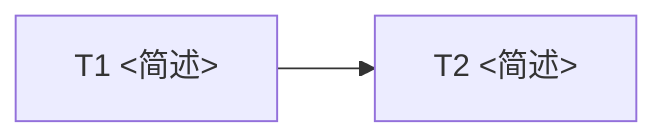

# tasks.md 模板

参照实例：`doc/spec/v2-rules-tree/tasks.md`（3 个任务）、`doc/spec/v1-mvp/tasks.md`（7 个任务，含"已知问题"表）。

~~~markdown
# api-regress v<N> 任务拆分

> 依据：[spec.md](spec.md)、[design.md](design.md)
> 任务编号在本 spec 内独立，从 T1 开始。每个任务结束时都能独立跑测试、独立 review。
> 分支：所有任务都在集成分支 `feat/v<N>-<slug>` 上完成。

## 依赖关系

<哪些可以并行、建议的顺序和理由。>

## 总览

> 当前进度以本表为准，每完成或开始一个任务就更新"状态"列。
> 状态取值：未开始 / 进行中 / 待 review / 已完成。

| 任务 | 状态 | 主要模块 | 覆盖的 AC | 测试方式 |
|---|---|---|---|---|
| T1 | 未开始 | <模块> | <AC 编号范围> | <单元 / mock 集成 / golden> |

开工前提：spec §<X> 中的相关决策已确认（T1：D<n>–D<m>）。

---

## T1 <任务名>

**交付**
- **`core/<x>.py`**：<做什么，对应 spec §…>
- **CLI**：<…>
- **文档**：<按 CLAUDE.md「文档同步」表列出要改的 doc/user、doc/dev、README>

**验收**：AC-<n> ~ AC-<m>。

**review 重点**
- <最容易出语义 bug 的地方>
- <安全 / 泄露请求头 / 契约稳定性>

**测试**：<测试方式，关键用例>
~~~

## 拆分规则

- 简单需求 1–2 个任务，复杂需求 4–6 个；超过 6 个先问用户。
- 每个任务都能独立跑通测试、独立 review；每个 AC 至少归属一个任务。
- 文档更新放在对应的任务里，不单独拆一个"写文档"任务（除非需求本身就是文档）。
- 实现中 code review 发现、暂缓处理的问题，在对应任务下加"已知问题"表（编号 K1 起，在本 spec 内独立），格式：`| # | 问题 | 后果 | 处理方向 |`。
