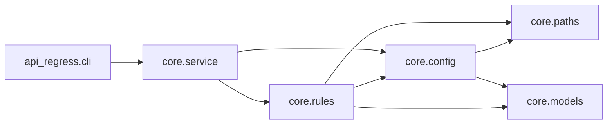
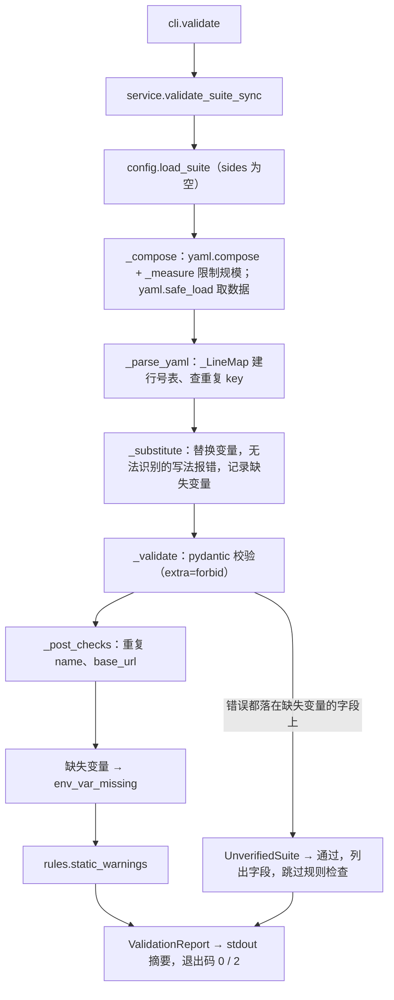

# 架构与模块职责

> 只写已经实现的部分。尚未实现的设计见 [spec-v1-design.md](../spec/spec-v1-design.md)。
> 文档里只引用文件名和函数名，不写行号。

## 分层

- `core` 是纯库，不能 import `cli` 或 `report`。由 `pyproject.toml` 里的 import-linter 契约保证，CI 执行 `lint-imports`。
- `cli` 只做参数解析、日志初始化、打印摘要，业务都通过 `core.service`。

## 模块

| 模块 | 职责 | 关键入口 |
|---|---|---|
| `core/models.py` | 跨模块共用的枚举和模型：`Level`、`Side`、`WarningCode`、`WarningItem` | `format_loc` |
| `core/paths.py` | 路径语法：解析、格式化、匹配、泛化、具体程度 | `parse`、`format_path`、`match`、`covers`、`overlaps`、`generalize`、`specificity` |
| `core/config.py` | suite 的 pydantic 模型；YAML 加载与规模限制；`${VAR}` 替换；报错行号 | `load_suite`、`load_suite_text`、`substitute_env`、`Suite.success_of`、`format_where` |
| `core/rules.py` | 规则按属性合并、ignore 剪枝、静态无效规则检测 | `RuleSet.resolve`、`RuleSet.is_pruned`、`static_warnings` |
| `core/service.py` | 对外编排入口（目前只有 validate），提供 async 和同步两种调用 | `validate_suite`、`validate_suite_sync` |
| `cli.py` | Click 命令行（`cli` 命令组 + 各子命令）、日志初始化 | `main`、`cli`、`validate`、`setup_logging` |
| `report/` | 报告渲染（T6 实现，目前为空包） | |

## validate 主流程

## 配置加载的关键点

- **规模限制**：`_measure` 在 `yaml.safe_load` 之前按节点 id 记忆化统计「展开锚点后的节点数」，超过 `MAX_NODES`、嵌套超过 `MAX_DEPTH`、或锚点引用自身时直接报配置错误，防止锚点指数展开把内存吃光。`yaml.compose` 自身的 `RecursionError` 和 PyYAML 解析非法日期抛出的 `ValueError` 也转成配置错误。
- **YAML 语法错误**：`_yaml_error` 只用 PyYAML 异常的 `context` / `problem` 和行号拼消息，不用 `str(exc)`，因为后者会带出错行的原文（可能含硬编码 token）。行号超过文件末尾时截到最后一行。
- **行号**：`_LineMap` 遍历节点树，建立「路径元组 → 行号」表（key 取 key 节点所在行）。pydantic 报错的 `loc` 按最长前缀查表，见 `_lookup_line`。重复 key 在遍历时逐个记录自己的行号。
- **变量写法**：`Substitution` 的正则不允许默认值里出现 `$` 和 `}`。替换前先把所有合法变量删掉，剩下的文本里还有 `${` 就算无法识别（嵌套写法也因此被拒绝）。变量为空字符串时，有默认值就取默认值。
- **环境变量按 target 区分**：`substitute_env` 返回的 `Substitution` 记录每个缺失变量的位置。`targets.baseline.*` 归 baseline，`targets.candidate.*` 归 candidate，其余（defaults、requests）归 shared。`load_suite_text` 的 `sides` 参数是本命令需要的 target：这些 target 和 shared 缺变量时报错；其余只记录在 `LoadedSuite.missing_vars`。
- **缺失变量导致的类型错误**：`validate` 时缺失变量保留原文（如 `"${T}"`），非字符串字段会校验失败。pydantic 会一次报出所有字段的错误：只要有一条落在缺失变量以外的位置，就照常报错；全部落在缺失变量的位置时，抛 `UnverifiedSuite`，`service` 把它当作「通过但未完全校验」处理，并跳过规则检查。不再尝试删字段重试，因为那样会制造假报错（必填字段被删）或假通过。
- **原始模板**：`LoadedSuite.raw` 保存替换前的数据，T5 计算请求指纹时用（spec §8.2 要求用 `${VAR}` 替换前的模板）。
- **base_url 检查**放在 `_post_checks`：本命令需要的 target 一定检查；不需要的一侧只要值不依赖缺失变量也检查，所以 `validate` 能发现写死的错误地址。协议不区分大小写，并且要求有主机名。
- **`success` 覆盖**：`Suite.success_of` 用 `model_fields_set` 区分「没写」和「写了 null」（spec D6）。

## 路径与匹配

- 模式 token：`Key`、`Index`（`[n]`）、`AnyIndex`（`[*]`）、`Deep`（`**`）。单独的 `$` 解析成空元组，表示根节点；`format_path(())` 输出 `$`，以 `$` 开头的 key 总是加引号，保证格式化结果能被 `parse` 解析回来。`parse` 带 `lru_cache`，`Rule.tokens` 每次调用它，因此不会和 `path` 不一致。具体路径 token：`Key`、`Index`（positional 数组）、`AnyIndex`（schema 数组）、`KeyedElem`（keyed 数组，展示为 `[sku_id=A12]`）。
- `match` 用 NFA 状态集合实现，`**` 通过 ε 闭包处理，避免回溯。`[n]` 只匹配 `Index(n)`，所以字面下标碰不到 schema 和 keyed 数组的元素。
- `covers(a, b)`：把模式 b 当作具体路径交给 `match`，b 里的 `**` 只能被 a 的 `**` 匹配，因此结果为真时包含关系一定成立（可能漏判，不会误判）。
- `overlaps(a, b)`：在两个模式的乘积状态上做可达性搜索，判断是否存在一条路径同时被两者匹配。

## 规则合并

- `CompiledRule.rank` = `(通配等级, 层级, 作用域, 书写顺序)`，对应 spec §6.3 的三级比较。通配等级来自 `paths.specificity`：无通配 2、含 `[*]` 1、含 `**` 0；层级是非 `**` token 的个数。
- `RuleSet.resolve` 对每个属性分别在「匹配到且写了该属性」的规则里取 `max(rank)`；`Resolved.sources` 记录每个属性来自哪条规则（`RuleRef{scope, index}`）。结果按路径缓存在 `RuleSet` 实例里，`RuleSet` 按请求创建，规则不变。
- ignore 剪枝：对比引擎自顶向下遍历，节点 `ignore` 为真就不再进入子树；`RuleSet.is_pruned` 供需要判断任意路径的场景使用（如不稳定字段建议），根节点 `$` 也算在内。
- `CompiledRule` 按对象身份比较和 hash，可以放进 set（design §5 的未命中规则检测会用到）。

## 静态无效规则（`static_warnings`）

| code | 判定 |
|---|---|
| `rule_under_ignored` | 规则路径的某个严格前缀（含根节点）被一条 `ignore: true` 规则 `covers`，并且没有更优先、可能 `overlaps` 该前缀的 `ignore: false` 规则。规则自己没写 `ignore` 时，所在节点本身也这样检查（spec D9）。见 `_ignored_by` |
| `index_rule_ineffective` | 规则里有字面下标，但没有任何 `mode: positional` 的 array 规则可能作用到那个数组 |
| `rule_ineffective_in_schema` | 规则配了 `on_value_change`，路径里有 `[*]`，但没有非 schema 的 array 规则可能作用到那个数组 |

全局规则在「全局 + 所有请求的规则」中检查，只报一次：只要某个请求里的 `ignore: false` 或 `array` 规则可能让它生效就不报；但请求级的 `ignore: true` 不算数（`_ignorers`），因为它只影响个别请求。请求级规则在「全局 + 本请求」中检查。判定都偏保守：宁可漏报，不误报。运行时才能确定的情况（例如 `compare: values` 落在 schema 数组里）由对比引擎报。

## CLI 约定

- 子命令挂在 `cli` 命令组下。通用参数（`--log-level`、`--log-file`）由装饰器 `common_options` 统一添加；它也负责初始化日志（日志文件打不开返回 3），并把未捕获的异常记为内部错误（退出码 3）。Click 自己的异常（`UsageError`、`Exit`、`Abort`）原样抛出，交给 `main`。
- 子命令返回 int 作为退出码。`main` 用 `standalone_mode=False` 调用 Click：子命令返回值和 `ctx.exit(code)` 都会作为返回值传出来；`ClickException`（含参数错误）返回 2，`Abort` 返回 3。
- 错误和 warning 的位置前缀统一由 `config.format_where` 生成：`suite.yaml:12: requests[0].method:`。

## 日志

- `cli.setup_logging` 把 `api_regress` logger 输出到 stderr，`--log-file` 时同时写文件。
- 已有的 INFO 节点：suite 加载结果（`config.load_suite_text`）、校验失败（`service.validate_suite_sync`）、validate 退出码及原因（`cli.validate`）。warning 以 WARNING 级别输出。
- 报错和 warning 只包含字段位置、变量名，不包含请求头的值；`tests/test_cli.py` 用哨兵 token 校验。
