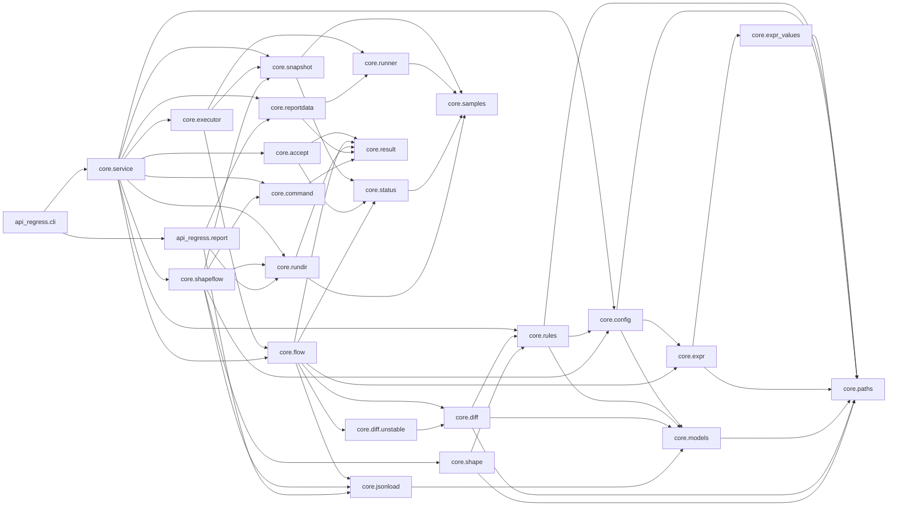
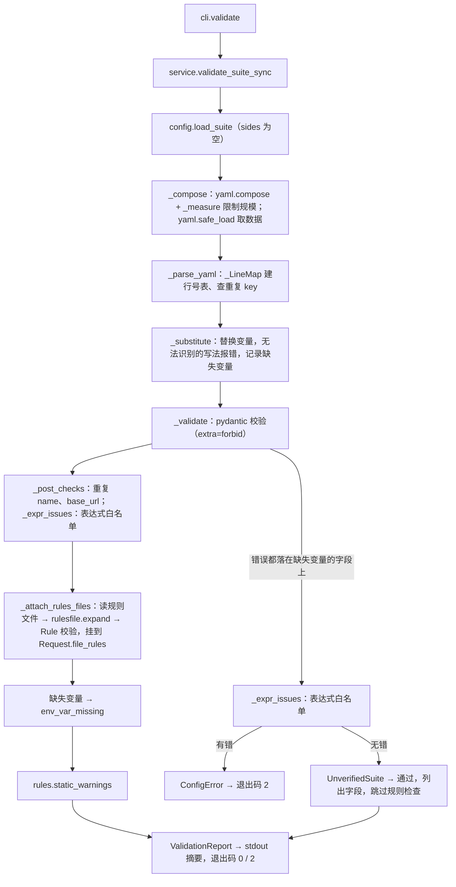
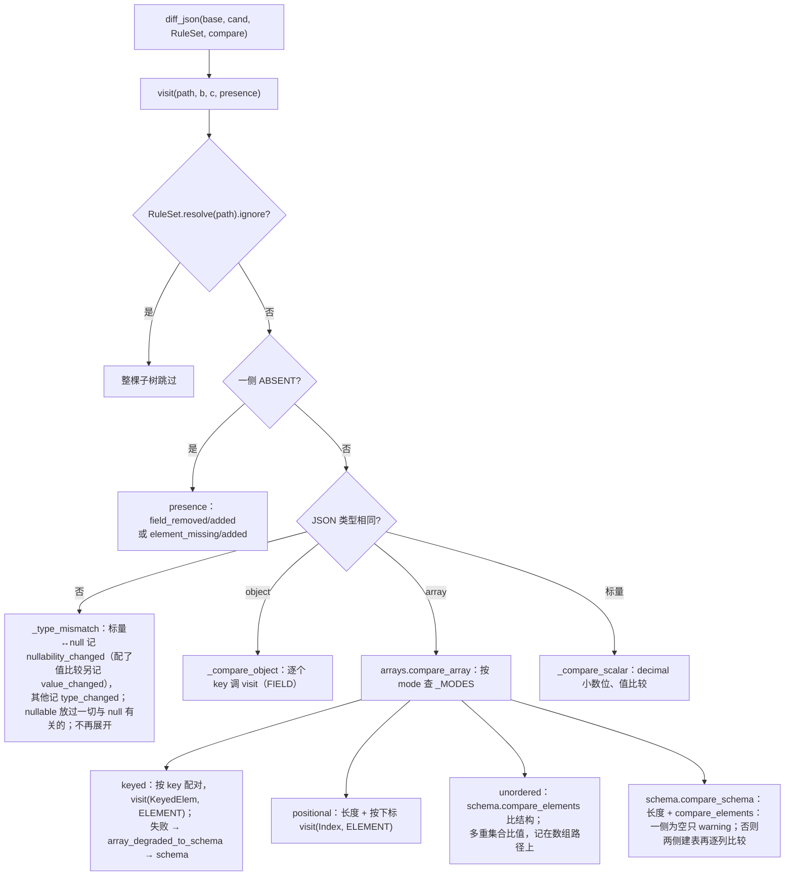
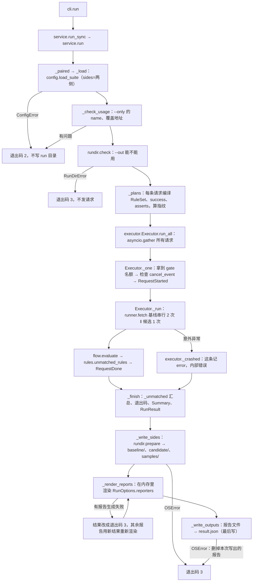
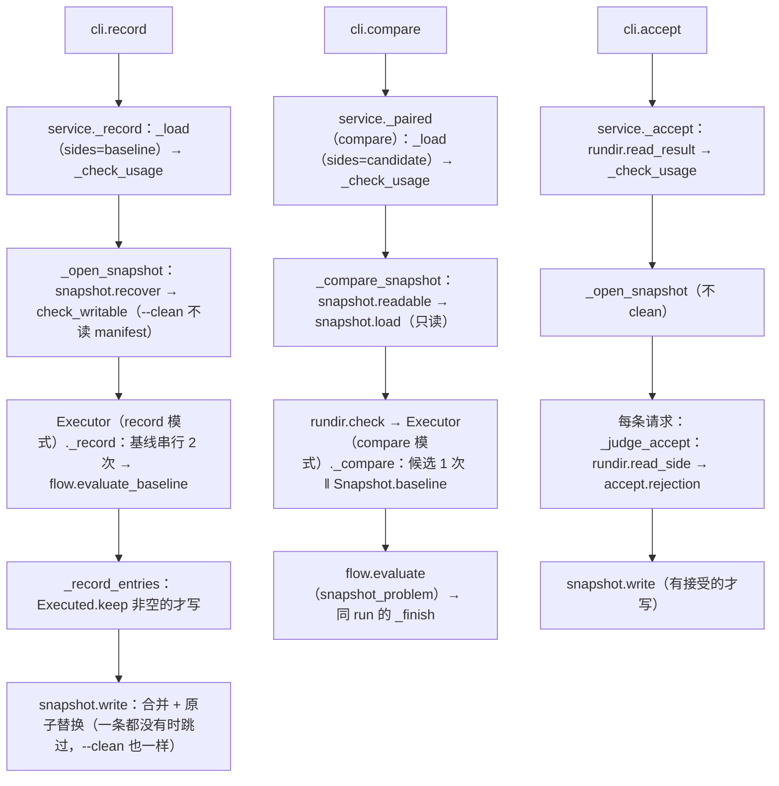
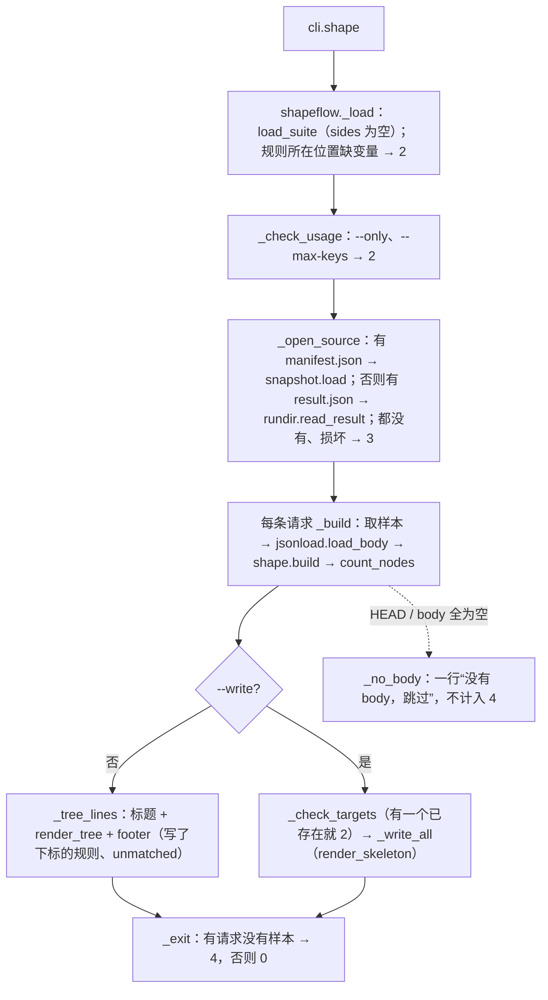

# 架构与模块职责

> 只写已经实现的部分。对外行为见 `doc/user/`。
> 文档里只引用文件名和函数名，不写行号。

## 分层

- `core` 是纯库，不能 import `cli` 或 `report`。由 `pyproject.toml` 里的 import-linter 契约保证，CI 执行 `lint-imports`。
- `cli` 只做参数解析、日志初始化、打印摘要，业务都通过 `core.service`。
- `report` 只依赖 `core`。core 不能 import report，所以报告由 cli 按 `--format` 取出渲染函数（`report.reporters`），作为 `RunOptions.reporters` 传给 `core.service`，由 service 在写入阶段调用（见「报告」）。以后的界面可以传自己的渲染函数，或者不传。
- `demo` 是独立的演示服务，不依赖 `core`、`cli`、`report`，`core` 也不依赖它（同样由 import-linter 契约保证）。只有 `cli.demo` 调用它。

## 模块

| 模块 | 职责 | 关键入口 |
|---|---|---|
| `core/models.py` | 跨模块共用的枚举和模型：`Level`、`Side`、`WarningCode`、`WarningItem`；finding 相关：`FindingType`、`Finding`、`ValueType`、`RuleRef`、`PathToken`、`Absent`（单例 `ABSENT`）；`Suggestion` | `format_loc`、`to_path_tokens`、`finding_id`、`rule_where`（规则位置的写法，报告和 shape 共用） |
| `core/paths.py` | 路径语法：解析、格式化、匹配、泛化、具体程度 | `parse`、`format_path`、`match`、`covers`、`overlaps`、`generalize`、`specificity` |
| `core/config.py` | suite 的 pydantic 模型；YAML 加载与规模限制；`${VAR}` 替换；报错行号；加载请求的规则文件并校验展开出的规则 | `load_suite`、`load_suite_text`、`parse_rules_file`、`FileRule`、`Request.file_rules`、`substitute_env`、`Suite.success_of`、`base_url_problem`、`format_where`、`NAME_PATTERN` |
| `core/rulesfile.py` | 规则文件的展开：把和响应同形的树展开成「路径 + 属性」的原始规则，检查 key、值、路径和重复路径；不依赖 config，属性值交给 config 用 `Rule` 校验 | `expand`、`RawRule`、`Problem` |
| `core/expr.py` | success / asserts 表达式：AST 白名单编译、simpleeval 求值、计算量预算；重新导出 `expr_values` 的视图类 | `compile_expr`、`eval_success`、`eval_assert`、`Outcome` |
| `core/expr_values.py` | 表达式里的值怎么运算：只读视图、JSON 语义的相等与包含、内置函数、运算符；类型不匹配一律抛 `ExprEvalError` | `JsonView`、`HeadersView`、`SideView`、`json_equal`、`contains`、`FUNCTIONS`、`OPERATORS`、`type_name` |
| `core/rules.py` | 规则按属性合并、ignore 剪枝、静态无效规则检测、本次未命中的规则 | `RuleSet.resolve`、`RuleSet.is_pruned`、`static_warnings`、`unmatched_rules` |
| `core/jsonfmt.py` | 把 `jsonload` 解析出的值写回 JSON 文本，数字按原文的小数位输出；报告的 body 对照和落盘的 body 文件共用 | `pretty_json`、`compact_json` |
| `core/jsonload.py` | 判断 body 是否为 JSON、按 charset 解码、去 BOM、Decimal 解析、重复 key / NaN / 嵌套过深 | `load_body`、`parse_json`、`is_json_media`、`media_type`、`charset_of` |
| `core/diff/walker.py` | 对比入口；按 JSON 类型分发；字段缺失、类型、可空性、decimal、值比较 | `diff_json`、`visit`、`DiffResult` |
| `core/diff/arrays.py` | 四种数组模式的分发表 `_MODES`；keyed 配对与降级、positional、unordered（结构交给 schema，值按多重集合） | `compare_array` |
| `core/diff/schema.py` | 不配对地比较元素：扁平表（路径 → 类型集合、小数位集合）及其比较；数组长度 finding | `compare_schema`、`compare_elements`、`build_table`、`report_length` |
| `core/diff/context.py` | 一次对比的上下文：规则、对比模式、finding / warning 收集，`Presence`（字段 / 元素缺失用哪种 finding） | `DiffContext.report`、`DiffContext.warn`、`DiffContext.where`、`DiffContext.value_level` |
| `core/diff/values.py` | JSON 类型、小数位、标量相等、标量的规范形式（keyed 的 key、unordered 的元素） | `json_type`、`scale`、`scale_of`、`decimal_text`、`scalar_equal`、`canon_scalar` |
| `core/samples.py` | sample 的内存表示（`Sample`，响应头名字小写）；落盘格式：请求文件（只留 `Content-Type` 和 `compare_headers`，sample 用 `body_file` 引用 body 文件）和 body 文件（JSON 缩进格式化或原始字节）的写入、读回与校验，run 目录两侧和快照共用；请求指纹 | `Sample`、`to_record`、`from_record`、`write_side_file`、`parse_side_document`、`stored_body`、`formatted_json`、`dump_json`、`SideFile`、`SampleFormatError`、`LegacyFormatError`、`kept_headers`、`fingerprint`、`FINGERPRINT_VERSION` |
| `core/runner.py` | 发请求：URL 拼接、请求头合并、`httpx.AsyncClient` + 信号量、自己实现的重试 | `make_call`、`build_url`、`merge_headers`、`Runner.fetch`、`describe_error`、`new_client` |
| `core/status.py` | 请求状态判定：有序规则表 `STATUS_RULES`；快照问题的枚举和提示 | `judge`、`Facts`、`RequestStatus`、`SnapshotProblem`、`SNAPSHOT_PROBLEM_TEXT`、`AUTH_OR_LIMIT` |
| `core/flow.py` | 单条请求的对比流程：状态 → 状态码 → success → 响应头 → body → asserts → 不稳定字段建议；填 `finding_id`；record 只看基线的判定 | `evaluate`、`evaluate_baseline`、`Plan`、`Evaluation` |
| `core/diff/unstable.py` | 不稳定字段建议：基线两个 sample 按 `compare: values` 对比后过滤 | `suggest_unstable`、`ignore_snippet` |
| `core/result.py` | `result.json` 的数据模型；退出码谓词表 `EXIT_RULES` | `RunResult`、`RequestResult`、`SampleInfo`、`Summary`、`UnmatchedRule`、`exit_code`、`run_exit_state` |
| `core/rundir.py` | run 目录：默认目录名、复用规则、两侧请求文件和 body 文件（`samples/<side>/<name>/`）、`result.json` 的写入；accept 读回 | `default_out_dir`、`check`、`prepare`、`write_side`、`body_dir`、`write_result`、`read_result`、`read_side` |
| `core/snapshot.py` | 快照：manifest 模型、读（含版本检查）、写前检查、按请求合并、原子替换、残留恢复 | `load`、`readable`、`check_writable`、`write`、`recover`、`Snapshot`、`Manifest`、`NewEntry`、`SnapshotError`、`SnapshotVersionError` |
| `core/command.py` | 命令返回值的基类和提前结束的方式：suite 或参数有问题（2）、工具自身或文件出错（3），统一退出码、原因和日志；service 和 shapeflow 共用 | `CommandReport`、`Stop`、`suite_error`、`internal_error`、`finish_log`、`usage_issue`、`only_issues` |
| `core/shape.py` | 字段树：把一条请求的若干个 body 合并成树（`Node`：类型、小数位、长度、示例值、子字段、元素节点），用 `RuleSet.resolve` 标注生效的规则；展示版和骨架两种渲染；在树上算未命中的规则 | `build`、`count_nodes`、`render_tree`、`render_skeleton`、`footer`、`unmatched`、`yaml_key`、`rule_text`、`Node` |
| `core/shapeflow.py` | shape 命令的流程：加载 suite（不需要环境变量）、读 `--from`（快照或 run 目录的基线）、每条请求建树、打印或写出骨架、退出码 | `shape_sync`、`shape_async`、`ShapeOptions`、`ShapeReport`、`ShapeRequest` |
| `core/accept.py` | accept 的判定：有序规则表 `ACCEPT_RULES` | `rejection` |
| `core/executor.py` | 并发执行每条请求：并发名额、取消、进度事件、单条请求的意外异常；run / compare / record 三种模式 | `Executor`、`Executed`、`Targets`、`RequestStarted`、`RequestDone`、`CancelToken` |
| `core/reportdata.py` | 报告的输入：`result.json` 之外渲染报告要用的信息（参与对比的两侧 sample、请求头名字、带 query 的请求路径，以及报出 finding 的 suite 配置：规则、asserts、生效的 success 和来源，suite 的对比模式），以及 `Reporter`（文件名 + 只在内存里渲染、返回 bytes 的函数） | `ReportInput`、`RequestExtras`、`SuccessSpec`、`Reporter`、`extras_for` |
| `core/service.py` | 对外编排入口，提供 async 和同步两种调用；命令的前置检查和退出码；本次未命中的规则；调用报告渲染函数 | `validate_suite(_sync)`、`run(_sync)`、`compare(_sync)`、`record(_sync)`、`accept(_sync)`、`shape(_sync)`（转发给 `shapeflow`）、`RunOptions`、`CompareOptions`、`RecordOptions`、`AcceptOptions`、`RunReport`、`RecordReport`、`AcceptReport`、`DEFAULT_MAX_KEYS`（从 `shapeflow` 重新导出，CLI 的默认值用它） |
| `cli.py` | Click 命令行（`cli` 命令组 + 各子命令，快照命令在 `snapshot` 子命令组下）、日志初始化 | `main`、`cli`、`validate`、`run`、`snapshot`、`compare`、`record`、`accept`、`shape`、`demo`、`setup_logging` |
| `demo/server.py` | 本地演示服务：标准库 `ThreadingHTTPServer`；`/v1`、`/v2` 前缀选数据集，有序路由表 `ROUTES`；Decimal 原样输出；不开 `SO_REUSEADDR`，端口被占用时直接报错 | `make_server`、`base_url`、`dispatch`、`dumps`、`DemoServer`、`DEFAULT_PORT` |
| `demo/data.py` | 演示数据：v1 固定数据，v2 的每处改动写在 `_v2_*` 函数里 | `DATASETS` |
| `demo/__init__.py`、`demo/suites/` | 自带的 `pass.yaml`、`regress.yaml`（作为包数据随 wheel 发布）及写出方法 | `suite_text`、`write_suites`、`SUITE_NAMES` |
| `report/__init__.py` | 格式名到 `Reporter` 的表 `FORMATS`；`--format none` 的名字 `NONE` | `reporters`、`FORMATS`、`NONE` |
| `report/common.py` | 几种报告共用的展示逻辑：finding 的值怎么显示、curl 复现命令、状态码、规则引用、body 的展示文本（按原文小数位排版 JSON） | `finding_values`、`rules_text`、`rule_where`（从 `core.models` 导入）、`finding_note`、`rule_attrs_text`、`curl_command`、`side_views`、`body_text`、`pretty_json` / `compact_json`（从 `core.jsonfmt` 导入）、`status_codes`、`failing` |
| `report/html.py`、`report/templates/report.html.j2` | `report.html`：Jinja2（autoescape），body 对照的截断 | `render`、`body_diff` |
| `report/sidediff.py` | 两侧文本的并排对照表格（HTML，已转义）：行级对齐 + 有上限的行内高亮 | `table`、`row_groups` |
| `report/md.py` | `report.md` | `render`、`cell` |
| `report/junit.py` | `junit.xml`：ElementTree 生成 | `render`、`xml_text` |

## validate 主流程

## 配置加载的关键点

- **规模限制**：`_measure` 在 `yaml.safe_load` 之前按节点 id 记忆化统计「展开锚点后的节点数」和「子树里映射与序列的层数」，超过 `MAX_NODES`、嵌套超过 `MAX_DEPTH`、或锚点引用自身时直接报配置错误，防止锚点指数展开把内存吃光。深度只数映射和序列（根为第 1 层，标量不算一层）；同一个锚点可能在不同深度被引用，所以记忆的是子树高度，每次命中都按当前深度重新判断。`yaml.compose` 自身的 `RecursionError` 和 PyYAML 解析非法日期抛出的 `ValueError` 也转成配置错误。
- **YAML 语法错误**：`_yaml_error` 只用 PyYAML 异常的 `context` / `problem` 和行号拼消息，不用 `str(exc)`，因为后者会带出错行的原文（可能含硬编码 token）。行号超过文件末尾时截到最后一行。
- **行号**：`_LineMap` 遍历节点树，建立「路径元组 → 行号」表（key 取 key 节点所在行）。pydantic 报错的 `loc` 按最长前缀查表，见 `_lookup_line`。重复 key 在遍历时逐个记录自己的行号。
- **变量写法**：`Substitution` 的正则不允许默认值里出现 `$` 和 `}`。替换前先把所有合法变量删掉，剩下的文本里还有 `${` 就算无法识别（嵌套写法也因此被拒绝）。变量为空字符串时，有默认值就取默认值。
- **环境变量按 target 区分**：`substitute_env` 返回的 `Substitution` 记录每个缺失变量的位置。`targets.baseline.*` 归 baseline，`targets.candidate.*` 归 candidate，其余（defaults、requests）归 shared。`load_suite_text` 的 `sides` 参数是本命令需要的 target：这些 target 和 shared 缺变量时报错；其余只记录在 `LoadedSuite.missing_vars`。
- **缺失变量导致的类型错误**：`validate` 时缺失变量保留原文（如 `"${T}"`），非字符串字段会校验失败。pydantic 会一次报出所有字段的错误：只要有一条落在缺失变量以外的位置，就照常报错；全部落在缺失变量的位置时，抛 `UnverifiedSuite`，`service` 把它当作「通过但未完全校验」处理，并跳过规则检查。不再尝试删字段重试，因为那样会制造假报错（必填字段被删）或假通过。
- **原始模板**：`LoadedSuite.raw` 保存替换前的数据，`samples.fingerprint` 用它计算请求指纹：指纹用 `${VAR}` 替换前的模板，换 token 或换环境不会让指纹变化。
- **base_url 检查**放在 `_post_checks`：本命令需要的 target 一定检查；不需要的一侧只要值不依赖缺失变量也检查，所以 `validate` 能发现写死的错误地址。协议不区分大小写，并且要求有主机名。
- **规则文件**（`_attach_rules_files`）：在 pydantic 校验和 `_post_checks` 都通过后执行。路径按 `load_suite_text` 的 `base_dir`（默认是 suite 文件所在目录）拼接，同一个文件只读一次；值来自缺失变量的 `rules_file` 跳过。文件用同一套 `_parse_yaml` 加载（规模限制、重复 key、行号表都相同，允许空文件），`rulesfile.expand` 展开，再逐条 `Rule.model_validate`，所以属性的校验和 suite 里的规则完全一致。错误的 `source` 是规则文件路径，`location` 是节点路径，行号用规则文件自己的行号表。展开的结果存在 `Request` 的私有属性里（`Request.file_rules`），不改 `Request` 的字段。
  - 展开时路径用 token 元组拼接（`parent + paths.parse(key)`），不拼字符串，避免引号 key 被重复转义；以 `**` 结尾的 key（如 `"**"`）借一个占位段解析。有属性的节点用 `paths.format_path` 生成路径，并检查能被 `paths.parse` 解析回同样的 token。重复路径按 token 元组判断。规则按先父后子、从上到下的顺序排列。
  - 被 YAML 解析成布尔值的 key（`on:`）还原不出原文，行号退到父节点。
- **`success` 覆盖**：`Suite.success_of` 用 `model_fields_set` 区分「没写」和「写了 null」（请求级 `success: null` 表示不判定，不再沿用 defaults）。

## 表达式引擎（`core/expr.py`、`core/expr_values.py`）

两层防护：`compile_expr` 的静态检查是主防线，`_Evaluator` 在求值时再兜底一层。`expr.py` 管语法和求值流程，`expr_values.py` 管值的语义（用户可见的规则见 [expressions.md](../user/expressions.md)）；拆开是为了让两边都远离单文件 1000 行的上限，也让语义规则集中在一处。

各种组合（操作数类型 × 运算符 / 函数 / 访问方式 / 真值上下文，变量 × success/assert）下的实际结果见 [expr-combinations.md](expr-combinations.md)。那份文件由 `scripts/gen_expr_combinations.py` 生成，`tests/test_expr_combinations.py` 保证它和代码一致，并在同一份结果上检查不变量（`==` 对称、`==`/`!=` 与 `in`/`not in` 互补、大小比较反对称、字面量与同值字段一致、不漏出 Python 原生异常和类型名）。**加新的语法、函数或运算符时，先在脚本里加上对应的维度，再重新生成，逐格检查 diff。** 不变量失败说明是 bug，不要靠重新生成来消除。

- **编译**：`_parse`（`ast.parse(mode="eval")`；SyntaxWarning 如无效转义一律当错误，结果不受 `PYTHONWARNINGS` 影响）→ `_Checker.run` → `_DecimalLiterals` 把浮点字面量按源码原文（`ast.get_source_segment`）转成 Decimal，保留小数位；整数保持 int，否则 `items[0]` 会抛 TypeError。超出 Decimal 范围的字面量、嵌套过深都转成 `ExprError`。结果是 `CompiledExpr`。
- **`_Checker`**：
  - `_result`：顶层是元组、列表、推导式或非布尔常量时直接拒绝（防止 `"a == 1, 'msg'"` 恒为真）。
  - 逐节点（分发表 `checks`）：节点类型在 `_STRUCTURE_NODES` 里；运算符没有位置信息，由所在的 BinOp/UnaryOp/Compare 检查是否在 `OPERATORS` 里；`is` / `is not` 至少一边是 None/True/False 常量；调用目标只能是 `FUNCTIONS` 里的名字，不能是方法，不支持关键字参数，参数个数按 `ARITY` 检查，`get`/`exists` 的常量路径用 `literal_path` 检查；属性不能以 `_` 开头，源码里的属性名必须和 AST 里的一致（Python 会对标识符做 NFKC 规范化，`.字段１` 会被读成 `.字段1`），`base`/`cand` 只允许 `SIDE_ATTRS`，`status` 不能再用 `.`；推导式循环变量只能是单个名字，不能是 `_RESERVED` 或 `_` 开头（这一项在逐节点检查之前单独跑一遍，提示更准确）。
  - 位置约束（`_allowed_positions` 先收集允许的位置）：生成器只能作为 `_GENERATOR_FUNCTIONS`（all/any/set/min/max）的唯一参数，否则当成值使用时真值恒为真、和列表比较恒不等；`base`/`cand` 只能作为属性访问的对象或 `get`/`exists` 的第一个参数，否则 `cand == base` 比较的是对象身份，两侧不同对象时恒为假。
  - 变量名按作用域单独检查（`_names`）：和 Python 一致，第一个 `for` 的可迭代对象在外层作用域，循环变量只在推导式内部可见。
  - 报错位置由 `_where` 生成：`col_offset` 是 UTF-8 字节数，转成字符数；多行表达式同时给出行号。
- **`_Evaluator`**：继承 simpleeval 的 `SimpleEval`，复用它的下标、比较、布尔运算、一元/二元运算、条件表达式和函数调用的处理，自己负责：
  - 分发：类级的 `_HANDLERS` 表，不在白名单里的节点直接报错。**不调用父类 `__init__`**：它每次都用 `warnings.catch_warnings()` 修改进程级的 warnings 过滤器，多线程并发求值时会把 `ignore` 过滤器永久留下；类级分发表也避免了绑定方法造成的引用环。
  - 作用域：`scope` 字典按词法作用域保存循环变量，`_eval_in` 切换。
  - 推导式：`_generate` 是惰性生成器，`any`/`all` 得到结果就停止；列表推导式在外面套 `list(...)`。
  - 属性访问：只允许在 `JsonView` 和 `SideView`（限 `SIDE_ATTRS`）上用 `.`；对 null 和其他值给出明确的错误。
  - 下标：`_eval_subscript` 对 `JsonView` 交给视图；字符串、列表字面量、元组走 `_index_sequence`，和 JSON 数组一样只接受整数（不接受布尔值）；其他值报错。
  - 遍历：`for` 的对象必须是 `ITERABLE`（视图、字符串、列表、元组、集合、生成器）。
  - 错误兜底：`_metered` 包装每个函数和运算符，捕获漏网的 `TypeError` / `ValueError` / `IndexError` / `KeyError` 和 Decimal 异常，转成用 `type_name` 描述的提示，保证错误信息里不出现 Python 内部类型名。
  - 计算量：`_Budget` 每个节点记 1；函数调用和运算符经 `_metered` 包装，按参数规模记账（JSON 节点数按 id 缓存）；推导式迭代另有 `MAX_ITERATIONS` 上限。总量超过 `WORK_BUDGET` 时报错。
  - 求值在 `decimal.localcontext(prec=DECIMAL_PRECISION)` 里进行，不受全局 Decimal 上下文影响。
- **值的语义（`expr_values.py`）**：
  - 布尔值不是数字：`json_equal` 在任一边是 bool 时要求两边类型相同（`false != 0`）；数组（含元组）逐个元素比较，对象按 key 比较。`contains` 用同样的相等判断数组和集合的元素，对象判断 key，字符串判断子串。`JsonView.__eq__` / `__contains__` 也走这两个函数，所以 Python 内部的比较（如列表里的 `in`）语义一致。
  - 运算符：`+` 只接受两个数字、两个字符串或两个数组（`_is_array`），拼接结果不超过 `MAX_SEQUENCE_LENGTH` 并重新包装成 `JsonView`；`-` 是数字或集合；`/` 一律转 Decimal 精确除；`//`、`%` 按 Decimal 语义（向零取整），两边都是整数时结果转回 int；`*`、`%` 只接受数字，整数乘积受 `MAX_INT_BITS` 限制；大小比较（`_ordering`）只在两个数字或两个字符串之间，NaN 报错；一元 `-`/`+` 只接受数字；不提供 `**` 和位运算。
  - 内置函数都是包装过的版本（`_len`、`_set`、`_abs`、`_extreme` 等），参数类型不对时抛 `ExprEvalError`；`_set` 拒绝对象/数组元素和布尔值与数字混合（Python 的哈希会把 `1` 和 `True` 当成同一个元素）。`_step` 把列表字面量和元组也当数组，`get`/`exists` 对它们和对 body 里的数组行为一致。
  - `type_name` 把值映射成 JSON 类型名（数字、字符串、布尔值、null、对象、数组、集合、生成器、base/cand），所有错误信息都用它。
- **`JsonView`**：`__slots__` 只有 `_data`、`_path`，类上除 dunder 外没有公开属性，所以 `getattr` 一定落到 `__getattr__`，只映射 JSON key（`body.x.items` 是字段而不是 `dict.items`）。不可写、不可 hash、不能比较大小；`==` 和 `in` 按 JSON 语义比较（见上）；迭代对象得到 key，迭代数组得到包装后的元素。错误信息带具体路径（`字段不存在：data.nope`）。`HeadersView` 继承它，key 统一转小写。`get`/`exists` 也能从 `SideView` 出发（`_step`）。
- **求值结果**：`Outcome(passed, error)`。任何异常都被捕获，`passed=False`，`error` 是简短原因（截断到 300 字符）；结果不是 bool 也算出错。表达式只能看到响应，看不到请求头，所以错误信息里不会出现请求头的值。`flow` 据此产生 `assert_failed`（`error is None and not passed`）、`assert_error`（`error` 非空）和 `success_eval_error` warning。
- **接入配置**：`config._expr_fields` 从替换变量后的原始数据（而不是 `Suite` 模型）里列出所有表达式字段，`_expr_issues` 逐个编译，错误带行号；原文含缺失变量的跳过，不是字符串的交给 pydantic 报。它在 pydantic 校验通过后和 `_post_checks` 一起执行；校验未通过但错误都落在缺失变量上（`UnverifiedSuite`）时也会先执行，所以 `validate` 不会因为别的字段缺变量就放过非法表达式。

## 路径与匹配

- 模式 token：`Key`、`Index`（`[n]`）、`AnyIndex`（`[*]`）、`Deep`（`**`）。单独的 `$` 解析成空元组，表示根节点；`format_path(())` 输出 `$`，以 `$` 开头的 key 总是加引号，保证格式化结果能被 `parse` 解析回来。`parse` 带 `lru_cache`，`Rule.tokens` 每次调用它，因此不会和 `path` 不一致。具体路径 token：`Key`、`Index`（positional 数组）、`AnyIndex`（schema 数组）、`KeyedElem`（keyed 数组，展示为 `[sku_id=A12]`）。
- `match` 用 NFA 状态集合实现，`**` 通过 ε 闭包处理，避免回溯。`[n]` 只匹配 `Index(n)`，所以字面下标碰不到 schema 和 keyed 数组的元素。
- `covers(a, b)`：把模式 b 当作具体路径交给 `match`，b 里的 `**` 只能被 a 的 `**` 匹配，因此结果为真时包含关系一定成立（可能漏判，不会误判）。
- `overlaps(a, b)`：在两个模式的乘积状态上做可达性搜索，判断是否存在一条路径同时被两者匹配。

## 规则合并

- `CompiledRule.rank` = `(通配等级, 层级, 来源, 书写顺序)`，对应 [suite.md](../user/suite.md)「规则怎么合并」的三级比较。来源的顺序是 `_SCOPE_RANK`：defaults 0 < rules_file 1 < request 2。`compile_rules` 按 defaults、规则文件、请求 `rules` 的顺序产出规则；规则文件里的规则 `RuleRef` 带 `file`、`line`。通配等级来自 `paths.specificity`：无通配 2、含 `[*]` 1、含 `**` 0；层级是非 `**` token 的个数。
- `RuleSet.resolve` 对每个属性分别在「匹配到且写了该属性」的规则里取 `max(rank)`；`Resolved.sources` 记录每个属性来自哪条规则（`RuleRef{scope, index, file, line}`）。结果按路径缓存在 `RuleSet` 实例里，`RuleSet` 按请求创建，规则不变。
- ignore 剪枝：对比引擎自顶向下遍历，节点 `ignore` 为真就不再进入子树；`RuleSet.is_pruned` 供需要判断任意路径的场景使用（如不稳定字段建议），根节点 `$` 也算在内。
- **缓存键**（`RuleSet._cache_key`）：keyed 元素只能被 `[*]` 和 `**` 匹配，和 `[*]` 等价；没有任何规则写到的下标同理。这两种 token 在缓存键里换成 `[*]`，大数组的每个元素共用一条缓存，不必把所有规则重新匹配一遍。
- `CompiledRule` 按对象身份比较和 hash，可以放进 set。

## 静态无效规则（`static_warnings`）

| code | 判定 |
|---|---|
| `rule_under_ignored` | 规则路径的某个严格前缀（含根节点）被一条 `ignore: true` 规则 `covers`，并且没有更优先、可能 `overlaps` 该前缀的 `ignore: false` 规则。规则自己没写 `ignore` 时，所在节点本身也这样检查（这时规则同样不生效，例如全局忽略了 `**.updated_at`、请求级给 `data.updated_at` 配值比较却没写 `ignore: false`）。见 `_ignored_by` |
| `index_rule_ineffective` | 规则里有字面下标，但没有任何 `mode: positional` 的 array 规则可能作用到那个数组 |
| `rule_ineffective_in_schema` | `_check_value_in_schema`：规则配了 `on_value_change`，路径里有 `[*]`，但没有 keyed / positional 的 array 规则可能作用到那个数组（schema 和 unordered 都不逐个配对）。`_check_nested_array`：规则配了非 schema 的 `array`，路径里有 `[*]`，但外层数组只可能是 schema（外层元素不配对，内层也无法配对）。两者共用 `_unpaired_array` |

全局规则在「全局 + 所有请求的规则」中检查，只报一次：只要某个请求里的 `ignore: false` 或 `array` 规则可能让它生效就不报；但请求级的 `ignore: true` 不算数（`_ignorers`），因为它只影响个别请求。请求级规则（含规则文件里的）在「全局 + 本请求」中检查。规则文件里的规则，warning 的 `file`、`line`、`location` 写规则文件、行号和节点路径（`rules._where`）。判定都偏保守：宁可漏报，不误报。运行时才能确定的情况（例如 `compare: values` 落在 schema 数组里）由对比引擎报。

## JSON 解析（`core/jsonload.py`）

- **是否为 JSON**：`is_json_media` 认 `application/json` 和任意 `*/*+json`（不区分大小写，忽略参数；`+json` 前面必须还有内容）。声明为其他类型时不解析；没有 Content-Type 时尝试解析一次，失败不提示；声明为 JSON 却解析失败时产生 `json_parse_failed`，按非 JSON 处理。warning 只写异常类型名，不回显 body 原文。
- **解码**：`charset_of` 取 Content-Type 的 charset，没写、不认识、或者不是文本编码（`hex`、`base64` 这类 bytes→bytes 编解码器，看 `CodecInfo._is_text_encoding`）时用 UTF-8。传入 `str` 时不再解码。解码后去掉开头的 BOM（`response.text` 也会保留 BOM）。
- **数字**：`json.loads(parse_float=_parse_float, parse_int=_parse_int, parse_constant=..., object_pairs_hook=...)`。整数保持 int，带小数点或指数的转成 Decimal，保留原文的小数位。超过 `_MAX_INT_DIGITS` 位的整数改用 Decimal（Python 默认拒绝把超过 4300 位的串转成 int）；指数超出 Decimal 范围时抛 `BodyRejected`，按解析失败处理。
- **NaN**：`Decimal('NaN')` 和自身不相等，与其他数比较大小会抛异常。对比时 `values._number_key` 把非有限值换成文本再比较；小数位不参与比较。
- **异常**：`BodyRejected` 的消息可以直接放进 warning；其他异常只写类型名，因为异常文本可能带出 body 原文。`load_body` 捕获 `ValueError`、`LookupError`、`ArithmeticError`、`RecursionError`，服务端返回的任何内容都不会让加载抛异常。
- **孤立代理字符**：`json.loads` 接受 `"\ud800"` 这样的转义，但这种字符串无法编码成 UTF-8，写 `result.json` 时会出错。原文里出现代理字符或它的转义时，`_scrub` 把每个孤立代理字符换成 U+FFFD。
- **重复 key / NaN**：`_Collector` 作为钩子记录，每个 body 每类最多一条 warning。重复 key 取最后一个值。NaN、Infinity 转成对应的 Decimal。钩子里拿不到路径，所以这两类 warning 没有 `path`。
- **嵌套深度**：对比引擎是递归实现的，`_check_depth` 用显式栈检查，对象和数组超过 `MAX_DEPTH`（200）层按解析失败处理；标量不算一层。
- **小数位**：`values.scale` 用 `max(0, -d.as_tuple().exponent)`，int 为 0，NaN/Infinity 返回 None（不参与比较）。**不要用 `Decimal.normalize()`**，它会抹掉末尾的 0。

## 对比引擎（`core/diff/`）

各种组合（类型 × 位置 × 规则、数组模式 × 场景、body 层）下引擎的实际输出见 [diff-combinations.md](diff-combinations.md)。那份文件由 `scripts/gen_diff_combinations.py` 生成，`tests/test_diff_combinations.py` 保证它和代码一致。**加新的条件分支时，先在脚本里加上对应的维度或场景，再重新生成，逐格检查 diff。**

- **只报最高层节点**：`visit` 遇到缺失或类型不同就返回，不再进入子树。schema 表按「先父后子」的顺序比较，已经报了缺失、新增或 `type_changed` 的路径，其子路径跳过（`_under`）。
- **schema 列只在一侧出现**（`schema._presence`）：先看父节点在另一侧是否还出现过对象（子字段）或数组（`[*]` 元素）。没有出现过，说明变化在父节点上（已经报了，或者被 `nullable` 放过），这里不报；父节点仍是数组、只是元素全空时，给 `array_empty`，不报字段增删。
- **schema 列的 null**（`_null_change`）：null 新出现、或基线只有 null 而候选出现了值时，涉及对象或数组的记 `type_changed`，标量记 `nullability_changed`（和普通字段一致：对象/数组变 null 是 breaking）。报了 `type_changed` 的列不再比较小数位。
- **ignore**：每个节点先 `RuleSet.resolve`，`ignore` 为真直接返回，所以被 ignore 的字段被删除也不报。schema 建表（`_collect`）和 unordered 的规范形式（`_canon_at`）同样跳过被 ignore 的子树。
- **缺失**：用 `models.ABSENT` 作哨兵，和 JSON 的 null 区分；它也直接作为 finding 的 `base_value` / `cand_value`，序列化为 `{"absent": true}`。
- **值比较**：`DiffContext.value_level` —— `on_value_change` 优先，`compare: values` 时默认 suspicious，否则不比较。数字按数值相等；`decimal.allow_string` 时数字字符串也按数值比较（`values.decimal_text` 只认 ASCII 的 JSON 数字语法）。标量和 null 之间的变化在 `nullability_changed` 之外另报 `value_changed`：结构类 finding 一个节点只报一条，值类可以叠加在上面，`nullable` 只去掉 `nullability_changed`。
- **unordered**：先用 `schema.compare_elements(schema_mode=False)` 比较元素结构，再用 `arrays._canon_at` 把元素变成可 hash 的形式按多重集合比较。`_canon_at` 跳过被 ignore 的字段，内层数组除了 positional 之外都按多重集合，配了 `allow_string` 的数字字符串按数值（`values.canon_scalar`）。
- **具体路径的元素 token**：positional 用 `Index`，keyed 用 `KeyedElem`（标签见 `arrays._label`），schema 和 unordered 用 `AnyIndex`。`[n]` 形式的规则只匹配 `Index`，所以对 schema / keyed 数组写字面下标不会生效。
- **schema 表**（`schema.Column`）：`types` 和 `scales` 都是「值 → 第一次出现的元素下标」，用来给出 `example_index`。元素里的嵌套数组也并入同一张表，下标始终是外层数组的。只有配了 `decimal` 的路径才记小数位。
- **元素内部不生效的规则**：`schema._warn_rules` 对表里命中 `on_value_change` 的规则提示；schema 模式下（`schema_mode=True`）还对 `compare: values` 每个数组提示一次，对内层数组上的非 schema `array` 规则提示。都是 `rule_ineffective_in_schema`。
- **warning 去重**：`DiffContext.warn` 用泛化路径（`DiffContext.where`）作为 `path`，按 (code, 泛化路径, 消息) 去重，所以 keyed / positional 数组里每个元素的同一个问题只提示一次。消息里的路径也用 `where`。
- **keyed 降级**：`_index_by_key` 发现元素不是对象、key 缺失或不是标量、key 重复时返回 None，整个数组改走 `compare_schema`。key 用 `values.canon_scalar` 规范化，数字按数值相等，类型不同则不等。
- **keyed 标签**（`arrays._label`）：数字按数值展示（`_number_label`，`1`、`1.0`、`1E0` 都是 `1`，所以 `finding_id` 跨运行稳定；这里只是展示，可以用 `normalize`），字符串会和数字、`true`/`false`/`null` 混淆或含特殊字符时加引号，因此 `1.5` 和 `"1.5"` 的路径不同。
- **finding 字段**：`path` 是具体路径，`generalized_path` 是 `paths.generalize` 后的结果，`path_tokens` 是 `PathToken` 列表，`rule_refs` 是该节点生效的所有规则属性来源（`Resolved.refs`）。`base_type` / `cand_type` 是两侧值的 JSON 类型（缺失为 `absent`），因为 Decimal 序列化成字符串后，`12.50` 和 `"12.50"` 看不出区别，真实的 `{"absent": true}` 和缺失也分不开。schema 数组里的 finding（`report(summary=True)`），两侧的值是排好序的类型列表或小数位列表，`base_type` / `cand_type` 为 None；数组长度 finding 同理。`finding_id` 由 `flow.evaluate` 在流程结束时用 `models.finding_id` 填上，见下文「result.json 契约」。
- **交叉校验**：`tests/test_diff_crosscheck.py` 用随机 JSON 和 deepdiff（`zip_ordered_iterables=True`、`threshold_to_diff_deeper=0`）比较 positional + `compare: values` 下的路径集合。

## run 主流程

- **发请求**（`runner.py`）：`make_call` 拼 URL（`base_url` 去掉末尾 `/` 加 `path`，`copy_merge_params` 附加 query），按 defaults → target → 请求级合并请求头（名字转小写去重，保留最后的写法）。`Call.headers` 只用于发送。`new_client` 设 `follow_redirects=False`；一个 `Runner` 持有一个 `asyncio.Semaphore(concurrency)`，每次 `fetch`（含重试）占一个名额。每次尝试外面套 `asyncio.timeout(timeout)`：httpx 的 `Timeout` 只限制单次连接、读、写，慢慢吐数据的响应能拖很久，总时限超了抛内置的 `TimeoutError`，和 httpx 的超时一样参与重试。
- **重试**：`Runner._fetch` 自己循环，只对 `RETRYABLE`（`httpx.ConnectError`、`httpx.TimeoutException`、总时限的 `TimeoutError`）重试，最多 `retries` 次；不用 transport 自带的 `retries`，因为它不会重试超时。其他 httpx 错误和不合法的 URL 直接记为失败的 sample（`status=None`）。任何状态码都不重试。
- **失败原因不能带请求头的值**（`runner.describe_error`）：`error` 会进日志、stdout、`result.json` 和 run 目录。发送前校验请求时的异常（`httpx.LocalProtocolError`、`UnicodeError` 等）消息里带着出问题的请求头的值（例如 h11 的 `Illegal header value b'Bearer xxx '`），所以按 `_FIXED` 表只写异常类型加固定说明；来自网络的异常（`_DETAILED`：连接错误、超时、对端协议错误、读错误）带上消息，但消息里出现任何一个请求头的值（含去掉首尾空白的写法）就整条丢掉，截断到 300 字符。`httpx.MockTransport` 不做请求头校验，这条要用真实的本地服务测。
- **`base_url` 检查**（`config.base_url_problem`）：`urlsplit`、`.port`、`httpx.URL` 任一抛错都算格式不合法；带 userinfo（`@`）的拒绝，因为 URL 会原样进日志和 run 目录，httpx 还会把它转成 Basic 认证头发出去。suite 校验和覆盖地址共用这个函数。
- **基线两个 sample**：`Executor._baseline` 串行请求，第 1 次失败就不发第 2 次；候选和基线用 `asyncio.gather` 同时进行。
- **代理**：httpx 默认读取代理环境变量，依赖里装了 `httpx[socks]` 以支持 SOCKS 代理。测试里 `tests/conftest.py` 清掉代理变量，否则发往 mock 服务的请求会绕到代理上。
- **取消**：`cancel_event` 只要有 `is_set()`（`threading.Event`、`asyncio.Event` 都行）。`asyncio.gather` 一开始就创建了所有请求的协程，所以 `Executor._one` 先拿 `run_all` 里的 gate（`asyncio.Semaphore(concurrency)`）名额，再检查取消，排队中的请求才能被取消；已经取消的请求不发出，记为 `error`，`RunResult.cancelled` 为真。
- **进度事件**：`on_event` 回调收到 `RequestStarted` / `RequestDone`（pydantic 模型，`event` 字段区分）。回调抛异常由 `Executor._emit` 接住，记 ERROR 日志并计入 `callback_errors`，退出码 3，运行不中断。
- **单条请求的意外异常**：`Executor._one` 接住各模式（`_run` / `_compare` / `_record`）抛出的任何 `Exception`，由 `executor._crashed` 把这条记为 `error`（原因写异常类型）并标记 `internal_error`，`service._internal` 据此给退出码 3。日志只写异常类型和 `traceback.format_tb` 的调用栈，不写异常消息，免得把请求内容带进日志。

### 单条请求（`flow.evaluate`）

- `_Flow` 先用 `jsonload.load_body` 解析两侧的第 1 个 sample（失败的 sample 当作非 JSON），收集解析 warning。
- 再对基线求 `success`（`_success_applies`：配了 success、不是 HEAD、不是 204、是 JSON；出错记 `success_eval_error`，视为不满足），连同两侧 sample 交给 `status.judge`。
- `status.judge` 按 `STATUS_RULES` 取第一条匹配：网络错误 → 快照问题（`snapshot_problem`，只有 compare 会给）→ 401/403/429 → 基线 5xx → 基线不满足 success → 两侧都非 JSON 且不是 HEAD/204（`Facts.body_less`）→ ok。
- `_compare`：`ok` 和 `unsupported` 都先比状态码（`status_changed` 后直接结束）；只有 `ok` 继续：`both_non_2xx` → `business_error`（候选不满足 success）→ `headers` → body（不是 HEAD/204 且没有 business_error 时：`diff_json` 或 `body_kind_changed`）→ `asserts`（两侧都是 JSON 时）→ `second_sample` + `suggest_unstable`。
- **响应头**（`_header_finding`）：值相同不报；候选缺失 `header_missing`（breaking）；`content-type` 只比 `jsonload.media_type`，不同记 breaking；其余（包括候选新出现）记 `header_changed`（suspicious）。
- 非 body 的 finding 由 `_Flow.report` 生成：`path` 和 `generalized_path` 都是伪路径（`$status`、`$body`、`$success`、`$header.<名字>`、`$assert[i]`），`path_tokens` 为空。
- `Evaluation.bodies`：两侧第 1 个 sample 和基线第 2 个 sample 中是 JSON 的 body，给「本次未命中的规则」用。

### 不稳定字段建议（`diff/unstable.py`）

`suggest_unstable` 用同一个 `RuleSet` 以 `compare: values` 调 `diff_json` 比较基线两个 sample，丢掉 `element_missing` / `element_added` / `array_length_changed`（数据量变化）和所有 warning，其余 finding 按泛化路径去重，`field_removed` / `field_added` 的原因是"只在一次基线响应里出现"，其他是"基线两次的值不同"。schema 数组内部本来就不比较值、ignore 的子树本来就跳过，所以不需要额外过滤。YAML 片段由 `yaml.safe_dump` 生成，`**.x`、`["a b"]` 这类路径会被正确加引号。

### 本次未命中的规则

`rules.unmatched_rules` 用显式栈遍历原始 body（对象 key 用 `Key`，数组元素用 `Index(i)`，所以 `[*]` 和 `[n]` 都能匹配），每个节点用 `paths.match`（和规则合并同一个匹配函数）把命中的规则移出待查列表，列表为空时提前结束。每条请求在 `executor._paired` 里算好自己的未命中规则（`Executed.missed`，没有 JSON body 时为 `None`），这样出错只影响这一条；`service._unmatched` 只做汇总：只看 `missed` 不是 `None` 的请求；请求级规则按请求列出；defaults 规则取所有请求未命中集合的交集，只列一次。

### run 目录（`rundir.py`）

- `default_out_dir`：`api-regress-out/<YYYYmmdd-HHMMSS>`，已存在时加 `-2`、`-3`。
- `check`：已存在的非空目录必须是之前的 run 目录才能用：`result.json` 能解析，并且有 `schema_version`、`command`、`tool_version`（`_written_by_us`）；或者是上次中途失败留下的（`_is_leftover`：没有 `result.json`，只有两侧目录、`samples/` 和报告，每项都要是 api-regress 写出的样子，由 `_LEFTOVER_CHECKS` 按名字查：两侧目录里只有 `.json` 文件，`samples/` 下只有 `<side>/<name>/<序号>.json|txt|bin`，报告是文件；同名但样子不对的一律拒绝，免得 `prepare` 删掉用户自己的文件）；`ignore` 里的文件（`RunOptions.log_file`，CLI 的 `--log-file`）不算。不满足抛 `RunDirError`（`OSError` 子类）。`service.run` / `service.compare` 在发请求之前调用，失败直接返回退出码 3。
- `prepare`：写入前再 `check` 一次，然后**先删旧的 `result.json`**，再删 `baseline/`、`candidate/`、`samples/` 和 `REPORT_FILES` 列出的旧报告（记 INFO 日志）。`result.json` 最后才写，所以本次中途失败或被打断时目录里没有 `result.json`：不会出现旧结果配新响应，`accept` 的 `read_result` 也会拒绝这个目录；`_is_leftover` 让这样的目录下次还能复用。删旧报告是免得 `--format` 变了以后留下和本次结果对不上的报告。不对 `--out` 本身做目录交换，避免 `--out .` 之类的误用删掉无关文件。
- `write_side`：`<side>/<name>.json` 和 body 目录 `samples/<side>/<name>/`（`body_dir`），由 `samples.write_side_file` 写：先写 body 文件，再写请求文件（`name`、`fingerprint`、`fingerprint_version` 和 `samples`，见下文「落盘格式」）。先写两侧，再写报告，最后写 `result.json`。
- `read_result` / `read_side`：accept 读回 run 目录。`read_result` 要求 `_written_by_us`、能按 `RunResult` 解析、请求名都符合 `config.NAME_PATTERN`（请求名会拼进文件路径，防止改过的 `result.json` 穿出目录），否则抛 `RunDirError`；`read_side` 请求文件不存在返回 `None`，格式不对、body 文件缺失或对不上抛 `SampleFormatError`（旧格式抛它的子类 `LegacyFormatError`，`service._judge_accept` 据此提示重新运行）。

### 退出码（`result.py`）

`EXIT_RULES` 是按 2 > 3 > 1 > 4 > 0 排列的 `(码, 谓词, 原因)` 表，`exit_code(ExitState)` 取第一个满足的。`run_exit_state` 统计达到 `--fail-on`（`FAIL_ON_LEVELS`）的 finding 数和 `error` / `inconclusive` 的请求数。suite 错误（2）在加载阶段直接返回；单条请求的意外异常、进度回调出错通过 `ExitState.internal_error` 参与计算。写 run 目录失败（3）发生在写入阶段：`RunReport` 和其中的 `result` 都改成 3 和新原因（`service._write_failed`），`out_dir` 为 `None`（CLI 显示 `result: 未写入`），本次写出的报告被删掉，`result.json` 不写。报告生成失败也是 3：在写任何文件之前就确定了，所以报告、`result.json` 和进程的退出码一致。

## 报告（`report/`）

- **调用时机**：`service._finish` 写完两侧响应后，用 `_report_input` 组装 `ReportInput`（`RunResult` 加每条请求的 `reportdata.extras_for`）。`_render_reports` 先只在内存里渲染全部报告（`Reporter.render` 返回 bytes，报告模块不写文件）：有报告出错时记 ERROR 日志、去掉它、把结果改成退出码 3（`_with_internal_error`，原因列出报告名和异常），再用新结果重新渲染其余报告，直到没有出错的为止（每轮至少去掉一个，一定结束）。然后 `_write_outputs` 写报告文件、最后写 `result.json`；任何 `OSError` 都删掉本次写出的报告再抛出。这样写出的报告和 `result.json`、进程的退出码总是一致。写出的路径放进 `RunReport.reports`，CLI 打印成 `reports:` 一行。
- **为什么要 `ReportInput`**：`result.json` 里没有 body 原文（HTML 的对照要用）、请求头名字（curl 要用）和报出 finding 的 suite 配置（"命中的规则"一列和对比模式要用），而 `result.json` 是对外契约，不为报告加字段。请求头只取名字（`runner.merge_headers` 合并后的 key），值不进 `ReportInput`。
- **展示规则**（`report/common.py`）：finding 两侧的值按 `base_type` / `cand_type` 显示：`absent` 或 `Absent` 实例写 `(缺失)`；类型为 None 且值是集合时是 schema 数组的汇总，写 `{a, b}`，`scale_changed` 加"小数位"前缀；其余用 `compact_json`（单行，对象和数组里嵌套的 `Decimal` 也按原文小数位、不加引号）。各报告各自截断（HTML 300、Markdown 80、JUnit 200 字符）。curl 用 `shlex.quote`，HEAD 用 `-I`，其他 `-i`，请求头值写 `<redacted>`。"命中的规则"由 `rules_text` 生成：有 `rule_refs` 时写规则位置、路径和 `rule_attrs_text`（除 `path` 外非默认的属性，单行 flow YAML）；assert 的 finding 按伪路径 `$assert[i]` 取本请求第 i 个 assert 的表达式；`business_error` 写 `RequestExtras.success`。`finding_note` 给类型后面括号里的说明：没配 `message` 的 assert，`Finding.message` 就是表达式原文，已经在规则列里，不再重复。
- **HTML**：`jinja2.Environment(autoescape=True, undefined=StrictUndefined)`，模板随包发布，用 `importlib.resources` 读。没有 JS，用 `
` 折叠，有问题的请求默认展开；颜色跟随 `prefers-color-scheme`。body 对照由 `report/sidediff.py` 的 `table` 生成，内容用 `markupsafe.escape` 转义，返回 `Markup` 原样插入模板。做法：`difflib.SequenceMatcher` 按行对齐，`get_grouped_opcodes(3)` 只留有差异的行和上下 3 行，各段之间一行省略号；opcode 用分发表 `_OPS` 处理；`replace` 块里两侧的行按顺序一对一配对，配对的两行再按字符做一次 `SequenceMatcher`，差异部分包 ``，多出来的行按删除或新增显示；超过 `INTRALINE_MAX_CHARS`（200）字符的行不做行内高亮，只整行标色。**不要换回 `difflib.HtmlDiff`**：它在整段被替换的行里两两比较找最相似的行（`_fancy_replace`，O(n·m)），1500 行都变了时要约 11 s，C 实现的 cydifflib 也只快约 2 倍；git、diff2html 也是按顺序配对、给行内高亮设上限。现在同样输入约 0.02–0.04 s，`tests/test_report.py` 有耗时测试。`body_text` 用 `jsonload.load_body` 解析后由 `pretty_json` 排版（`json.dumps` 不认 `Decimal`，也会丢掉 `12.50` 的末尾 0）；非 JSON 原样，非 UTF-8 只给字节数。超过 1500 行或 20 万字符截断并注明，避免报告文件过大。两侧文本相同时不出表格，只给一句说明。
- **Markdown**：标题 `### 名字  方法 路径  基线码 → 候选码`，表格单元格和列表项经 `md.cell` 转义 `|`、尖括号、反引号、`*`、`_` 和换行（路径里的 `[*]`、`**` 否则会被渲染成斜体、粗体）。只展开有 finding 或状态不是 `ok` 的请求（`unsupported` 也展开，附原因）。
- **JUnit**：`testsuites > testsuite > testcase`。failure / error / skipped 的判定在 `junit._outcome`：先看达到 `--fail-on` 的 finding（failure），再看 `error` / `inconclusive`（error），`unsupported` 记 skipped，和退出码 1 优先于 4 一致。`xml_text` 把 XML 1.0 不允许的字符换成 U+FFFD。
- **测试**（`tests/test_report.py`）：Markdown 和 JUnit 与 `tests/golden/` 下的快照逐字比较（`UPDATE_GOLDEN=1` 重新生成）；HTML 检查 `<script>` 被转义、各板块存在；JUnit 用 `xml.etree` 解析并核对 failure / error / skipped 数；报告生成失败时其余报告和 `result.json` 的退出码一致、写文件失败不留报告和 `result.json`、复用目录先删旧 `result.json` 且中断留下的目录可复用、`--format` 重复和 `none`。

## snapshot record / compare / accept

命令返回值和提前结束的方式在 `core/command.py`（`CommandReport`、`Stop`、`suite_error`、`internal_error`），shape 也用它们。三个命令共用 `service` 里的前置检查（`_load` 按命令需要的 target 加载 suite、`_check_usage` 检查 `--only` 和覆盖地址、`_open_snapshot` / `_compare_snapshot` 处理快照），任何一步不通过都用 `command.Stop` 带着算好的返回值提前结束，**不发请求**。退出码都走 `result.exit_code`：record / accept 的「没写入」用 `ExitState.incomplete` 加 `incomplete_text`。

- **执行器**（`executor.py`）：`Executor` 按 `Mode` 选择 `_run` / `_compare` / `_record`，并发名额、取消、进度事件和意外异常的处理三种模式完全一样（见上文 run 主流程）。`Targets` 带着覆盖地址和快照。
- **compare 的基线**：`Snapshot.baseline` 返回快照里的 sample 和 `SnapshotProblem`：没有这条请求时是 `([], "missing")`，指纹或 `fingerprint_version` 不一致时照样返回 sample 加 `fingerprint_mismatch`。`flow.evaluate` 在基线为空时用占位 sample `_NO_BASELINE` 走判定：`STATUS_RULES` 里快照问题排在网络错误之后、其他规则之前，所以占位 sample 不会影响结果，候选网络错误仍然判 `error`。有快照问题且状态是 `inconclusive` 时额外对候选求一次 success（`_Flow.candidate_success`），写进 `RequestResult.candidate_success`。`_compare` 在 `status_changed` 后结束前也调用一次（`warn=False`：这条请求不报 success 相关的 warning），否则状态码变了、候选又不满足 success 的响应会被 accept 收进快照。
- **record 的判定**（`flow.evaluate_baseline`）：`_Flow` 的候选为 `None` 时指向基线，`Facts` 两侧都放基线，复用 `STATUS_RULES`：提示里的"哪一侧"都会是基线。`ok` / `unsupported` 才写入；第 2 个 sample 由 `_Flow.second_sample` 判断能不能用（不能用时给 `second_sample_unavailable`，只写第 1 个），两个都是 JSON 时算不稳定字段建议。
- **accept 的判定**（`accept.py`）：`ACCEPT_RULES` 是 `(谓词, 原因)` 的有序表，按 record 的标准检查候选本身（网络错误、401/403/429、5xx、不满足 success），再加上请求状态（`error`、非快照原因的 `inconclusive`）。只用 run 目录里的信息：`RequestResult.status`、`snapshot_problem`、`candidate_success`、`findings` 里的 `business_error`，以及 `candidate/<name>.json` 的 sample 和指纹。候选的请求文件或 body 文件损坏时拒绝这条并记为内部错误（退出码 3）。被接受的候选按读出的 sample 重新写进快照；格式化是幂等的，写出的 body 文件和 run 目录里的逐字节相同。写进快照时 `compare_headers` 用候选 sample 现有的响应头名字（落盘时已经过滤过）。

## 落盘格式（`core/samples.py`）

run 目录两侧和快照共用。请求文件只放元数据，每个 sample 的 body 单独一个文件，放在调用方给的 body 目录里（快照 `samples/<name>/`，run 目录 `samples/<side>/<name>/`）。

- **请求文件**：`name`、`fingerprint`、`fingerprint_version`、`samples[]`。sample 是 `url`、`status`、`headers`、`body_file`、`body_formatted`、`body_size`、`body_sha256`、`elapsed_ms`、`retries`；body 为空时只有 `body_size: 0`；网络错误只有 `url`、`status`（null）、`error`、`retries`。
- **body 文件名**：`<序号>.<扩展名>`，序号从 1 开始、等于 sample 的位置。读回时先用 `BODY_FILE` 正则和序号检查 `body_file`（`_check_body_file`），**通过后才拼路径**，所以改过的请求文件写不出指向别处的路径；再核对大小和 SHA-256。
- **格式化**（`stored_body` / `formatted_json`）：Content-Type 是 JSON（`jsonload.is_json_media`）时，用 `jsonload.load_body` 解析、`jsonfmt.pretty_json` 输出。例外存原始字节：charset 不是 UTF-8（`jsonload.charset_of` 返回的已是规范化后的名字）、解析失败、有 `duplicate_key`。最后**自检**：把格式化结果重新 `load_body`，`repr(value)`（能区分 `Decimal('12.50')` 和 `Decimal('12.5')`，也能比较 `NaN`）和 warning code 列表都和原文相同才用，否则存原始字节。所以对比引擎从格式化文件里读到的值和 warning 与原始响应完全一样。格式化是幂等的（再格式化一次结果不变）。
- **扩展名**：JSON 响应 `.json`（不论是否格式化）；否则能按 UTF-8 严格解码为 `.txt`，不能为 `.bin`。读回时不看扩展名。
- **旧格式**：sample 里有 `body` / `body_b64` 时抛 `LegacyFormatError`（`SampleFormatError` 的子类），快照和 accept 各自给出重录或重新运行的提示。快照 `schema_version` 仍是 1。
- **写入顺序**（`write_side_file`）：先写 body 文件，最后写请求文件。

## 快照（`core/snapshot.py`）

- **格式**：`manifest.json`（`Manifest`：`schema_version`、`tool_version`、`fingerprint_version`、`updated_at`、`requests: {name: ManifestEntry}`，`ManifestEntry` 是 `fingerprint`、`recorded_at`、`source`、`samples`）、`requests/<name>.json` 和 `samples/<name>/`（`samples.write_side_file`，和 run 目录的两侧文件相同）。manifest 是索引；指纹以请求文件里的为准。
- **读**（`load`）：目录不存在、或是空目录，当作空快照；有内容但没有 `manifest.json` 抛 `SnapshotError`。`_read_manifest` 先单独看 `schema_version`：是整数但不是当前版本时抛 `SnapshotVersionError`（退出码 2），再用 pydantic 校验（失败算损坏，退出码 3），请求名也要符合 `config.NAME_PATTERN`。只读本次要用的请求文件，`_read_entry` 用 `parse_side_document` 解析（同时读回并校验 `samples/<name>/` 里的 body 文件），格式错误、body 文件缺失或对不上、`name` 不对、没有 sample 都算损坏；旧格式（`LegacyFormatError`）在消息里提示 `snapshot record --clean`。`samples.from_record` 对任何坏数据都抛 `SampleFormatError`（不会漏出 `TypeError` / `ValueError`）。
- **写前检查**（`check_writable`）：已存在的非空目录必须含 `manifest.json`（`_is_snapshot_dir`）；不是 `--clean` 时读 manifest，并检查它列出的请求文件都存在；不解析这些文件，`_fill` 按字节原样复制没变的那些（大快照上 `snapshot record --only x` 不必把每个 body 都解一遍），内容坏了由 compare 的 `load` 报。返回现有的 `Manifest` 作为合并的底。
- **异常 → 退出码**：`service._snapshot_step` 统一把快照操作的 `SnapshotVersionError` 换成退出码 2、其他 `OSError`（含 `SnapshotError`）换成 3；`_open_snapshot`（record / accept）、`_compare_snapshot`、`_save` 都经过它。
- **JSON 格式**：run 目录和快照的请求文件、manifest 都用 `samples.dump_json` 写（UTF-8、不转义非 ASCII、缩进 2、末尾换行），两边格式不会分叉。
- **写**（`write`）：`_merged_manifest` 合并索引（本次的条目覆盖同名的旧条目，按 name 排序）；`_fill` 在 `tempfile.mkdtemp(prefix=".<name>.tmp-", dir=父目录)` 里复制没变的请求（`_copy_entry`：请求文件 `shutil.copy2`，body 目录 `shutil.copytree`，都不解析；body 目录不存在时只复制请求文件）、写入新的请求文件和 body 文件、manifest；`_swap` 做 `snap → snap.old`、`tmp → snap`、删 `snap.old`；最后一步失败时新快照已经就位，只记 WARNING，留给下次 `recover` 删。不能直接 `os.replace` 到已存在的非空目录（`ENOTEMPTY`），所以要先把旧目录挪开。任何 `OSError` 都删掉临时目录、转成 `SnapshotError`，旧快照不受影响。
- **残留**（`recover`，record / accept 开始时调用）：路径先 `resolve()`（这样 `--dir .` 也有名字）。`snap.old` 存在时：没有 `manifest.json` 说明不是我们留下的，报错；`snap` 不存在说明中断在两次 rename 之间，把 `.old` 恢复回来；否则删掉 `.old`。最后删掉同级的 `.<name>.tmp-*`。不支持多个进程同时写同一个快照。
- **compare 只读**（`readable`）：不调用 `recover`，不删除、不改名任何东西，免得删掉另一个进程正在写的临时目录，或在只读挂载上失败。`snap` 不存在而 `snap.old` 含 `manifest.json` 时（中断在两次 rename 之间）返回 `snap.old` 来读，记 WARNING。
- **record 一条都没写入时不写快照**，`--clean` 也一样（`service._record` 记 WARNING）：否则基线不可用、token 过期时 `--clean` 会把好的快照换成空的。

## shape（`core/shape.py`、`core/shapeflow.py`）

只读，不发请求。`service.shape(_sync)` 直接转发给 `shapeflow`，流程放在单独的模块里，免得 `service.py` 超过 1000 行。

- **不需要环境变量**：`load_suite(sides=())`，缺失的变量只记录不报错（和 validate 一样），`targets` 里的变量 shape 根本不用。缺失变量的位置落在 `defaults.rules` 或 `requests[i].rules` / `rules_file` 下时，规则没法确定，按 suite 错误（`_RULE_LOC`）；`UnverifiedSuite`（有非字符串字段的值来自缺失变量，拿不到 `Suite`）也按 suite 错误。
- **样本**：快照用 `snapshot.load` 读要用的请求（`snapshot.readable` 处理中断残留）；run 目录先 `rundir.read_result` 确认是 api-regress 写的，再按请求 `rundir.read_side(…, "baseline", …)`。body 文件的校验和 compare、accept 相同，损坏或旧格式是 3。`_no_body` 先判断没有 body 的请求：HEAD，或者不是网络错误的 sample 至少有一个且 body 全为空（204），记为 `ShapeRequest.skipped`，只打印一行、不建树、不写骨架、**不计入退出码 4**；sample 全是网络错误时不算。其余请求的网络错误、空 body、非 JSON 的 sample 跳过（`_json_bodies`），一个都不剩时这条请求"没有样本"（`ShapeRequest.missing`，计入 4），所以返回 HTML 错误页的请求不会被悄悄跳过。不检查指纹。
- **合并**（`shape.build`）：每个节点是一个泛化路径；对象的 key 用 dict 按 key 归并（线性，保留第一次出现的顺序），数组的所有元素、所有 sample 并进同一个元素节点，和数组规则无关。按 JSON 类型分发（`_ADDERS`）：数字记小数位（`diff.values.scale`，NaN 不记）和示例，字符串、布尔值记示例，数组记长度。不复用 `diff/schema.py` 的 `build_table`：它产出的是扁平路径，而且受 keyed 等数组规则和 ignore 影响。
- **树保留全部 key**：被 ignore 的子树、超过 `--max-keys` 的 key 都在树里，只在渲染时跳过；所以未命中的规则按全部 key 算。
- **渲染**：`_Walker` 遍历出 `Row`（深度、YAML key、节点、`Resolved`；截断提示的 node 为 None），再由 `_lines` 对齐注释（最多到第 `COMMENT_COLUMN_MAX` 列）。对象的 key 缩进一级；元素行 `name[*]` 和数组同级；根节点的元素写 `"[*]"`。根节点不是纯对象、或者根节点上有生效的规则时，第一行是 `# 根节点 $：…` 注释。节点最终 `ignore: true` 时不再往下走。注释由有序的格式化函数表拼成：展示版 `DISPLAY_PARTS`（类型、小数位、长度、示例值）加 `Annotator` 的规则来源；骨架 `SKELETON_PARTS` 只有类型和小数位，**没有示例值和规则**（骨架可能提交到仓库）。小数位全是 0（只有整数）时不列。
- **key 的写法**（`yaml_key`）：先用 `paths.format_path` 把一级路径写成规则路径（特殊字符的字段名变成 `["x.y"]`），再看它能不能原样作为 YAML 的字符串 key（用 `yaml.safe_load` 试解析：`on`、`null`、`1`、`[`、`*` 开头等都不行），不行就加双引号（需要转义时改单引号，含单引号或控制字符时用 `json.dumps`）。`tests/test_shape.py` 检查每种写法读回来都是同一条路径。有 `lru_cache`：大对象里 key 名大量重复。
- **生效的规则**：`RuleSet.resolve(泛化路径)`，`Resolved.sources` 里有的属性才列，写成 `属性 ← 来源 规则路径`。来源的写法用 `models.rule_where`，和报告里「命中的规则」是同一个函数。写了字面下标的规则匹配不到 `[*]`，不会出现在树上，在请求末尾单独列出。
- **未命中的规则**（`shape.unmatched`）：没写下标的规则在树上判断（树的路径就是所有具体路径的泛化，结果和 `rules.unmatched_rules` 逐个 body 遍历相同，节点少得多）；写了下标的规则仍然用 `rules.unmatched_rules` 遍历原始 body。范围是这条请求自己的样本，defaults 的规则也按这条请求算。
- **骨架里过大的对象**：`render_skeleton` 用 `_Walker(drop_truncated=True)`，key 超过 `max_keys` 的对象一个 key 都不写，只出一行提示（`Row.dropped`）：这种 key 多半是 id、邮箱之类的数据，骨架要提交到仓库。展示版仍然列前 N 个。
- **`--write`**：`_check_targets` 先检查所有要写的文件（有样本的请求）都不存在（符号链接也算存在），有一个存在就 2、一个都不写；然后逐个用 `open("x")` 写，写到一半失败时删掉本次写出的文件，退出码 3。目录不存在时创建。stdout 每个文件一行 `wrote <path>`，最后一行提示 `rules_file` 的写法（`_hint`）：和 `config` 加载规则文件一样，按**不解析符号链接**的 suite 所在目录算相对路径（`absolute()` 而不是 `resolve()`），`os.path.relpath` 算不出来（Windows 上不在同一个盘）时给绝对路径。
- **退出码**：2（suite、参数、目标文件已存在）在读样本之前或写文件之前直接返回；3（`--from` 不可用、版本不兼容、损坏、写文件失败）；4 由 `ExitState.incomplete` 给出；0 的原因是"全部输出"。
- **耗时**（实测，M 系列 Mac）：models.dev 的 `/api.json`（6 MB，合并后 28.3 万个节点）录成 2 个 sample 的快照，`shape` 全程约 2.6 s：解析 2 个 body 0.3 s、建树 0.7 s、渲染（`--max-keys 50`，3 万行）0.4 s、未命中的规则 0.9 s（有一条规则一直没命中时要走完整棵树）。

## result.json 契约

- 模型在 `core/result.py`（引用 `models.Finding`、`WarningItem`、`Suggestion`），JSON Schema 由 `scripts/export_result_schema.py` 从 `RunResult.model_json_schema(mode="serialization")` 导出到 `schema/result.schema.json`，`tests/test_result_schema.py` 检查它和模型一致，并用 jsonschema 校验一次真实运行的输出。**改模型后重新导出，并在 review 时看 schema 的 diff**；加字段尽量给默认值，改名或删字段要升 `schema_version`。
- 顶层：`schema_version`（当前 1）、`tool_version`、`command`、`suite`、`started_at` / `finished_at`（带时区的 ISO 8601）、`fail_on`、`cancelled`、`exit_code`、`exit_reason`、`summary`、`requests`、`unmatched_rules`。
- 枚举与 `models.py` / `status.py` 一致：请求状态 `RequestStatus`、finding 类型 `FindingType`、级别 `Level`、warning code `WarningCode`（`env_var_missing` 只出现在 validate 的输出里）。
- **数字**：pydantic 把 `Decimal` 序列化成 `str(Decimal)`，小数位与原文相同（`12.50` → `"12.50"`；指数写法会变成规范形式，如 `1.50E1` → `"15.0"`，小数位仍是 1）。数字和数字字符串靠 `base_type` / `cand_type` 区分。数字原文以 run 目录 / 快照里的 body 文件为准（格式化不改变小数位，见「落盘格式」）。
- **缺失**：`{"absent": true}`（`models.ABSENT`），和 `null` 区分。schema 数组的 finding 两侧是类型集合或小数位集合，附 `example_index`。
- **`finding_id`**：`models.finding_id` = sha256(请求名 \0 类型 \0 具体路径) 的前 16 个十六进制字符。keyed 数组的具体路径用 key 值（`[sku=A]`，数字按数值规范化），schema 数组的具体路径就是泛化路径，非 body 的 finding 用伪路径，所以跨运行稳定、keyed 不同元素互不相同。
- **`rule_refs`**：`{scope, index}`，`scope` 为 `defaults`、`rules_file` 或 `request`；`rules_file` 时另有 `file`、`line`。`unmatched_rules` 同理。warning 来自规则文件时有 `file`。
- **只在有值时输出的字段**：`file`、`line`（`RuleRef`、`UnmatchedRule`）和 warning 的 `file` 用 `models.omitted_if_none()`（pydantic 的 `exclude_if`），值为 None 时不写进 `result.json`，不使用规则文件的 suite 输出和以前逐字节相同。
- **`snapshot_problem` / `candidate_success`**（`RequestResult`）：给 accept 用的事实。前者是 compare 时的 `SnapshotProblem`（`missing` / `fingerprint_mismatch`），后者是候选的 success 结果（`_Flow.candidate_success`，只求值一次；没有求值为 `null`）。`baseline` 在快照里没有这条请求时为空列表。
- 不含任何请求头；sample 只给 URL、状态码、耗时、重试次数、Content-Type 和错误原因。

## CLI 约定

- 子命令挂在 `cli` 命令组下：`validate`、`run`、`snapshot`、`shape`、`demo`；`snapshot` 本身是命令组，下面挂 `record`、`compare`、`accept`，这样顶层只有实时对比的 `run`，和快照有关的都在一处。几个命令共用的参数（`-d` / `--dir`，参数名仍是 `snapshot`；`--only`、`--out`、`--fail-on`、`--format`、suite 参数）定义成模块级的装饰器常量；`--format` 是可重复的选项（和 `--only` 一样），`_parse_formats` 把每个值按逗号拆开、去重前校验（`_format_problem`：未知格式、空值、`none` 和其他格式混用），写错走 `BadParameter`，退出码 2；不写时全部输出，`none` 时返回空列表；`_finish` 统一打印错误或摘要，最后一行总是 `exit N: 原因`。通用参数（`--log-level`、`--log-file`）由装饰器 `common_options` 统一添加；它也负责初始化日志（日志文件打不开返回 3），并把未捕获的异常记为内部错误（退出码 3）。Click 自己的异常（`UsageError`、`Exit`、`Abort`）原样抛出，交给 `main`。
- 子命令返回 int 作为退出码。`main` 用 `standalone_mode=False` 调用 Click：子命令返回值和 `ctx.exit(code)` 都会作为返回值传出来；`ClickException`（含参数错误）返回 2，`Abort` 返回 3。
- 错误和 warning 的位置前缀统一由 `config.format_where` 生成：`suite.yaml:12: requests[0].method:`。

## 日志

- 标准库 `logging`。`cli.setup_logging` 把 `api_regress` logger 输出到 stderr，`--log-file` 时同时写文件。
- **INFO 节点**：suite 加载结果（`config.load_suite_text`）、校验失败（`service.validate_suite_sync`）、validate 退出码及原因（`cli.validate`）；run 开始的请求数（`service.run`）、每次请求的发出和返回（`runner.Runner`：请求名、target、方法、URL、状态码、耗时、重试次数；发出时只列请求头的**名字**）、每条请求的状态和 finding / warning 数（`flow.evaluate`）、汇总（`service._log_summary`）、写入的每个文件（`service._write_sides`、`service._write_outputs`、`rundir.write_result`）、各命令的退出码及原因（`command.finish_log`，由 `service._finish`、`command.suite_error`、`command.internal_error`、`service._record`、`service._accept`、`shapeflow._shape` 调用）；record / compare 开始的请求数（`service._record`、`service._paired`）、快照的读取和写入（`snapshot.load`、`snapshot.write`）、残留的删除和恢复（`snapshot.recover`，恢复记 WARNING）、compare 读中断残留（`snapshot.readable`，WARNING）、accept 拒绝的每条请求（`service._accept`）；shape 的样本来源和请求数、每条请求的样本数和节点数（或没有样本的原因）、写出的骨架文件、退出码（`shapeflow`），**示例值不进日志**。
- **WARNING**：validate 的 warning、重试（`runner.Runner._fetch`）。**ERROR**：suite 错误、`--out` / 快照 / run 目录不能用或写入失败（`command.suite_error`、`command.internal_error`）。快照目录不存在时 compare 记 WARNING。**DEBUG**：响应体的前 2KB（`repr` 形式）。
- **任何级别都不输出请求头的值**：`runner.Call.headers` 只传给 httpx；`Sample`、run 目录、快照、`result.json` 里没有请求头；保存的响应头只有 `Content-Type` 和 `compare_headers`。报错和 warning 只包含字段位置、变量名。`tests/test_cli.py`（validate）、`tests/test_run_cli.py`（run：stdout、stderr、日志文件、run 目录）和 `tests/test_snapshot_cli.py`（record → compare → accept：日志文件、快照、run 目录，响应的 `Set-Cookie` 里也放了哨兵）用哨兵 token 校验；`tests/test_run_cli.py` 的 run 目录里包含三种报告。
