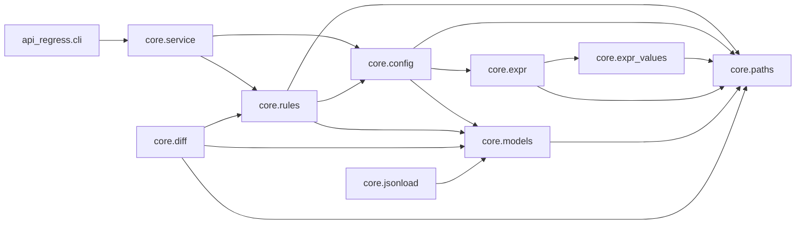
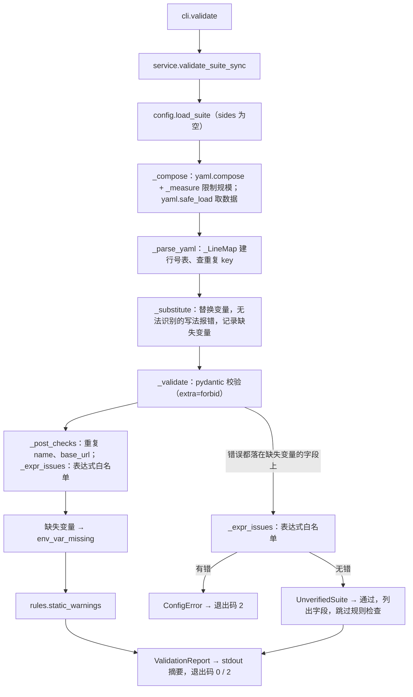
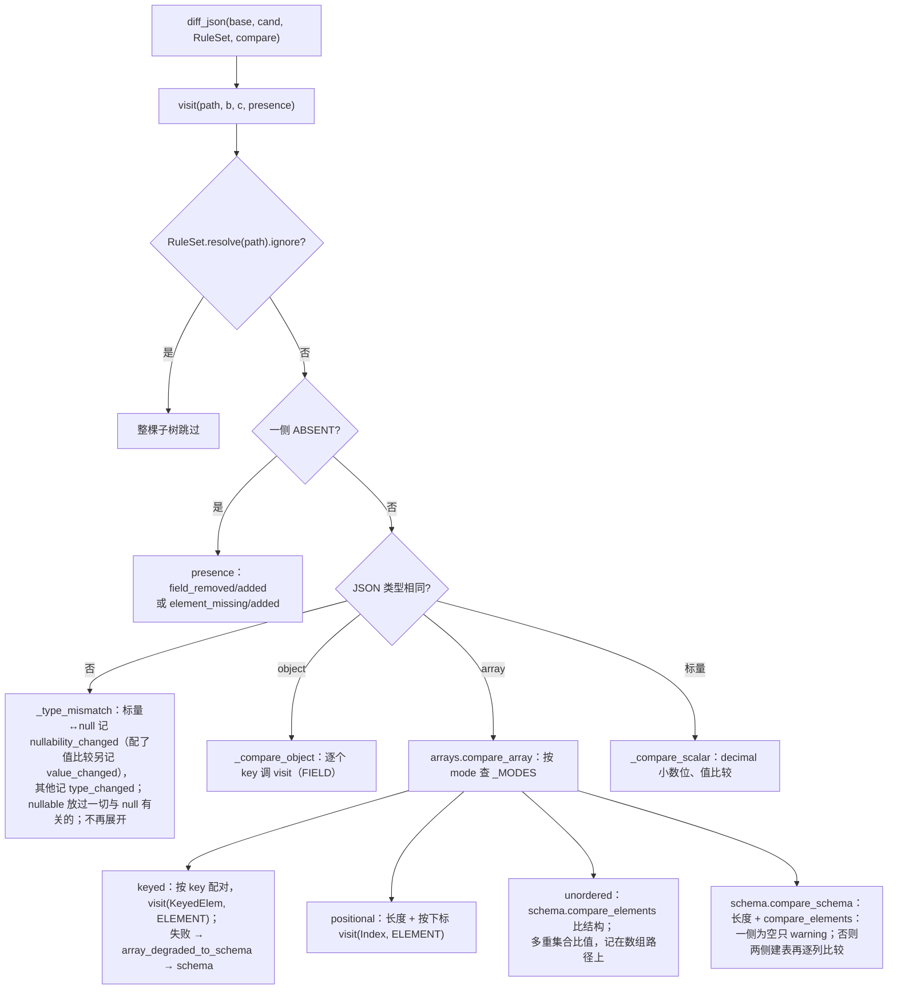

# 架构与模块职责

> 只写已经实现的部分。尚未实现的设计见 [spec-v1-design.md](../spec/spec-v1-design.md)。
> 文档里只引用文件名和函数名，不写行号。

## 分层

`core.diff` 和 `core.jsonload` 已实现，T4 起由 `core.service` 调用（目前只有测试在用）。

- `core` 是纯库，不能 import `cli` 或 `report`。由 `pyproject.toml` 里的 import-linter 契约保证，CI 执行 `lint-imports`。
- `cli` 只做参数解析、日志初始化、打印摘要，业务都通过 `core.service`。

## 模块

| 模块 | 职责 | 关键入口 |
|---|---|---|
| `core/models.py` | 跨模块共用的枚举和模型：`Level`、`Side`、`WarningCode`、`WarningItem`；finding 相关：`FindingType`、`Finding`、`ValueType`、`RuleRef`、`PathToken`、`Absent`（单例 `ABSENT`） | `format_loc`、`to_path_tokens` |
| `core/paths.py` | 路径语法：解析、格式化、匹配、泛化、具体程度 | `parse`、`format_path`、`match`、`covers`、`overlaps`、`generalize`、`specificity` |
| `core/config.py` | suite 的 pydantic 模型；YAML 加载与规模限制；`${VAR}` 替换；报错行号 | `load_suite`、`load_suite_text`、`substitute_env`、`Suite.success_of`、`format_where` |
| `core/expr.py` | success / asserts 表达式：AST 白名单编译、simpleeval 求值、计算量预算；重新导出 `expr_values` 的视图类 | `compile_expr`、`eval_success`、`eval_assert`、`Outcome` |
| `core/expr_values.py` | 表达式里的值怎么运算：只读视图、JSON 语义的相等与包含、内置函数、运算符；类型不匹配一律抛 `ExprEvalError` | `JsonView`、`HeadersView`、`SideView`、`json_equal`、`contains`、`FUNCTIONS`、`OPERATORS`、`type_name` |
| `core/rules.py` | 规则按属性合并、ignore 剪枝、静态无效规则检测 | `RuleSet.resolve`、`RuleSet.is_pruned`、`static_warnings` |
| `core/jsonload.py` | 判断 body 是否为 JSON、按 charset 解码、去 BOM、Decimal 解析、重复 key / NaN / 嵌套过深 | `load_body`、`parse_json`、`is_json_media`、`media_type`、`charset_of` |
| `core/diff/walker.py` | 对比入口；按 JSON 类型分发；字段缺失、类型、可空性、decimal、值比较 | `diff_json`、`visit`、`DiffResult` |
| `core/diff/arrays.py` | 四种数组模式的分发表 `_MODES`；keyed 配对与降级、positional、unordered（结构交给 schema，值按多重集合） | `compare_array` |
| `core/diff/schema.py` | 不配对地比较元素：扁平表（路径 → 类型集合、小数位集合）及其比较；数组长度 finding | `compare_schema`、`compare_elements`、`build_table`、`report_length` |
| `core/diff/context.py` | 一次对比的上下文：规则、对比模式、finding / warning 收集，`Presence`（字段 / 元素缺失用哪种 finding） | `DiffContext.report`、`DiffContext.warn`、`DiffContext.where`、`DiffContext.value_level` |
| `core/diff/values.py` | JSON 类型、小数位、标量相等、标量的规范形式（keyed 的 key、unordered 的元素） | `json_type`、`scale`、`scale_of`、`decimal_text`、`scalar_equal`、`canon_scalar` |
| `core/service.py` | 对外编排入口（目前只有 validate），提供 async 和同步两种调用 | `validate_suite`、`validate_suite_sync` |
| `cli.py` | Click 命令行（`cli` 命令组 + 各子命令）、日志初始化 | `main`、`cli`、`validate`、`setup_logging` |
| `report/` | 报告渲染（T6 实现，目前为空包） | |

## validate 主流程

## 配置加载的关键点

- **规模限制**：`_measure` 在 `yaml.safe_load` 之前按节点 id 记忆化统计「展开锚点后的节点数」和「子树里映射与序列的层数」，超过 `MAX_NODES`、嵌套超过 `MAX_DEPTH`、或锚点引用自身时直接报配置错误，防止锚点指数展开把内存吃光。深度只数映射和序列（根为第 1 层，标量不算一层）；同一个锚点可能在不同深度被引用，所以记忆的是子树高度，每次命中都按当前深度重新判断。`yaml.compose` 自身的 `RecursionError` 和 PyYAML 解析非法日期抛出的 `ValueError` 也转成配置错误。
- **YAML 语法错误**：`_yaml_error` 只用 PyYAML 异常的 `context` / `problem` 和行号拼消息，不用 `str(exc)`，因为后者会带出错行的原文（可能含硬编码 token）。行号超过文件末尾时截到最后一行。
- **行号**：`_LineMap` 遍历节点树，建立「路径元组 → 行号」表（key 取 key 节点所在行）。pydantic 报错的 `loc` 按最长前缀查表，见 `_lookup_line`。重复 key 在遍历时逐个记录自己的行号。
- **变量写法**：`Substitution` 的正则不允许默认值里出现 `$` 和 `}`。替换前先把所有合法变量删掉，剩下的文本里还有 `${` 就算无法识别（嵌套写法也因此被拒绝）。变量为空字符串时，有默认值就取默认值。
- **环境变量按 target 区分**：`substitute_env` 返回的 `Substitution` 记录每个缺失变量的位置。`targets.baseline.*` 归 baseline，`targets.candidate.*` 归 candidate，其余（defaults、requests）归 shared。`load_suite_text` 的 `sides` 参数是本命令需要的 target：这些 target 和 shared 缺变量时报错；其余只记录在 `LoadedSuite.missing_vars`。
- **缺失变量导致的类型错误**：`validate` 时缺失变量保留原文（如 `"${T}"`），非字符串字段会校验失败。pydantic 会一次报出所有字段的错误：只要有一条落在缺失变量以外的位置，就照常报错；全部落在缺失变量的位置时，抛 `UnverifiedSuite`，`service` 把它当作「通过但未完全校验」处理，并跳过规则检查。不再尝试删字段重试，因为那样会制造假报错（必填字段被删）或假通过。
- **原始模板**：`LoadedSuite.raw` 保存替换前的数据，T5 计算请求指纹时用（spec §8.2 要求用 `${VAR}` 替换前的模板）。
- **base_url 检查**放在 `_post_checks`：本命令需要的 target 一定检查；不需要的一侧只要值不依赖缺失变量也检查，所以 `validate` 能发现写死的错误地址。协议不区分大小写，并且要求有主机名。
- **`success` 覆盖**：`Suite.success_of` 用 `model_fields_set` 区分「没写」和「写了 null」（spec D6）。

## 表达式引擎（`core/expr.py`、`core/expr_values.py`）

两层防护：`compile_expr` 的静态检查是主防线，`_Evaluator` 在求值时再兜底一层。`expr.py` 管语法和求值流程，`expr_values.py` 管值的语义（spec §7.7、D16）；拆开是为了让两边都远离单文件 1000 行的上限，也让语义规则集中在一处。

- **编译**：`_parse`（`ast.parse(mode="eval")`；SyntaxWarning 如无效转义一律当错误，结果不受 `PYTHONWARNINGS` 影响）→ `_Checker.run` → `_DecimalLiterals` 把浮点字面量按源码原文（`ast.get_source_segment`）转成 Decimal，保留小数位；整数保持 int，否则 `items[0]` 会抛 TypeError。超出 Decimal 范围的字面量、嵌套过深都转成 `ExprError`。结果是 `CompiledExpr`。
- **`_Checker`**：
  - `_result`：顶层是元组、列表、推导式或非布尔常量时直接拒绝（防止 `"a == 1, 'msg'"` 恒为真）。
  - 逐节点（分发表 `checks`）：节点类型在 `_STRUCTURE_NODES` 里；运算符没有位置信息，由所在的 BinOp/UnaryOp/Compare 检查是否在 `OPERATORS` 里；`is` / `is not` 至少一边是 None/True/False 常量；调用目标只能是 `FUNCTIONS` 里的名字，不能是方法，不支持关键字参数，参数个数按 `ARITY` 检查，`get`/`exists` 的常量路径用 `literal_path` 检查；属性不能以 `_` 开头，源码里的属性名必须和 AST 里的一致（Python 会对标识符做 NFKC 规范化，`.字段１` 会被读成 `.字段1`），`base`/`cand` 只允许 `SIDE_ATTRS`，`status` 不能再用 `.`；推导式循环变量只能是单个名字，不能是 `_RESERVED` 或 `_` 开头（这一项在逐节点检查之前单独跑一遍，提示更准确）。
  - 位置约束（`_allowed_positions` 先收集允许的位置）：生成器只能作为 `_GENERATOR_FUNCTIONS`（all/any/set/min/max）的唯一参数，否则当成值使用时真值恒为真、和列表比较恒不等；`base`/`cand` 只能作为属性访问的对象或 `get`/`exists` 的第一个参数，否则 `cand == base` 比较的是对象身份，两侧不同对象时恒为假。
  - 变量名按作用域单独检查（`_names`）：和 Python 一致，第一个 `for` 的可迭代对象在外层作用域，循环变量只在推导式内部可见。
  - 报错位置由 `_where` 生成：`col_offset` 是 UTF-8 字节数，转成字符数；多行表达式同时给出行号。
- **`_Evaluator`**：继承 simpleeval 的 `SimpleEval`，复用它的下标、比较、布尔运算、一元/二元运算、条件表达式和函数调用的处理，自己负责：
  - 分发：类级的 `_HANDLERS` 表，不在白名单里的节点直接报错。**不调用父类 `__init__`**：它每次都用 `warnings.catch_warnings()` 修改进程级的 warnings 过滤器，多线程并发求值时会把 `ignore` 过滤器永久留下；类级分发表也避免了绑定方法造成的引用环。
  - 作用域：`scope` 字典按词法作用域保存循环变量，`_eval_in` 切换。
  - 推导式：`_generate` 是惰性生成器，`any`/`all` 得到结果就停止；列表推导式在外面套 `list(...)`。
  - 属性访问：只允许在 `JsonView` 和 `SideView`（限 `SIDE_ATTRS`）上用 `.`；对 null 和其他值给出明确的错误。
  - 下标：`_eval_subscript` 对 `JsonView` 交给视图；字符串、列表字面量、元组走 `_index_sequence`，和 JSON 数组一样只接受整数（不接受布尔值）；其他值报错。
  - 遍历：`for` 的对象必须是 `ITERABLE`（视图、字符串、列表、元组、集合、生成器）。
  - 错误兜底：`_metered` 包装每个函数和运算符，捕获漏网的 `TypeError` / `ValueError` / `IndexError` / `KeyError` 和 Decimal 异常，转成用 `type_name` 描述的提示，保证错误信息里不出现 Python 内部类型名。
  - 计算量：`_Budget` 每个节点记 1；函数调用和运算符经 `_metered` 包装，按参数规模记账（JSON 节点数按 id 缓存）；推导式迭代另有 `MAX_ITERATIONS` 上限。总量超过 `WORK_BUDGET` 时报错。
  - 求值在 `decimal.localcontext(prec=DECIMAL_PRECISION)` 里进行，不受全局 Decimal 上下文影响。
- **值的语义（`expr_values.py`）**：
  - 布尔值不是数字：`json_equal` 在任一边是 bool 时要求两边类型相同（`false != 0`）；数组（含元组）逐个元素比较，对象按 key 比较。`contains` 用同样的相等判断数组和集合的元素，对象判断 key，字符串判断子串。`JsonView.__eq__` / `__contains__` 也走这两个函数，所以 Python 内部的比较（如列表里的 `in`）语义一致。
  - 运算符：`+` 只接受两个数字、两个字符串或两个数组（`_is_array`），拼接结果不超过 `MAX_SEQUENCE_LENGTH` 并重新包装成 `JsonView`；`-` 是数字或集合；`/` 一律转 Decimal 精确除；`//`、`%` 按 Decimal 语义（向零取整），两边都是整数时结果转回 int；`*`、`%` 只接受数字，整数乘积受 `MAX_INT_BITS` 限制；大小比较（`_ordering`）只在两个数字或两个字符串之间，NaN 报错；一元 `-`/`+` 只接受数字；不提供 `**` 和位运算。
  - 内置函数都是包装过的版本（`_len`、`_set`、`_abs`、`_extreme` 等），参数类型不对时抛 `ExprEvalError`；`_set` 拒绝对象/数组元素和布尔值与数字混合（Python 的哈希会把 `1` 和 `True` 当成同一个元素）。`_step` 把列表字面量和元组也当数组，`get`/`exists` 对它们和对 body 里的数组行为一致。
  - `type_name` 把值映射成 JSON 类型名（数字、字符串、布尔值、null、对象、数组、集合、生成器、base/cand），所有错误信息都用它。
- **`JsonView`**：`__slots__` 只有 `_data`、`_path`，类上除 dunder 外没有公开属性，所以 `getattr` 一定落到 `__getattr__`，只映射 JSON key（`body.x.items` 是字段而不是 `dict.items`）。不可写、不可 hash、不能比较大小；`==` 和 `in` 按 JSON 语义比较（见上）；迭代对象得到 key，迭代数组得到包装后的元素。错误信息带具体路径（`字段不存在：data.nope`）。`HeadersView` 继承它，key 统一转小写。`get`/`exists` 也能从 `SideView` 出发（`_step`）。
- **求值结果**：`Outcome(passed, error)`。任何异常都被捕获，`passed=False`，`error` 是简短原因（截断到 300 字符）；结果不是 bool 也算出错。表达式只能看到响应，看不到请求头，所以错误信息里不会出现请求头的值。T4 据此产生 `assert_failed`（`error is None and not passed`）、`assert_error`（`error` 非空）和 `success_eval_error` warning。
- **接入配置**：`config._expr_fields` 从替换变量后的原始数据（而不是 `Suite` 模型）里列出所有表达式字段，`_expr_issues` 逐个编译，错误带行号；原文含缺失变量的跳过，不是字符串的交给 pydantic 报。它在 pydantic 校验通过后和 `_post_checks` 一起执行；校验未通过但错误都落在缺失变量上（`UnverifiedSuite`）时也会先执行，所以 `validate` 不会因为别的字段缺变量就放过非法表达式。

## 路径与匹配

- 模式 token：`Key`、`Index`（`[n]`）、`AnyIndex`（`[*]`）、`Deep`（`**`）。单独的 `$` 解析成空元组，表示根节点；`format_path(())` 输出 `$`，以 `$` 开头的 key 总是加引号，保证格式化结果能被 `parse` 解析回来。`parse` 带 `lru_cache`，`Rule.tokens` 每次调用它，因此不会和 `path` 不一致。具体路径 token：`Key`、`Index`（positional 数组）、`AnyIndex`（schema 数组）、`KeyedElem`（keyed 数组，展示为 `[sku_id=A12]`）。
- `match` 用 NFA 状态集合实现，`**` 通过 ε 闭包处理，避免回溯。`[n]` 只匹配 `Index(n)`，所以字面下标碰不到 schema 和 keyed 数组的元素。
- `covers(a, b)`：把模式 b 当作具体路径交给 `match`，b 里的 `**` 只能被 a 的 `**` 匹配，因此结果为真时包含关系一定成立（可能漏判，不会误判）。
- `overlaps(a, b)`：在两个模式的乘积状态上做可达性搜索，判断是否存在一条路径同时被两者匹配。

## 规则合并

- `CompiledRule.rank` = `(通配等级, 层级, 作用域, 书写顺序)`，对应 spec §6.3 的三级比较。通配等级来自 `paths.specificity`：无通配 2、含 `[*]` 1、含 `**` 0；层级是非 `**` token 的个数。
- `RuleSet.resolve` 对每个属性分别在「匹配到且写了该属性」的规则里取 `max(rank)`；`Resolved.sources` 记录每个属性来自哪条规则（`RuleRef{scope, index}`）。结果按路径缓存在 `RuleSet` 实例里，`RuleSet` 按请求创建，规则不变。
- ignore 剪枝：对比引擎自顶向下遍历，节点 `ignore` 为真就不再进入子树；`RuleSet.is_pruned` 供需要判断任意路径的场景使用（如不稳定字段建议），根节点 `$` 也算在内。
- **缓存键**（`RuleSet._cache_key`）：keyed 元素只能被 `[*]` 和 `**` 匹配，和 `[*]` 等价；没有任何规则写到的下标同理。这两种 token 在缓存键里换成 `[*]`，大数组的每个元素共用一条缓存，不必把所有规则重新匹配一遍。
- `CompiledRule` 按对象身份比较和 hash，可以放进 set（design §5 的未命中规则检测会用到）。

## 静态无效规则（`static_warnings`）

| code | 判定 |
|---|---|
| `rule_under_ignored` | 规则路径的某个严格前缀（含根节点）被一条 `ignore: true` 规则 `covers`，并且没有更优先、可能 `overlaps` 该前缀的 `ignore: false` 规则。规则自己没写 `ignore` 时，所在节点本身也这样检查（spec D9）。见 `_ignored_by` |
| `index_rule_ineffective` | 规则里有字面下标，但没有任何 `mode: positional` 的 array 规则可能作用到那个数组 |
| `rule_ineffective_in_schema` | `_check_value_in_schema`：规则配了 `on_value_change`，路径里有 `[*]`，但没有 keyed / positional 的 array 规则可能作用到那个数组（schema 和 unordered 都不逐个配对）。`_check_nested_array`：规则配了非 schema 的 `array`，路径里有 `[*]`，但外层数组只可能是 schema（D14）。两者共用 `_unpaired_array` |

全局规则在「全局 + 所有请求的规则」中检查，只报一次：只要某个请求里的 `ignore: false` 或 `array` 规则可能让它生效就不报；但请求级的 `ignore: true` 不算数（`_ignorers`），因为它只影响个别请求。请求级规则在「全局 + 本请求」中检查。判定都偏保守：宁可漏报，不误报。运行时才能确定的情况（例如 `compare: values` 落在 schema 数组里）由对比引擎报。

## JSON 解析（`core/jsonload.py`）

- **是否为 JSON**：`is_json_media` 认 `application/json` 和任意 `*/*+json`（不区分大小写，忽略参数；`+json` 前面必须还有内容）。声明为其他类型时不解析；没有 Content-Type 时尝试解析一次，失败不提示；声明为 JSON 却解析失败时产生 `json_parse_failed`，按非 JSON 处理。warning 只写异常类型名，不回显 body 原文。
- **解码**：`charset_of` 取 Content-Type 的 charset，没写、不认识、或者不是文本编码（`hex`、`base64` 这类 bytes→bytes 编解码器，看 `CodecInfo._is_text_encoding`）时用 UTF-8。传入 `str` 时不再解码。解码后去掉开头的 BOM（`response.text` 也会保留 BOM）。
- **数字**：`json.loads(parse_float=_parse_float, parse_int=_parse_int, parse_constant=..., object_pairs_hook=...)`。整数保持 int，带小数点或指数的转成 Decimal，保留原文的小数位。超过 `_MAX_INT_DIGITS` 位的整数改用 Decimal（Python 默认拒绝把超过 4300 位的串转成 int）；指数超出 Decimal 范围时抛 `BodyRejected`，按解析失败处理。
- **NaN**：`Decimal('NaN')` 和自身不相等，与其他数比较大小会抛异常。对比时 `values._number_key` 把非有限值换成文本再比较；小数位不参与比较。
- **异常**：`BodyRejected` 的消息可以直接放进 warning；其他异常只写类型名，因为异常文本可能带出 body 原文。`load_body` 捕获 `ValueError`、`LookupError`、`ArithmeticError`、`RecursionError`，服务端返回的任何内容都不会让加载抛异常。
- **孤立代理字符**：`json.loads` 接受 `"\ud800"` 这样的转义，但这种字符串无法编码成 UTF-8，写 `result.json` 时会出错。原文里出现代理字符或它的转义时，`_scrub` 把每个孤立代理字符换成 U+FFFD。
- **重复 key / NaN**：`_Collector` 作为钩子记录，每个 body 每类最多一条 warning。重复 key 取最后一个值。NaN、Infinity 转成对应的 Decimal。钩子里拿不到路径，所以这两类 warning 没有 `path`。
- **嵌套深度**：对比引擎是递归实现的，`_check_depth` 用显式栈检查，对象和数组超过 `MAX_DEPTH`（200）层按解析失败处理；标量不算一层。
- **小数位**：`values.scale` 用 `max(0, -d.as_tuple().exponent)`，int 为 0，NaN/Infinity 返回 None（不参与比较）。**不要用 `Decimal.normalize()`**，它会抹掉末尾的 0。

## 对比引擎（`core/diff/`）

各种组合（类型 × 位置 × 规则、数组模式 × 场景、body 层）下引擎的实际输出见 [diff-combinations.md](diff-combinations.md)。那份文件由 `scripts/gen_diff_combinations.py` 生成，`tests/test_diff_combinations.py` 保证它和代码一致。**加新的条件分支时，先在脚本里加上对应的维度或场景，再重新生成，逐格检查 diff。**

- **只报最高层节点**：`visit` 遇到缺失或类型不同就返回，不再进入子树。schema 表按「先父后子」的顺序比较，已经报了缺失、新增或 `type_changed` 的路径，其子路径跳过（`_under`）。
- **schema 列只在一侧出现**（`schema._presence`）：先看父节点在另一侧是否还出现过对象（子字段）或数组（`[*]` 元素）。没有出现过，说明变化在父节点上（已经报了，或者被 `nullable` 放过），这里不报；父节点仍是数组、只是元素全空时，给 `array_empty`，不报字段增删（D14）。
- **schema 列的 null**（`_null_change`）：null 新出现、或基线只有 null 而候选出现了值时，涉及对象或数组的记 `type_changed`，标量记 `nullability_changed`（D11）。报了 `type_changed` 的列不再比较小数位。
- **ignore**：每个节点先 `RuleSet.resolve`，`ignore` 为真直接返回，所以被 ignore 的字段被删除也不报。schema 建表（`_collect`）和 unordered 的规范形式（`_canon_at`）同样跳过被 ignore 的子树。
- **缺失**：用 `models.ABSENT` 作哨兵，和 JSON 的 null 区分；它也直接作为 finding 的 `base_value` / `cand_value`，序列化为 `{"absent": true}`。
- **值比较**：`DiffContext.value_level` —— `on_value_change` 优先，`compare: values` 时默认 suspicious，否则不比较。数字按数值相等；`decimal.allow_string` 时数字字符串也按数值比较（`values.decimal_text` 只认 ASCII 的 JSON 数字语法）。标量和 null 之间的变化在 `nullability_changed` 之外另报 `value_changed`（D10）。
- **unordered**（D13）：先用 `schema.compare_elements(schema_mode=False)` 比较元素结构，再用 `arrays._canon_at` 把元素变成可 hash 的形式按多重集合比较。`_canon_at` 跳过被 ignore 的字段，内层数组除了 positional 之外都按多重集合，配了 `allow_string` 的数字字符串按数值（`values.canon_scalar`）。
- **具体路径的元素 token**：positional 用 `Index`，keyed 用 `KeyedElem`（标签见 `arrays._label`），schema 和 unordered 用 `AnyIndex`。`[n]` 形式的规则只匹配 `Index`，所以对 schema / keyed 数组写字面下标不会生效。
- **schema 表**（`schema.Column`）：`types` 和 `scales` 都是「值 → 第一次出现的元素下标」，用来给出 `example_index`。元素里的嵌套数组也并入同一张表，下标始终是外层数组的。只有配了 `decimal` 的路径才记小数位。
- **元素内部不生效的规则**：`schema._warn_rules` 对表里命中 `on_value_change` 的规则提示；schema 模式下（`schema_mode=True`）还对 `compare: values` 每个数组提示一次，对内层数组上的非 schema `array` 规则提示（D14）。都是 `rule_ineffective_in_schema`。
- **warning 去重**：`DiffContext.warn` 用泛化路径（`DiffContext.where`）作为 `path`，按 (code, 泛化路径, 消息) 去重，所以 keyed / positional 数组里每个元素的同一个问题只提示一次。消息里的路径也用 `where`。
- **keyed 降级**：`_index_by_key` 发现元素不是对象、key 缺失或不是标量、key 重复时返回 None，整个数组改走 `compare_schema`。key 用 `values.canon_scalar` 规范化，数字按数值相等，类型不同则不等。
- **keyed 标签**（`arrays._label`）：数字按数值展示（`_number_label`，`1`、`1.0`、`1E0` 都是 `1`，所以 `finding_id` 跨运行稳定；这里只是展示，可以用 `normalize`），字符串会和数字、`true`/`false`/`null` 混淆或含特殊字符时加引号，因此 `1.5` 和 `"1.5"` 的路径不同。
- **finding 字段**：`path` 是具体路径，`generalized_path` 是 `paths.generalize` 后的结果，`path_tokens` 是 `PathToken` 列表，`rule_refs` 是该节点生效的所有规则属性来源（`Resolved.refs`）。`base_type` / `cand_type` 是两侧值的 JSON 类型（缺失为 `absent`），因为 Decimal 序列化成字符串后，`12.50` 和 `"12.50"` 看不出区别，真实的 `{"absent": true}` 和缺失也分不开。schema 数组里的 finding（`report(summary=True)`），两侧的值是排好序的类型列表或小数位列表，`base_type` / `cand_type` 为 None；数组长度 finding 同理。`finding_id` 在 T4 生成。
- **交叉校验**：`tests/test_diff_crosscheck.py` 用随机 JSON 和 deepdiff（`zip_ordered_iterables=True`、`threshold_to_diff_deeper=0`）比较 positional + `compare: values` 下的路径集合。

## CLI 约定

- 子命令挂在 `cli` 命令组下。通用参数（`--log-level`、`--log-file`）由装饰器 `common_options` 统一添加；它也负责初始化日志（日志文件打不开返回 3），并把未捕获的异常记为内部错误（退出码 3）。Click 自己的异常（`UsageError`、`Exit`、`Abort`）原样抛出，交给 `main`。
- 子命令返回 int 作为退出码。`main` 用 `standalone_mode=False` 调用 Click：子命令返回值和 `ctx.exit(code)` 都会作为返回值传出来；`ClickException`（含参数错误）返回 2，`Abort` 返回 3。
- 错误和 warning 的位置前缀统一由 `config.format_where` 生成：`suite.yaml:12: requests[0].method:`。

## 日志

- `cli.setup_logging` 把 `api_regress` logger 输出到 stderr，`--log-file` 时同时写文件。
- 已有的 INFO 节点：suite 加载结果（`config.load_suite_text`）、校验失败（`service.validate_suite_sync`）、validate 退出码及原因（`cli.validate`）。warning 以 WARNING 级别输出。
- 报错和 warning 只包含字段位置、变量名，不包含请求头的值；`tests/test_cli.py` 用哨兵 token 校验。
