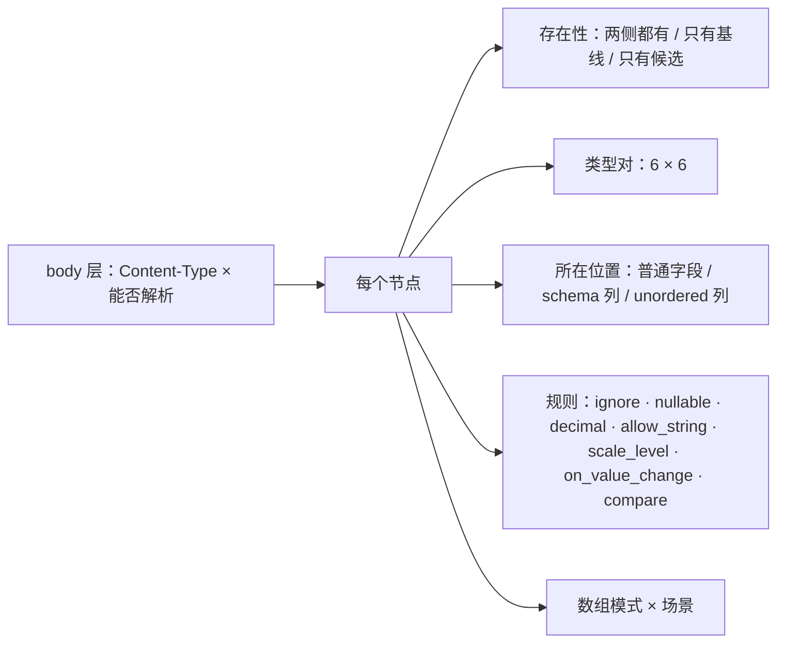
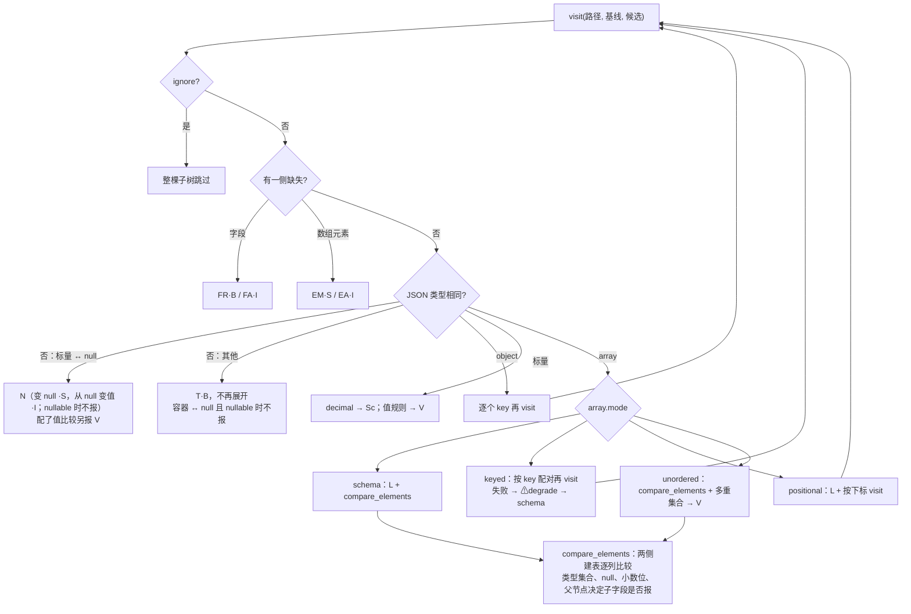

# 对比引擎组合表

> **本文件由 `scripts/gen_diff_combinations.py` 生成，不要手改。**
> 每个格子都是真正运行 `diff_json` / `load_body` 的结果。`tests/test_diff_combinations.py` 会重新生成并比较：
> 对比行为一变，测试就失败。确认变化符合预期后，运行 `uv run python scripts/gen_diff_combinations.py` 更新本文件，
> 并在 review 时逐格检查 `git diff`。加新的条件分支时，先在脚本里加上对应的维度或场景。

## 怎么读

格子里是 `类型·级别@相对路径`，多条用 `+` 连接；路径和被比较的节点相同时省略 `@`。

| 缩写 | finding | | 缩写 | 含义 |
|---|---|---|---|---|
| `T` | type_changed | | `·B` | breaking |
| `N` | nullability_changed | | `·S` | suspicious |
| `Sc` | scale_changed | | `·I` | info |
| `V` | value_changed | | `⚠empty` | array_empty |
| `FR` / `FA` | field_removed / field_added | | `⚠degrade` | array_degraded_to_schema |
| `L` | array_length_changed | | `⚠ineffective` | rule_ineffective_in_schema |
| `EM` / `EA` | element_missing / element_added | | `—` | 没有 finding 也没有 warning |

## 组合维度

## 判定流程

## 类型 × 位置 × 规则

类型相同时用两份不同的值（number 的小数位也不同：`1.10` → `2.0`），类型不同时用 `{"a": 1}`、`[1]`、`"x"`、`1.10`、`true`、`null`。

### 普通字段

**无规则**

| 基线 ↓ ／ 候选 → | object | array | string | number | boolean | null |
|---|---|---|---|---|---|---|
| **object** | FR·B@.a + FA·I@.b | T·B | T·B | T·B | T·B | T·B |
| **array** | T·B | L·I | T·B | T·B | T·B | T·B |
| **string** | T·B | T·B | — | T·B | T·B | N·S |
| **number** | T·B | T·B | T·B | — | T·B | N·S |
| **boolean** | T·B | T·B | T·B | T·B | — | N·S |
| **null** | T·B | T·B | N·I | N·I | N·I | — |

**nullable: true**

| 基线 ↓ ／ 候选 → | object | array | string | number | boolean | null |
|---|---|---|---|---|---|---|
| **object** | FR·B@.a + FA·I@.b | T·B | T·B | T·B | T·B | — |
| **array** | T·B | L·I | T·B | T·B | T·B | — |
| **string** | T·B | T·B | — | T·B | T·B | — |
| **number** | T·B | T·B | T·B | — | T·B | — |
| **boolean** | T·B | T·B | T·B | T·B | — | — |
| **null** | — | — | — | — | — | — |

**on_value_change: breaking**

| 基线 ↓ ／ 候选 → | object | array | string | number | boolean | null |
|---|---|---|---|---|---|---|
| **object** | FR·B@.a + FA·I@.b | T·B | T·B | T·B | T·B | T·B |
| **array** | T·B | L·I | T·B | T·B | T·B | T·B |
| **string** | T·B | T·B | V·B | T·B | T·B | N·S + V·B |
| **number** | T·B | T·B | T·B | V·B | T·B | N·S + V·B |
| **boolean** | T·B | T·B | T·B | T·B | V·B | N·S + V·B |
| **null** | T·B | T·B | N·I + V·B | N·I + V·B | N·I + V·B | — |

**decimal: {}**

| 基线 ↓ ／ 候选 → | object | array | string | number | boolean | null |
|---|---|---|---|---|---|---|
| **object** | FR·B@.a + FA·I@.b | T·B | T·B | T·B | T·B | T·B |
| **array** | T·B | L·I | T·B | T·B | T·B | T·B |
| **string** | T·B | T·B | — | T·B | T·B | N·S |
| **number** | T·B | T·B | T·B | Sc·B | T·B | N·S |
| **boolean** | T·B | T·B | T·B | T·B | — | N·S |
| **null** | T·B | T·B | N·I | N·I | N·I | — |

**decimal: {allow_string: true}**

| 基线 ↓ ／ 候选 → | object | array | string | number | boolean | null |
|---|---|---|---|---|---|---|
| **object** | FR·B@.a + FA·I@.b | T·B | T·B | T·B | T·B | T·B |
| **array** | T·B | L·I | T·B | T·B | T·B | T·B |
| **string** | T·B | T·B | — | T·B | T·B | N·S |
| **number** | T·B | T·B | T·B | Sc·B | T·B | N·S |
| **boolean** | T·B | T·B | T·B | T·B | — | N·S |
| **null** | T·B | T·B | N·I | N·I | N·I | — |

**compare: values**

| 基线 ↓ ／ 候选 → | object | array | string | number | boolean | null |
|---|---|---|---|---|---|---|
| **object** | FR·B@.a + FA·I@.b | T·B | T·B | T·B | T·B | T·B |
| **array** | T·B | L·I + ⚠ineffective | T·B | T·B | T·B | T·B |
| **string** | T·B | T·B | V·S | T·B | T·B | N·S + V·S |
| **number** | T·B | T·B | T·B | V·S | T·B | N·S + V·S |
| **boolean** | T·B | T·B | T·B | T·B | V·S | N·S + V·S |
| **null** | T·B | T·B | N·I + V·S | N·I + V·S | N·I + V·S | — |

### schema 数组的一列

**无规则**

| 基线 ↓ ／ 候选 → | object | array | string | number | boolean | null |
|---|---|---|---|---|---|---|
| **object** | FR·B@.a + FA·I@.b | T·B | T·B | T·B | T·B | T·B |
| **array** | T·B | — | T·B | T·B | T·B | T·B |
| **string** | T·B | T·B | — | T·B | T·B | N·S |
| **number** | T·B | T·B | T·B | — | T·B | N·S |
| **boolean** | T·B | T·B | T·B | T·B | — | N·S |
| **null** | T·B | T·B | N·I | N·I | N·I | — |

**nullable: true**

| 基线 ↓ ／ 候选 → | object | array | string | number | boolean | null |
|---|---|---|---|---|---|---|
| **object** | FR·B@.a + FA·I@.b | T·B | T·B | T·B | T·B | — |
| **array** | T·B | — | T·B | T·B | T·B | — |
| **string** | T·B | T·B | — | T·B | T·B | — |
| **number** | T·B | T·B | T·B | — | T·B | — |
| **boolean** | T·B | T·B | T·B | T·B | — | — |
| **null** | — | — | — | — | — | — |

**on_value_change: breaking**

| 基线 ↓ ／ 候选 → | object | array | string | number | boolean | null |
|---|---|---|---|---|---|---|
| **object** | FR·B@.a + FA·I@.b + ⚠ineffective | T·B + ⚠ineffective | T·B + ⚠ineffective | T·B + ⚠ineffective | T·B + ⚠ineffective | T·B + ⚠ineffective |
| **array** | T·B + ⚠ineffective | ⚠ineffective | T·B + ⚠ineffective | T·B + ⚠ineffective | T·B + ⚠ineffective | T·B + ⚠ineffective |
| **string** | T·B + ⚠ineffective | T·B + ⚠ineffective | ⚠ineffective | T·B + ⚠ineffective | T·B + ⚠ineffective | N·S + ⚠ineffective |
| **number** | T·B + ⚠ineffective | T·B + ⚠ineffective | T·B + ⚠ineffective | ⚠ineffective | T·B + ⚠ineffective | N·S + ⚠ineffective |
| **boolean** | T·B + ⚠ineffective | T·B + ⚠ineffective | T·B + ⚠ineffective | T·B + ⚠ineffective | ⚠ineffective | N·S + ⚠ineffective |
| **null** | T·B + ⚠ineffective | T·B + ⚠ineffective | N·I + ⚠ineffective | N·I + ⚠ineffective | N·I + ⚠ineffective | ⚠ineffective |

**decimal: {}**

| 基线 ↓ ／ 候选 → | object | array | string | number | boolean | null |
|---|---|---|---|---|---|---|
| **object** | FR·B@.a + FA·I@.b | T·B | T·B | T·B | T·B | T·B |
| **array** | T·B | — | T·B | T·B | T·B | T·B |
| **string** | T·B | T·B | — | T·B | T·B | N·S |
| **number** | T·B | T·B | T·B | Sc·B | T·B | N·S |
| **boolean** | T·B | T·B | T·B | T·B | — | N·S |
| **null** | T·B | T·B | N·I | N·I | N·I | — |

**decimal: {allow_string: true}**

| 基线 ↓ ／ 候选 → | object | array | string | number | boolean | null |
|---|---|---|---|---|---|---|
| **object** | FR·B@.a + FA·I@.b | T·B | T·B | T·B | T·B | T·B |
| **array** | T·B | — | T·B | T·B | T·B | T·B |
| **string** | T·B | T·B | — | T·B | T·B | N·S |
| **number** | T·B | T·B | T·B | Sc·B | T·B | N·S |
| **boolean** | T·B | T·B | T·B | T·B | — | N·S |
| **null** | T·B | T·B | N·I | N·I | N·I | — |

**compare: values**

| 基线 ↓ ／ 候选 → | object | array | string | number | boolean | null |
|---|---|---|---|---|---|---|
| **object** | FR·B@.a + FA·I@.b + ⚠ineffective | T·B + ⚠ineffective | T·B + ⚠ineffective | T·B + ⚠ineffective | T·B + ⚠ineffective | T·B + ⚠ineffective |
| **array** | T·B + ⚠ineffective | ⚠ineffective | T·B + ⚠ineffective | T·B + ⚠ineffective | T·B + ⚠ineffective | T·B + ⚠ineffective |
| **string** | T·B + ⚠ineffective | T·B + ⚠ineffective | ⚠ineffective | T·B + ⚠ineffective | T·B + ⚠ineffective | N·S + ⚠ineffective |
| **number** | T·B + ⚠ineffective | T·B + ⚠ineffective | T·B + ⚠ineffective | ⚠ineffective | T·B + ⚠ineffective | N·S + ⚠ineffective |
| **boolean** | T·B + ⚠ineffective | T·B + ⚠ineffective | T·B + ⚠ineffective | T·B + ⚠ineffective | ⚠ineffective | N·S + ⚠ineffective |
| **null** | T·B + ⚠ineffective | T·B + ⚠ineffective | N·I + ⚠ineffective | N·I + ⚠ineffective | N·I + ⚠ineffective | ⚠ineffective |

### unordered 数组的一列

**无规则**

| 基线 ↓ ／ 候选 → | object | array | string | number | boolean | null |
|---|---|---|---|---|---|---|
| **object** | FR·B@.a + FA·I@.b + V·S@l | T·B + V·S@l | T·B + V·S@l | T·B + V·S@l | T·B + V·S@l | T·B + V·S@l |
| **array** | T·B + V·S@l | V·S@l | T·B + V·S@l | T·B + V·S@l | T·B + V·S@l | T·B + V·S@l |
| **string** | T·B + V·S@l | T·B + V·S@l | V·S@l | T·B + V·S@l | T·B + V·S@l | N·S + V·S@l |
| **number** | T·B + V·S@l | T·B + V·S@l | T·B + V·S@l | V·S@l | T·B + V·S@l | N·S + V·S@l |
| **boolean** | T·B + V·S@l | T·B + V·S@l | T·B + V·S@l | T·B + V·S@l | V·S@l | N·S + V·S@l |
| **null** | T·B + V·S@l | T·B + V·S@l | N·I + V·S@l | N·I + V·S@l | N·I + V·S@l | — |

**nullable: true**

| 基线 ↓ ／ 候选 → | object | array | string | number | boolean | null |
|---|---|---|---|---|---|---|
| **object** | FR·B@.a + FA·I@.b + V·S@l | T·B + V·S@l | T·B + V·S@l | T·B + V·S@l | T·B + V·S@l | V·S@l |
| **array** | T·B + V·S@l | V·S@l | T·B + V·S@l | T·B + V·S@l | T·B + V·S@l | V·S@l |
| **string** | T·B + V·S@l | T·B + V·S@l | V·S@l | T·B + V·S@l | T·B + V·S@l | V·S@l |
| **number** | T·B + V·S@l | T·B + V·S@l | T·B + V·S@l | V·S@l | T·B + V·S@l | V·S@l |
| **boolean** | T·B + V·S@l | T·B + V·S@l | T·B + V·S@l | T·B + V·S@l | V·S@l | V·S@l |
| **null** | V·S@l | V·S@l | V·S@l | V·S@l | V·S@l | — |

**on_value_change: breaking**

| 基线 ↓ ／ 候选 → | object | array | string | number | boolean | null |
|---|---|---|---|---|---|---|
| **object** | FR·B@.a + FA·I@.b + V·S@l + ⚠ineffective | T·B + V·S@l + ⚠ineffective | T·B + V·S@l + ⚠ineffective | T·B + V·S@l + ⚠ineffective | T·B + V·S@l + ⚠ineffective | T·B + V·S@l + ⚠ineffective |
| **array** | T·B + V·S@l + ⚠ineffective | V·S@l + ⚠ineffective | T·B + V·S@l + ⚠ineffective | T·B + V·S@l + ⚠ineffective | T·B + V·S@l + ⚠ineffective | T·B + V·S@l + ⚠ineffective |
| **string** | T·B + V·S@l + ⚠ineffective | T·B + V·S@l + ⚠ineffective | V·S@l + ⚠ineffective | T·B + V·S@l + ⚠ineffective | T·B + V·S@l + ⚠ineffective | N·S + V·S@l + ⚠ineffective |
| **number** | T·B + V·S@l + ⚠ineffective | T·B + V·S@l + ⚠ineffective | T·B + V·S@l + ⚠ineffective | V·S@l + ⚠ineffective | T·B + V·S@l + ⚠ineffective | N·S + V·S@l + ⚠ineffective |
| **boolean** | T·B + V·S@l + ⚠ineffective | T·B + V·S@l + ⚠ineffective | T·B + V·S@l + ⚠ineffective | T·B + V·S@l + ⚠ineffective | V·S@l + ⚠ineffective | N·S + V·S@l + ⚠ineffective |
| **null** | T·B + V·S@l + ⚠ineffective | T·B + V·S@l + ⚠ineffective | N·I + V·S@l + ⚠ineffective | N·I + V·S@l + ⚠ineffective | N·I + V·S@l + ⚠ineffective | ⚠ineffective |

**decimal: {}**

| 基线 ↓ ／ 候选 → | object | array | string | number | boolean | null |
|---|---|---|---|---|---|---|
| **object** | FR·B@.a + FA·I@.b + V·S@l | T·B + V·S@l | T·B + V·S@l | T·B + V·S@l | T·B + V·S@l | T·B + V·S@l |
| **array** | T·B + V·S@l | V·S@l | T·B + V·S@l | T·B + V·S@l | T·B + V·S@l | T·B + V·S@l |
| **string** | T·B + V·S@l | T·B + V·S@l | V·S@l | T·B + V·S@l | T·B + V·S@l | N·S + V·S@l |
| **number** | T·B + V·S@l | T·B + V·S@l | T·B + V·S@l | Sc·B + V·S@l | T·B + V·S@l | N·S + V·S@l |
| **boolean** | T·B + V·S@l | T·B + V·S@l | T·B + V·S@l | T·B + V·S@l | V·S@l | N·S + V·S@l |
| **null** | T·B + V·S@l | T·B + V·S@l | N·I + V·S@l | N·I + V·S@l | N·I + V·S@l | — |

**decimal: {allow_string: true}**

| 基线 ↓ ／ 候选 → | object | array | string | number | boolean | null |
|---|---|---|---|---|---|---|
| **object** | FR·B@.a + FA·I@.b + V·S@l | T·B + V·S@l | T·B + V·S@l | T·B + V·S@l | T·B + V·S@l | T·B + V·S@l |
| **array** | T·B + V·S@l | V·S@l | T·B + V·S@l | T·B + V·S@l | T·B + V·S@l | T·B + V·S@l |
| **string** | T·B + V·S@l | T·B + V·S@l | V·S@l | T·B + V·S@l | T·B + V·S@l | N·S + V·S@l |
| **number** | T·B + V·S@l | T·B + V·S@l | T·B + V·S@l | Sc·B + V·S@l | T·B + V·S@l | N·S + V·S@l |
| **boolean** | T·B + V·S@l | T·B + V·S@l | T·B + V·S@l | T·B + V·S@l | V·S@l | N·S + V·S@l |
| **null** | T·B + V·S@l | T·B + V·S@l | N·I + V·S@l | N·I + V·S@l | N·I + V·S@l | — |

**compare: values**

| 基线 ↓ ／ 候选 → | object | array | string | number | boolean | null |
|---|---|---|---|---|---|---|
| **object** | FR·B@.a + FA·I@.b + V·S@l | T·B + V·S@l | T·B + V·S@l | T·B + V·S@l | T·B + V·S@l | T·B + V·S@l |
| **array** | T·B + V·S@l | V·S@l | T·B + V·S@l | T·B + V·S@l | T·B + V·S@l | T·B + V·S@l |
| **string** | T·B + V·S@l | T·B + V·S@l | V·S@l | T·B + V·S@l | T·B + V·S@l | N·S + V·S@l |
| **number** | T·B + V·S@l | T·B + V·S@l | T·B + V·S@l | V·S@l | T·B + V·S@l | N·S + V·S@l |
| **boolean** | T·B + V·S@l | T·B + V·S@l | T·B + V·S@l | T·B + V·S@l | V·S@l | N·S + V·S@l |
| **null** | T·B + V·S@l | T·B + V·S@l | N·I + V·S@l | N·I + V·S@l | N·I + V·S@l | — |

## 数组模式 × 场景

数组 `l` 的元素形如 `{"id": 1, "p": 1.10}`，keyed 模式用 `keys: [id]`。路径相对于 `l`。

**无元素规则**

| 场景 ↓ ／ 模式 → | schema | keyed | positional | unordered |
|---|---|---|---|---|
| 完全相同 | — | — | — | — |
| 顺序打乱 | — | — | — | — |
| 多 1 个元素 | L·I | EA·I@[id=2] | L·I + EA·I@[1] | V·S |
| 少 1 个元素 | L·I | EM·S@[id=2] | L·I + EM·S@[1] | V·S |
| 空 → 非空 | L·S + ⚠empty | EA·I@[id=1] | L·S + EA·I@[0] | V·S + ⚠empty |
| 非空 → 空 | L·S + ⚠empty | EM·S@[id=1] | L·S + EM·S@[0] | V·S + ⚠empty |
| 两侧都空 | — | — | — | — |
| 元素删字段 | FR·B@[*].x | FR·B@[id=1].x | FR·B@[0].x | FR·B@[*].x + V·S |
| 元素字段改类型 | T·B@[*].p | T·B@[id=1].p | T·B@[0].p | T·B@[*].p + V·S |
| 元素值变（小数位相同） | — | — | — | V·S |
| 元素小数位变 | — | — | — | — |
| 元素字段变 null | N·S@[*].p | N·S@[id=1].p | N·S@[0].p | N·S@[*].p + V·S |
| 元素对象字段变 null | T·B@[*].o | T·B@[id=1].o | T·B@[0].o | T·B@[*].o + V·S |
| key 重复 | — | ⚠degrade | — | — |
| key 缺失 | FR·B@[*].id | FR·B@[*].id + ⚠degrade | FR·B@[0].id | FR·B@[*].id + V·S |
| 元素不是对象 | — | ⚠degrade | — | — |
| 内层数组变空 | ⚠empty | L·S@[id=1].sub + ⚠empty | L·S@[0].sub + ⚠empty | V·S + ⚠empty |

**l[*].p: decimal**

| 场景 ↓ ／ 模式 → | schema | keyed | positional | unordered |
|---|---|---|---|---|
| 完全相同 | — | — | — | — |
| 顺序打乱 | — | — | — | — |
| 多 1 个元素 | L·I | EA·I@[id=2] | L·I + EA·I@[1] | V·S |
| 少 1 个元素 | L·I | EM·S@[id=2] | L·I + EM·S@[1] | V·S |
| 空 → 非空 | L·S + ⚠empty | EA·I@[id=1] | L·S + EA·I@[0] | V·S + ⚠empty |
| 非空 → 空 | L·S + ⚠empty | EM·S@[id=1] | L·S + EM·S@[0] | V·S + ⚠empty |
| 两侧都空 | — | — | — | — |
| 元素删字段 | FR·B@[*].x | FR·B@[id=1].x | FR·B@[0].x | FR·B@[*].x + V·S |
| 元素字段改类型 | T·B@[*].p | T·B@[id=1].p | T·B@[0].p | T·B@[*].p + V·S |
| 元素值变（小数位相同） | — | — | — | V·S |
| 元素小数位变 | Sc·B@[*].p | Sc·B@[id=1].p | Sc·B@[0].p | Sc·B@[*].p |
| 元素字段变 null | N·S@[*].p | N·S@[id=1].p | N·S@[0].p | N·S@[*].p + V·S |
| 元素对象字段变 null | T·B@[*].o | T·B@[id=1].o | T·B@[0].o | T·B@[*].o + V·S |
| key 重复 | — | ⚠degrade | — | — |
| key 缺失 | FR·B@[*].id | FR·B@[*].id + ⚠degrade | FR·B@[0].id | FR·B@[*].id + V·S |
| 元素不是对象 | — | ⚠degrade | — | — |
| 内层数组变空 | ⚠empty | L·S@[id=1].sub + ⚠empty | L·S@[0].sub + ⚠empty | V·S + ⚠empty |

**l[*].p: on_value_change: breaking**

| 场景 ↓ ／ 模式 → | schema | keyed | positional | unordered |
|---|---|---|---|---|
| 完全相同 | ⚠ineffective | — | — | ⚠ineffective |
| 顺序打乱 | ⚠ineffective | — | V·B@[0].p + V·B@[1].p | ⚠ineffective |
| 多 1 个元素 | L·I + ⚠ineffective | EA·I@[id=2] | L·I + EA·I@[1] | V·S + ⚠ineffective |
| 少 1 个元素 | L·I + ⚠ineffective | EM·S@[id=2] | L·I + EM·S@[1] | V·S + ⚠ineffective |
| 空 → 非空 | L·S + ⚠empty | EA·I@[id=1] | L·S + EA·I@[0] | V·S + ⚠empty |
| 非空 → 空 | L·S + ⚠empty | EM·S@[id=1] | L·S + EM·S@[0] | V·S + ⚠empty |
| 两侧都空 | — | — | — | — |
| 元素删字段 | FR·B@[*].x + ⚠ineffective | FR·B@[id=1].x | FR·B@[0].x | FR·B@[*].x + V·S + ⚠ineffective |
| 元素字段改类型 | T·B@[*].p + ⚠ineffective | T·B@[id=1].p | T·B@[0].p | T·B@[*].p + V·S + ⚠ineffective |
| 元素值变（小数位相同） | ⚠ineffective | V·B@[id=1].p | V·B@[0].p | V·S + ⚠ineffective |
| 元素小数位变 | ⚠ineffective | — | — | ⚠ineffective |
| 元素字段变 null | N·S@[*].p + ⚠ineffective | N·S@[id=1].p + V·B@[id=1].p | N·S@[0].p + V·B@[0].p | N·S@[*].p + V·S + ⚠ineffective |
| 元素对象字段变 null | T·B@[*].o | T·B@[id=1].o | T·B@[0].o | T·B@[*].o + V·S |
| key 重复 | ⚠ineffective | ⚠degrade + ⚠ineffective | — | ⚠ineffective |
| key 缺失 | FR·B@[*].id + ⚠ineffective | FR·B@[*].id + ⚠degrade + ⚠ineffective | FR·B@[0].id | FR·B@[*].id + V·S + ⚠ineffective |
| 元素不是对象 | — | ⚠degrade | — | — |
| 内层数组变空 | ⚠empty | L·S@[id=1].sub + ⚠empty | L·S@[0].sub + ⚠empty | V·S + ⚠empty |

## 缺失与 ignore

| 情况 | 结果 |
|---|---|
| 字段被删除 | FR·B@v |
| 字段新增 | FA·I@v |
| 值为 null 的字段被删除 | FR·B@v |
| 字段被删除，但 ignore | — |
| 父节点 ignore，子节点 ignore: false | — |
| 全局 **.v ignore，请求级 v ignore: false | FR·B@v |

## body 层

| 输入 | 结果 | warning |
|---|---|---|
| application/json | JSON | — |
| application/json，解析失败 | 非 JSON | json_parse_failed |
| application/problem+json | JSON | — |
| model/gltf+json | JSON | — |
| 没有 Content-Type | JSON | — |
| 没有 Content-Type，解析失败 | 非 JSON | — |
| text/html | 非 JSON | — |
| charset=gbk | JSON | — |
| charset=hex（非文本编码） | JSON | — |
| BOM | JSON | — |
| 重复 key | JSON | duplicate_key |
| NaN | JSON | nan_or_infinity |
| 数字超出范围 | 非 JSON | json_parse_failed |
| 对象/数组嵌套 200 层 | JSON | — |
| 对象/数组嵌套 201 层 | 非 JSON | json_parse_failed |
| 孤立代理字符 | JSON | — |
