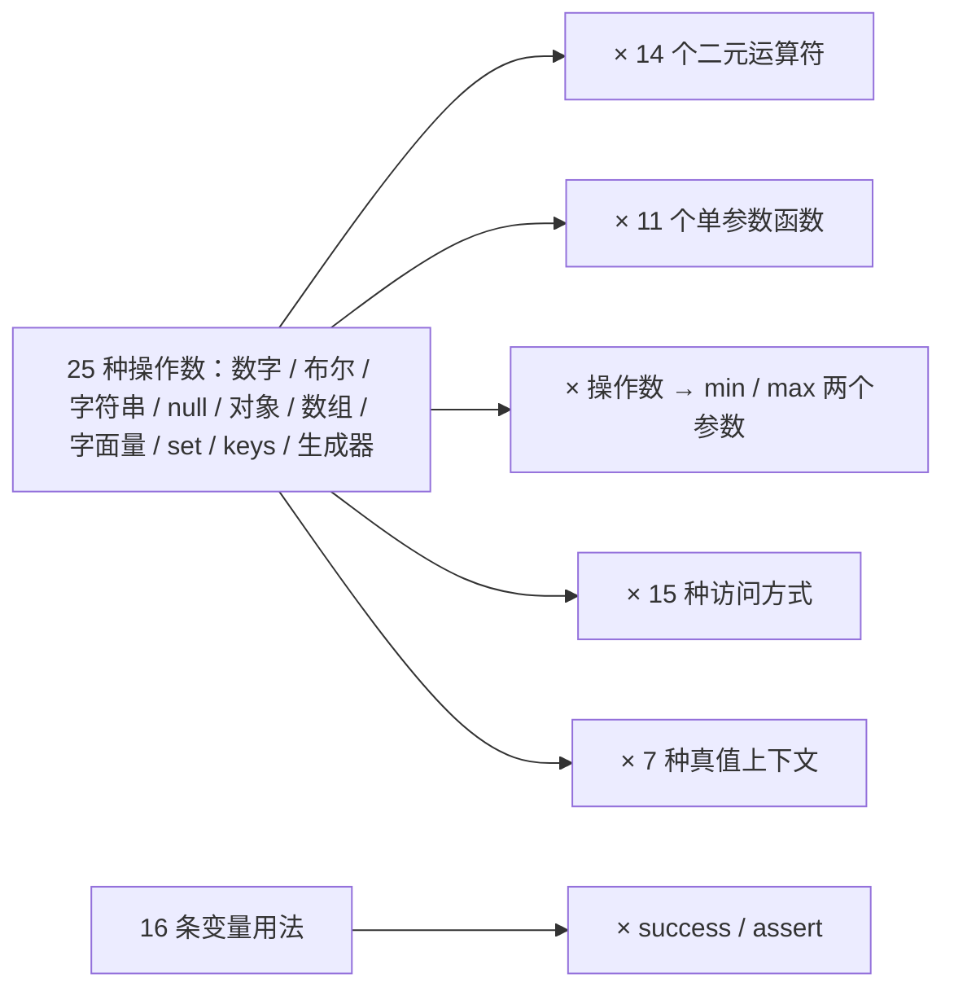
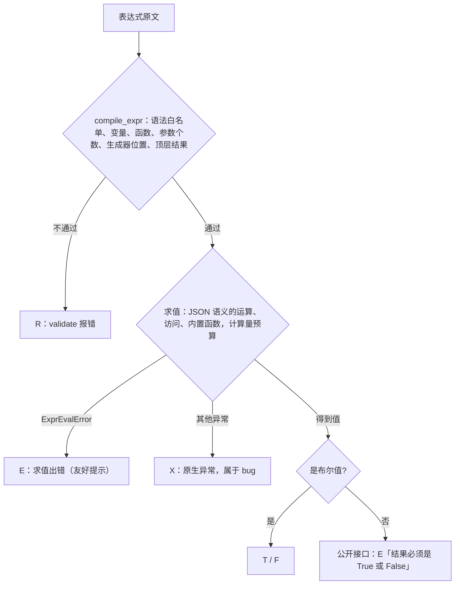

# 表达式组合表

> **本文件由 `scripts/gen_expr_combinations.py` 生成，不要手改。**
> 每个格子都是真正运行 `compile_expr` 和求值的结果。`tests/test_expr_combinations.py` 会重新生成并比较：
> 表达式行为一变，测试就失败。确认变化符合 spec §7.7 后，运行 `uv run python scripts/gen_expr_combinations.py`
> 更新本文件，并在 review 时逐格检查 `git diff`。加新的语法、函数或运算符时，先在脚本里加上对应的维度。
> 同一个测试还会检查一组不变量：`==` 对称、`==` 与 `!=` 互补、`in` 与 `not in` 互补、大小比较反对称、
> 字面量和同值字段结果一致、错误信息里没有 Python 原生异常和类型名。

## 怎么读

| 格子 | 含义 |
|---|---|
| `T` / `F` | 结果是 True / False |
| 其他文本 | 求值成功，结果的值（超过 24 个字符截断）；字符串带引号，集合写成 `{...}` |
| `E1`、`E2`… | 求值出错，具体信息见表下方。信息里本格操作数的类型名换成了占位符：`‹左›`、`‹右›` 是左右两边的类型，`‹X›` 是行里操作数的类型（访问方式一表不替换，因为那里的类型指下标）；所以同一个编号在不同格子里代表同一个模板 |
| `R1`、`R2`… | 编译（validate）阶段就拒绝，具体信息见表下方；位置信息（第几列）已去掉 |
| `X1`、`X2`… | 漏出了 Python 原生异常——**不应出现**，出现即是 bug |

编号只在一张表内有效。

## 组合维度

## 判定流程

## 操作数

| 代号 | 表达式 | 说明 |
|---|---|---|
| `i` | `body.i` | 整数 3 |
| `z` | `body.z` | 整数 0 |
| `3` | `3` | 整数字面量 |
| `d` | `body.d` | Decimal 1.50 |
| `di` | `body.di` | Decimal 整值 3.0 |
| `1.50` | `1.50` | 小数字面量（转成 Decimal） |
| `nan` | `body.nan` | NaN |
| `inf` | `body.inf` | Infinity |
| `status` | `status` | 状态码 200 |
| `t` | `body.t` | true |
| `f` | `body.f` | false |
| `s` | `body.s` | 字符串 "ab" |
| `es` | `body.es` | 空字符串 |
| `ns` | `body.ns` | 数字样子的字符串 "3" |
| `n` | `body.n` | null |
| `o` | `body.o` | 对象 {"k": 1} |
| `eo` | `body.eo` | 空对象 |
| `headers` | `headers` | 响应头 |
| `a` | `body.a` | 数组 [1, 2] |
| `ea` | `body.ea` | 空数组 |
| `[1,2]` | `[1, 2]` | 列表字面量 |
| `(1,2)` | `(1, 2)` | 元组字面量 |
| `set` | `set(body.a)` | 集合 |
| `keys` | `keys(body.o)` | keys() 的结果 |
| `gen` | `(x for x in body.a)` | 生成器 |

响应体 `{"i": 3, "z": 0, "di": 3.0, "d": 1.50, "t": true, "f": false, "s": "ab", "es": "", "ns": "3", "n": null, "o": {"k": 1}, "eo": {}, "a": [1, 2], "ea": [], "nan": NaN, "inf": Infinity}`；响应头 `Content-Type, X-K`；status 为 200。（解析后 `nan`、`inf`、`d`、`di` 是 Decimal：d=1.50, di=3.0, nan=NaN, inf=Infinity）

## 二元运算

表达式是 `行 运算符 列`，例如 `body.i + body.s`。

### `+`

| 左 ↓ ／ 右 → | `i` | `z` | `3` | `d` | `di` | `1.50` | `nan` | `inf` | `status` | `t` | `f` | `s` | `es` | `ns` | `n` | `o` | `eo` | `headers` | `a` | `ea` | `[1,2]` | `(1,2)` | `set` | `keys` | `gen` |
|---|---|---|---|---|---|---|---|---|---|---|---|---|---|---|---|---|---|---|---|---|---|---|---|---|---|
| **i** | 6 | 3 | 6 | 4.50 | 6.0 | 4.50 | NaN | Infinity | 203 | `E1` | `E1` | `E1` | `E1` | `E1` | `E1` | `E1` | `E1` | `E1` | `E1` | `E1` | `E1` | `E1` | `E1` | `E1` | `R1` |
| **z** | 3 | 0 | 3 | 1.50 | 3.0 | 1.50 | NaN | Infinity | 200 | `E1` | `E1` | `E1` | `E1` | `E1` | `E1` | `E1` | `E1` | `E1` | `E1` | `E1` | `E1` | `E1` | `E1` | `E1` | `R1` |
| **3** | 6 | 3 | 6 | 4.50 | 6.0 | 4.50 | NaN | Infinity | 203 | `E1` | `E1` | `E1` | `E1` | `E1` | `E1` | `E1` | `E1` | `E1` | `E1` | `E1` | `E1` | `E1` | `E1` | `E1` | `R1` |
| **d** | 4.50 | 1.50 | 4.50 | 3.00 | 4.50 | 3.00 | NaN | Infinity | 201.50 | `E1` | `E1` | `E1` | `E1` | `E1` | `E1` | `E1` | `E1` | `E1` | `E1` | `E1` | `E1` | `E1` | `E1` | `E1` | `R1` |
| **di** | 6.0 | 3.0 | 6.0 | 4.50 | 6.0 | 4.50 | NaN | Infinity | 203.0 | `E1` | `E1` | `E1` | `E1` | `E1` | `E1` | `E1` | `E1` | `E1` | `E1` | `E1` | `E1` | `E1` | `E1` | `E1` | `R1` |
| **1.50** | 4.50 | 1.50 | 4.50 | 3.00 | 4.50 | 3.00 | NaN | Infinity | 201.50 | `E1` | `E1` | `E1` | `E1` | `E1` | `E1` | `E1` | `E1` | `E1` | `E1` | `E1` | `E1` | `E1` | `E1` | `E1` | `R1` |
| **nan** | NaN | NaN | NaN | NaN | NaN | NaN | NaN | NaN | NaN | `E1` | `E1` | `E1` | `E1` | `E1` | `E1` | `E1` | `E1` | `E1` | `E1` | `E1` | `E1` | `E1` | `E1` | `E1` | `R1` |
| **inf** | Infinity | Infinity | Infinity | Infinity | Infinity | Infinity | NaN | Infinity | Infinity | `E1` | `E1` | `E1` | `E1` | `E1` | `E1` | `E1` | `E1` | `E1` | `E1` | `E1` | `E1` | `E1` | `E1` | `E1` | `R1` |
| **status** | 203 | 200 | 203 | 201.50 | 203.0 | 201.50 | NaN | Infinity | 400 | `E1` | `E1` | `E1` | `E1` | `E1` | `E1` | `E1` | `E1` | `E1` | `E1` | `E1` | `E1` | `E1` | `E1` | `E1` | `R1` |
| **t** | `E1` | `E1` | `E1` | `E1` | `E1` | `E1` | `E1` | `E1` | `E1` | `E1` | `E1` | `E1` | `E1` | `E1` | `E1` | `E1` | `E1` | `E1` | `E1` | `E1` | `E1` | `E1` | `E1` | `E1` | `R1` |
| **f** | `E1` | `E1` | `E1` | `E1` | `E1` | `E1` | `E1` | `E1` | `E1` | `E1` | `E1` | `E1` | `E1` | `E1` | `E1` | `E1` | `E1` | `E1` | `E1` | `E1` | `E1` | `E1` | `E1` | `E1` | `R1` |
| **s** | `E1` | `E1` | `E1` | `E1` | `E1` | `E1` | `E1` | `E1` | `E1` | `E1` | `E1` | "abab" | "ab" | "ab3" | `E1` | `E1` | `E1` | `E1` | `E1` | `E1` | `E1` | `E1` | `E1` | `E1` | `R1` |
| **es** | `E1` | `E1` | `E1` | `E1` | `E1` | `E1` | `E1` | `E1` | `E1` | `E1` | `E1` | "ab" | "" | "3" | `E1` | `E1` | `E1` | `E1` | `E1` | `E1` | `E1` | `E1` | `E1` | `E1` | `R1` |
| **ns** | `E1` | `E1` | `E1` | `E1` | `E1` | `E1` | `E1` | `E1` | `E1` | `E1` | `E1` | "3ab" | "3" | "33" | `E1` | `E1` | `E1` | `E1` | `E1` | `E1` | `E1` | `E1` | `E1` | `E1` | `R1` |
| **n** | `E1` | `E1` | `E1` | `E1` | `E1` | `E1` | `E1` | `E1` | `E1` | `E1` | `E1` | `E1` | `E1` | `E1` | `E1` | `E1` | `E1` | `E1` | `E1` | `E1` | `E1` | `E1` | `E1` | `E1` | `R1` |
| **o** | `E1` | `E1` | `E1` | `E1` | `E1` | `E1` | `E1` | `E1` | `E1` | `E1` | `E1` | `E1` | `E1` | `E1` | `E1` | `E1` | `E1` | `E1` | `E1` | `E1` | `E1` | `E1` | `E1` | `E1` | `R1` |
| **eo** | `E1` | `E1` | `E1` | `E1` | `E1` | `E1` | `E1` | `E1` | `E1` | `E1` | `E1` | `E1` | `E1` | `E1` | `E1` | `E1` | `E1` | `E1` | `E1` | `E1` | `E1` | `E1` | `E1` | `E1` | `R1` |
| **headers** | `E1` | `E1` | `E1` | `E1` | `E1` | `E1` | `E1` | `E1` | `E1` | `E1` | `E1` | `E1` | `E1` | `E1` | `E1` | `E1` | `E1` | `E1` | `E1` | `E1` | `E1` | `E1` | `E1` | `E1` | `R1` |
| **a** | `E1` | `E1` | `E1` | `E1` | `E1` | `E1` | `E1` | `E1` | `E1` | `E1` | `E1` | `E1` | `E1` | `E1` | `E1` | `E1` | `E1` | `E1` | [1, 2, 1, 2] | [1, 2] | [1, 2, 1, 2] | [1, 2, 1, 2] | `E1` | [1, 2, "k"] | `R1` |
| **ea** | `E1` | `E1` | `E1` | `E1` | `E1` | `E1` | `E1` | `E1` | `E1` | `E1` | `E1` | `E1` | `E1` | `E1` | `E1` | `E1` | `E1` | `E1` | [1, 2] | [] | [1, 2] | [1, 2] | `E1` | ["k"] | `R1` |
| **[1,2]** | `E1` | `E1` | `E1` | `E1` | `E1` | `E1` | `E1` | `E1` | `E1` | `E1` | `E1` | `E1` | `E1` | `E1` | `E1` | `E1` | `E1` | `E1` | [1, 2, 1, 2] | [1, 2] | [1, 2, 1, 2] | [1, 2, 1, 2] | `E1` | [1, 2, "k"] | `R1` |
| **(1,2)** | `E1` | `E1` | `E1` | `E1` | `E1` | `E1` | `E1` | `E1` | `E1` | `E1` | `E1` | `E1` | `E1` | `E1` | `E1` | `E1` | `E1` | `E1` | [1, 2, 1, 2] | [1, 2] | [1, 2, 1, 2] | [1, 2, 1, 2] | `E1` | [1, 2, "k"] | `R1` |
| **set** | `E1` | `E1` | `E1` | `E1` | `E1` | `E1` | `E1` | `E1` | `E1` | `E1` | `E1` | `E1` | `E1` | `E1` | `E1` | `E1` | `E1` | `E1` | `E1` | `E1` | `E1` | `E1` | `E1` | `E1` | `R1` |
| **keys** | `E1` | `E1` | `E1` | `E1` | `E1` | `E1` | `E1` | `E1` | `E1` | `E1` | `E1` | `E1` | `E1` | `E1` | `E1` | `E1` | `E1` | `E1` | ["k", 1, 2] | ["k"] | ["k", 1, 2] | ["k", 1, 2] | `E1` | ["k", "k"] | `R1` |
| **gen** | `R1` | `R1` | `R1` | `R1` | `R1` | `R1` | `R1` | `R1` | `R1` | `R1` | `R1` | `R1` | `R1` | `R1` | `R1` | `R1` | `R1` | `R1` | `R1` | `R1` | `R1` | `R1` | `R1` | `R1` | `R1` |

- `E1`：+ 不能用于‹左›和‹右›
- `R1`：生成器只能作为 all / any / set / min / max 的唯一参数；需要列表请写成 [...]

### `-`

| 左 ↓ ／ 右 → | `i` | `z` | `3` | `d` | `di` | `1.50` | `nan` | `inf` | `status` | `t` | `f` | `s` | `es` | `ns` | `n` | `o` | `eo` | `headers` | `a` | `ea` | `[1,2]` | `(1,2)` | `set` | `keys` | `gen` |
|---|---|---|---|---|---|---|---|---|---|---|---|---|---|---|---|---|---|---|---|---|---|---|---|---|---|
| **i** | 0 | 3 | 0 | 1.50 | 0.0 | 1.50 | NaN | -Infinity | -197 | `E1` | `E1` | `E1` | `E1` | `E1` | `E1` | `E1` | `E1` | `E1` | `E1` | `E1` | `E1` | `E1` | `E1` | `E1` | `R1` |
| **z** | -3 | 0 | -3 | -1.50 | -3.0 | -1.50 | NaN | -Infinity | -200 | `E1` | `E1` | `E1` | `E1` | `E1` | `E1` | `E1` | `E1` | `E1` | `E1` | `E1` | `E1` | `E1` | `E1` | `E1` | `R1` |
| **3** | 0 | 3 | 0 | 1.50 | 0.0 | 1.50 | NaN | -Infinity | -197 | `E1` | `E1` | `E1` | `E1` | `E1` | `E1` | `E1` | `E1` | `E1` | `E1` | `E1` | `E1` | `E1` | `E1` | `E1` | `R1` |
| **d** | -1.50 | 1.50 | -1.50 | 0.00 | -1.50 | 0.00 | NaN | -Infinity | -198.50 | `E1` | `E1` | `E1` | `E1` | `E1` | `E1` | `E1` | `E1` | `E1` | `E1` | `E1` | `E1` | `E1` | `E1` | `E1` | `R1` |
| **di** | 0.0 | 3.0 | 0.0 | 1.50 | 0.0 | 1.50 | NaN | -Infinity | -197.0 | `E1` | `E1` | `E1` | `E1` | `E1` | `E1` | `E1` | `E1` | `E1` | `E1` | `E1` | `E1` | `E1` | `E1` | `E1` | `R1` |
| **1.50** | -1.50 | 1.50 | -1.50 | 0.00 | -1.50 | 0.00 | NaN | -Infinity | -198.50 | `E1` | `E1` | `E1` | `E1` | `E1` | `E1` | `E1` | `E1` | `E1` | `E1` | `E1` | `E1` | `E1` | `E1` | `E1` | `R1` |
| **nan** | NaN | NaN | NaN | NaN | NaN | NaN | NaN | NaN | NaN | `E1` | `E1` | `E1` | `E1` | `E1` | `E1` | `E1` | `E1` | `E1` | `E1` | `E1` | `E1` | `E1` | `E1` | `E1` | `R1` |
| **inf** | Infinity | Infinity | Infinity | Infinity | Infinity | Infinity | NaN | `E2` | Infinity | `E1` | `E1` | `E1` | `E1` | `E1` | `E1` | `E1` | `E1` | `E1` | `E1` | `E1` | `E1` | `E1` | `E1` | `E1` | `R1` |
| **status** | 197 | 200 | 197 | 198.50 | 197.0 | 198.50 | NaN | -Infinity | 0 | `E1` | `E1` | `E1` | `E1` | `E1` | `E1` | `E1` | `E1` | `E1` | `E1` | `E1` | `E1` | `E1` | `E1` | `E1` | `R1` |
| **t** | `E1` | `E1` | `E1` | `E1` | `E1` | `E1` | `E1` | `E1` | `E1` | `E1` | `E1` | `E1` | `E1` | `E1` | `E1` | `E1` | `E1` | `E1` | `E1` | `E1` | `E1` | `E1` | `E1` | `E1` | `R1` |
| **f** | `E1` | `E1` | `E1` | `E1` | `E1` | `E1` | `E1` | `E1` | `E1` | `E1` | `E1` | `E1` | `E1` | `E1` | `E1` | `E1` | `E1` | `E1` | `E1` | `E1` | `E1` | `E1` | `E1` | `E1` | `R1` |
| **s** | `E1` | `E1` | `E1` | `E1` | `E1` | `E1` | `E1` | `E1` | `E1` | `E1` | `E1` | `E1` | `E1` | `E1` | `E1` | `E1` | `E1` | `E1` | `E1` | `E1` | `E1` | `E1` | `E1` | `E1` | `R1` |
| **es** | `E1` | `E1` | `E1` | `E1` | `E1` | `E1` | `E1` | `E1` | `E1` | `E1` | `E1` | `E1` | `E1` | `E1` | `E1` | `E1` | `E1` | `E1` | `E1` | `E1` | `E1` | `E1` | `E1` | `E1` | `R1` |
| **ns** | `E1` | `E1` | `E1` | `E1` | `E1` | `E1` | `E1` | `E1` | `E1` | `E1` | `E1` | `E1` | `E1` | `E1` | `E1` | `E1` | `E1` | `E1` | `E1` | `E1` | `E1` | `E1` | `E1` | `E1` | `R1` |
| **n** | `E1` | `E1` | `E1` | `E1` | `E1` | `E1` | `E1` | `E1` | `E1` | `E1` | `E1` | `E1` | `E1` | `E1` | `E1` | `E1` | `E1` | `E1` | `E1` | `E1` | `E1` | `E1` | `E1` | `E1` | `R1` |
| **o** | `E1` | `E1` | `E1` | `E1` | `E1` | `E1` | `E1` | `E1` | `E1` | `E1` | `E1` | `E1` | `E1` | `E1` | `E1` | `E1` | `E1` | `E1` | `E1` | `E1` | `E1` | `E1` | `E1` | `E1` | `R1` |
| **eo** | `E1` | `E1` | `E1` | `E1` | `E1` | `E1` | `E1` | `E1` | `E1` | `E1` | `E1` | `E1` | `E1` | `E1` | `E1` | `E1` | `E1` | `E1` | `E1` | `E1` | `E1` | `E1` | `E1` | `E1` | `R1` |
| **headers** | `E1` | `E1` | `E1` | `E1` | `E1` | `E1` | `E1` | `E1` | `E1` | `E1` | `E1` | `E1` | `E1` | `E1` | `E1` | `E1` | `E1` | `E1` | `E1` | `E1` | `E1` | `E1` | `E1` | `E1` | `R1` |
| **a** | `E1` | `E1` | `E1` | `E1` | `E1` | `E1` | `E1` | `E1` | `E1` | `E1` | `E1` | `E1` | `E1` | `E1` | `E1` | `E1` | `E1` | `E1` | `E1` | `E1` | `E1` | `E1` | `E1` | `E1` | `R1` |
| **ea** | `E1` | `E1` | `E1` | `E1` | `E1` | `E1` | `E1` | `E1` | `E1` | `E1` | `E1` | `E1` | `E1` | `E1` | `E1` | `E1` | `E1` | `E1` | `E1` | `E1` | `E1` | `E1` | `E1` | `E1` | `R1` |
| **[1,2]** | `E1` | `E1` | `E1` | `E1` | `E1` | `E1` | `E1` | `E1` | `E1` | `E1` | `E1` | `E1` | `E1` | `E1` | `E1` | `E1` | `E1` | `E1` | `E1` | `E1` | `E1` | `E1` | `E1` | `E1` | `R1` |
| **(1,2)** | `E1` | `E1` | `E1` | `E1` | `E1` | `E1` | `E1` | `E1` | `E1` | `E1` | `E1` | `E1` | `E1` | `E1` | `E1` | `E1` | `E1` | `E1` | `E1` | `E1` | `E1` | `E1` | `E1` | `E1` | `R1` |
| **set** | `E1` | `E1` | `E1` | `E1` | `E1` | `E1` | `E1` | `E1` | `E1` | `E1` | `E1` | `E1` | `E1` | `E1` | `E1` | `E1` | `E1` | `E1` | `E1` | `E1` | `E1` | `E1` | {} | `E1` | `R1` |
| **keys** | `E1` | `E1` | `E1` | `E1` | `E1` | `E1` | `E1` | `E1` | `E1` | `E1` | `E1` | `E1` | `E1` | `E1` | `E1` | `E1` | `E1` | `E1` | `E1` | `E1` | `E1` | `E1` | `E1` | `E1` | `R1` |
| **gen** | `R1` | `R1` | `R1` | `R1` | `R1` | `R1` | `R1` | `R1` | `R1` | `R1` | `R1` | `R1` | `R1` | `R1` | `R1` | `R1` | `R1` | `R1` | `R1` | `R1` | `R1` | `R1` | `R1` | `R1` | `R1` |

- `E1`：- 只能用于数字，这里是‹左›和‹右›
- `E2`：-：数值运算没有意义（例如 Infinity - Infinity）
- `R1`：生成器只能作为 all / any / set / min / max 的唯一参数；需要列表请写成 [...]

### `*`

| 左 ↓ ／ 右 → | `i` | `z` | `3` | `d` | `di` | `1.50` | `nan` | `inf` | `status` | `t` | `f` | `s` | `es` | `ns` | `n` | `o` | `eo` | `headers` | `a` | `ea` | `[1,2]` | `(1,2)` | `set` | `keys` | `gen` |
|---|---|---|---|---|---|---|---|---|---|---|---|---|---|---|---|---|---|---|---|---|---|---|---|---|---|
| **i** | 9 | 0 | 9 | 4.50 | 9.0 | 4.50 | NaN | Infinity | 600 | `E1` | `E1` | `E1` | `E1` | `E1` | `E1` | `E1` | `E1` | `E1` | `E1` | `E1` | `E1` | `E1` | `E1` | `E1` | `R1` |
| **z** | 0 | 0 | 0 | 0.00 | 0.0 | 0.00 | NaN | `E2` | 0 | `E1` | `E1` | `E1` | `E1` | `E1` | `E1` | `E1` | `E1` | `E1` | `E1` | `E1` | `E1` | `E1` | `E1` | `E1` | `R1` |
| **3** | 9 | 0 | 9 | 4.50 | 9.0 | 4.50 | NaN | Infinity | 600 | `E1` | `E1` | `E1` | `E1` | `E1` | `E1` | `E1` | `E1` | `E1` | `E1` | `E1` | `E1` | `E1` | `E1` | `E1` | `R1` |
| **d** | 4.50 | 0.00 | 4.50 | 2.2500 | 4.500 | 2.2500 | NaN | Infinity | 300.00 | `E1` | `E1` | `E1` | `E1` | `E1` | `E1` | `E1` | `E1` | `E1` | `E1` | `E1` | `E1` | `E1` | `E1` | `E1` | `R1` |
| **di** | 9.0 | 0.0 | 9.0 | 4.500 | 9.00 | 4.500 | NaN | Infinity | 600.0 | `E1` | `E1` | `E1` | `E1` | `E1` | `E1` | `E1` | `E1` | `E1` | `E1` | `E1` | `E1` | `E1` | `E1` | `E1` | `R1` |
| **1.50** | 4.50 | 0.00 | 4.50 | 2.2500 | 4.500 | 2.2500 | NaN | Infinity | 300.00 | `E1` | `E1` | `E1` | `E1` | `E1` | `E1` | `E1` | `E1` | `E1` | `E1` | `E1` | `E1` | `E1` | `E1` | `E1` | `R1` |
| **nan** | NaN | NaN | NaN | NaN | NaN | NaN | NaN | NaN | NaN | `E1` | `E1` | `E1` | `E1` | `E1` | `E1` | `E1` | `E1` | `E1` | `E1` | `E1` | `E1` | `E1` | `E1` | `E1` | `R1` |
| **inf** | Infinity | `E2` | Infinity | Infinity | Infinity | Infinity | NaN | Infinity | Infinity | `E1` | `E1` | `E1` | `E1` | `E1` | `E1` | `E1` | `E1` | `E1` | `E1` | `E1` | `E1` | `E1` | `E1` | `E1` | `R1` |
| **status** | 600 | 0 | 600 | 300.00 | 600.0 | 300.00 | NaN | Infinity | 40000 | `E1` | `E1` | `E1` | `E1` | `E1` | `E1` | `E1` | `E1` | `E1` | `E1` | `E1` | `E1` | `E1` | `E1` | `E1` | `R1` |
| **t** | `E1` | `E1` | `E1` | `E1` | `E1` | `E1` | `E1` | `E1` | `E1` | `E1` | `E1` | `E1` | `E1` | `E1` | `E1` | `E1` | `E1` | `E1` | `E1` | `E1` | `E1` | `E1` | `E1` | `E1` | `R1` |
| **f** | `E1` | `E1` | `E1` | `E1` | `E1` | `E1` | `E1` | `E1` | `E1` | `E1` | `E1` | `E1` | `E1` | `E1` | `E1` | `E1` | `E1` | `E1` | `E1` | `E1` | `E1` | `E1` | `E1` | `E1` | `R1` |
| **s** | `E1` | `E1` | `E1` | `E1` | `E1` | `E1` | `E1` | `E1` | `E1` | `E1` | `E1` | `E1` | `E1` | `E1` | `E1` | `E1` | `E1` | `E1` | `E1` | `E1` | `E1` | `E1` | `E1` | `E1` | `R1` |
| **es** | `E1` | `E1` | `E1` | `E1` | `E1` | `E1` | `E1` | `E1` | `E1` | `E1` | `E1` | `E1` | `E1` | `E1` | `E1` | `E1` | `E1` | `E1` | `E1` | `E1` | `E1` | `E1` | `E1` | `E1` | `R1` |
| **ns** | `E1` | `E1` | `E1` | `E1` | `E1` | `E1` | `E1` | `E1` | `E1` | `E1` | `E1` | `E1` | `E1` | `E1` | `E1` | `E1` | `E1` | `E1` | `E1` | `E1` | `E1` | `E1` | `E1` | `E1` | `R1` |
| **n** | `E1` | `E1` | `E1` | `E1` | `E1` | `E1` | `E1` | `E1` | `E1` | `E1` | `E1` | `E1` | `E1` | `E1` | `E1` | `E1` | `E1` | `E1` | `E1` | `E1` | `E1` | `E1` | `E1` | `E1` | `R1` |
| **o** | `E1` | `E1` | `E1` | `E1` | `E1` | `E1` | `E1` | `E1` | `E1` | `E1` | `E1` | `E1` | `E1` | `E1` | `E1` | `E1` | `E1` | `E1` | `E1` | `E1` | `E1` | `E1` | `E1` | `E1` | `R1` |
| **eo** | `E1` | `E1` | `E1` | `E1` | `E1` | `E1` | `E1` | `E1` | `E1` | `E1` | `E1` | `E1` | `E1` | `E1` | `E1` | `E1` | `E1` | `E1` | `E1` | `E1` | `E1` | `E1` | `E1` | `E1` | `R1` |
| **headers** | `E1` | `E1` | `E1` | `E1` | `E1` | `E1` | `E1` | `E1` | `E1` | `E1` | `E1` | `E1` | `E1` | `E1` | `E1` | `E1` | `E1` | `E1` | `E1` | `E1` | `E1` | `E1` | `E1` | `E1` | `R1` |
| **a** | `E1` | `E1` | `E1` | `E1` | `E1` | `E1` | `E1` | `E1` | `E1` | `E1` | `E1` | `E1` | `E1` | `E1` | `E1` | `E1` | `E1` | `E1` | `E1` | `E1` | `E1` | `E1` | `E1` | `E1` | `R1` |
| **ea** | `E1` | `E1` | `E1` | `E1` | `E1` | `E1` | `E1` | `E1` | `E1` | `E1` | `E1` | `E1` | `E1` | `E1` | `E1` | `E1` | `E1` | `E1` | `E1` | `E1` | `E1` | `E1` | `E1` | `E1` | `R1` |
| **[1,2]** | `E1` | `E1` | `E1` | `E1` | `E1` | `E1` | `E1` | `E1` | `E1` | `E1` | `E1` | `E1` | `E1` | `E1` | `E1` | `E1` | `E1` | `E1` | `E1` | `E1` | `E1` | `E1` | `E1` | `E1` | `R1` |
| **(1,2)** | `E1` | `E1` | `E1` | `E1` | `E1` | `E1` | `E1` | `E1` | `E1` | `E1` | `E1` | `E1` | `E1` | `E1` | `E1` | `E1` | `E1` | `E1` | `E1` | `E1` | `E1` | `E1` | `E1` | `E1` | `R1` |
| **set** | `E1` | `E1` | `E1` | `E1` | `E1` | `E1` | `E1` | `E1` | `E1` | `E1` | `E1` | `E1` | `E1` | `E1` | `E1` | `E1` | `E1` | `E1` | `E1` | `E1` | `E1` | `E1` | `E1` | `E1` | `R1` |
| **keys** | `E1` | `E1` | `E1` | `E1` | `E1` | `E1` | `E1` | `E1` | `E1` | `E1` | `E1` | `E1` | `E1` | `E1` | `E1` | `E1` | `E1` | `E1` | `E1` | `E1` | `E1` | `E1` | `E1` | `E1` | `R1` |
| **gen** | `R1` | `R1` | `R1` | `R1` | `R1` | `R1` | `R1` | `R1` | `R1` | `R1` | `R1` | `R1` | `R1` | `R1` | `R1` | `R1` | `R1` | `R1` | `R1` | `R1` | `R1` | `R1` | `R1` | `R1` | `R1` |

- `E1`：* 只能用于数字，这里是‹左›和‹右›
- `E2`：*：数值运算没有意义（例如 Infinity - Infinity）
- `R1`：生成器只能作为 all / any / set / min / max 的唯一参数；需要列表请写成 [...]

### `/`

| 左 ↓ ／ 右 → | `i` | `z` | `3` | `d` | `di` | `1.50` | `nan` | `inf` | `status` | `t` | `f` | `s` | `es` | `ns` | `n` | `o` | `eo` | `headers` | `a` | `ea` | `[1,2]` | `(1,2)` | `set` | `keys` | `gen` |
|---|---|---|---|---|---|---|---|---|---|---|---|---|---|---|---|---|---|---|---|---|---|---|---|---|---|
| **i** | 1 | `E1` | 1 | 2 | 1 | 2 | NaN | 0E-1000048 | 0.015 | `E2` | `E2` | `E2` | `E2` | `E2` | `E2` | `E2` | `E2` | `E2` | `E2` | `E2` | `E2` | `E2` | `E2` | `E2` | `R1` |
| **z** | 0 | `E1` | 0 | 0E+2 | 0E+1 | 0E+2 | NaN | 0E-1000048 | 0 | `E2` | `E2` | `E2` | `E2` | `E2` | `E2` | `E2` | `E2` | `E2` | `E2` | `E2` | `E2` | `E2` | `E2` | `E2` | `R1` |
| **3** | 1 | `E1` | 1 | 2 | 1 | 2 | NaN | 0E-1000048 | 0.015 | `E2` | `E2` | `E2` | `E2` | `E2` | `E2` | `E2` | `E2` | `E2` | `E2` | `E2` | `E2` | `E2` | `E2` | `E2` | `R1` |
| **d** | 0.50 | `E1` | 0.50 | 1 | 0.5 | 1 | NaN | 0E-1000048 | 0.0075 | `E2` | `E2` | `E2` | `E2` | `E2` | `E2` | `E2` | `E2` | `E2` | `E2` | `E2` | `E2` | `E2` | `E2` | `E2` | `R1` |
| **di** | 1.0 | `E1` | 1.0 | 2 | 1 | 2 | NaN | 0E-1000048 | 0.015 | `E2` | `E2` | `E2` | `E2` | `E2` | `E2` | `E2` | `E2` | `E2` | `E2` | `E2` | `E2` | `E2` | `E2` | `E2` | `R1` |
| **1.50** | 0.50 | `E1` | 0.50 | 1 | 0.5 | 1 | NaN | 0E-1000048 | 0.0075 | `E2` | `E2` | `E2` | `E2` | `E2` | `E2` | `E2` | `E2` | `E2` | `E2` | `E2` | `E2` | `E2` | `E2` | `E2` | `R1` |
| **nan** | NaN | `E1` | NaN | NaN | NaN | NaN | NaN | NaN | NaN | `E2` | `E2` | `E2` | `E2` | `E2` | `E2` | `E2` | `E2` | `E2` | `E2` | `E2` | `E2` | `E2` | `E2` | `E2` | `R1` |
| **inf** | Infinity | `E1` | Infinity | Infinity | Infinity | Infinity | NaN | `E3` | Infinity | `E2` | `E2` | `E2` | `E2` | `E2` | `E2` | `E2` | `E2` | `E2` | `E2` | `E2` | `E2` | `E2` | `E2` | `E2` | `R1` |
| **status** | 66.66666666666666666666… | `E1` | 66.66666666666666666666… | 133.3333333333333333333… | 66.66666666666666666666… | 133.3333333333333333333… | NaN | 0E-1000048 | 1 | `E2` | `E2` | `E2` | `E2` | `E2` | `E2` | `E2` | `E2` | `E2` | `E2` | `E2` | `E2` | `E2` | `E2` | `E2` | `R1` |
| **t** | `E2` | `E2` | `E2` | `E2` | `E2` | `E2` | `E2` | `E2` | `E2` | `E2` | `E2` | `E2` | `E2` | `E2` | `E2` | `E2` | `E2` | `E2` | `E2` | `E2` | `E2` | `E2` | `E2` | `E2` | `R1` |
| **f** | `E2` | `E2` | `E2` | `E2` | `E2` | `E2` | `E2` | `E2` | `E2` | `E2` | `E2` | `E2` | `E2` | `E2` | `E2` | `E2` | `E2` | `E2` | `E2` | `E2` | `E2` | `E2` | `E2` | `E2` | `R1` |
| **s** | `E2` | `E2` | `E2` | `E2` | `E2` | `E2` | `E2` | `E2` | `E2` | `E2` | `E2` | `E2` | `E2` | `E2` | `E2` | `E2` | `E2` | `E2` | `E2` | `E2` | `E2` | `E2` | `E2` | `E2` | `R1` |
| **es** | `E2` | `E2` | `E2` | `E2` | `E2` | `E2` | `E2` | `E2` | `E2` | `E2` | `E2` | `E2` | `E2` | `E2` | `E2` | `E2` | `E2` | `E2` | `E2` | `E2` | `E2` | `E2` | `E2` | `E2` | `R1` |
| **ns** | `E2` | `E2` | `E2` | `E2` | `E2` | `E2` | `E2` | `E2` | `E2` | `E2` | `E2` | `E2` | `E2` | `E2` | `E2` | `E2` | `E2` | `E2` | `E2` | `E2` | `E2` | `E2` | `E2` | `E2` | `R1` |
| **n** | `E2` | `E2` | `E2` | `E2` | `E2` | `E2` | `E2` | `E2` | `E2` | `E2` | `E2` | `E2` | `E2` | `E2` | `E2` | `E2` | `E2` | `E2` | `E2` | `E2` | `E2` | `E2` | `E2` | `E2` | `R1` |
| **o** | `E2` | `E2` | `E2` | `E2` | `E2` | `E2` | `E2` | `E2` | `E2` | `E2` | `E2` | `E2` | `E2` | `E2` | `E2` | `E2` | `E2` | `E2` | `E2` | `E2` | `E2` | `E2` | `E2` | `E2` | `R1` |
| **eo** | `E2` | `E2` | `E2` | `E2` | `E2` | `E2` | `E2` | `E2` | `E2` | `E2` | `E2` | `E2` | `E2` | `E2` | `E2` | `E2` | `E2` | `E2` | `E2` | `E2` | `E2` | `E2` | `E2` | `E2` | `R1` |
| **headers** | `E2` | `E2` | `E2` | `E2` | `E2` | `E2` | `E2` | `E2` | `E2` | `E2` | `E2` | `E2` | `E2` | `E2` | `E2` | `E2` | `E2` | `E2` | `E2` | `E2` | `E2` | `E2` | `E2` | `E2` | `R1` |
| **a** | `E2` | `E2` | `E2` | `E2` | `E2` | `E2` | `E2` | `E2` | `E2` | `E2` | `E2` | `E2` | `E2` | `E2` | `E2` | `E2` | `E2` | `E2` | `E2` | `E2` | `E2` | `E2` | `E2` | `E2` | `R1` |
| **ea** | `E2` | `E2` | `E2` | `E2` | `E2` | `E2` | `E2` | `E2` | `E2` | `E2` | `E2` | `E2` | `E2` | `E2` | `E2` | `E2` | `E2` | `E2` | `E2` | `E2` | `E2` | `E2` | `E2` | `E2` | `R1` |
| **[1,2]** | `E2` | `E2` | `E2` | `E2` | `E2` | `E2` | `E2` | `E2` | `E2` | `E2` | `E2` | `E2` | `E2` | `E2` | `E2` | `E2` | `E2` | `E2` | `E2` | `E2` | `E2` | `E2` | `E2` | `E2` | `R1` |
| **(1,2)** | `E2` | `E2` | `E2` | `E2` | `E2` | `E2` | `E2` | `E2` | `E2` | `E2` | `E2` | `E2` | `E2` | `E2` | `E2` | `E2` | `E2` | `E2` | `E2` | `E2` | `E2` | `E2` | `E2` | `E2` | `R1` |
| **set** | `E2` | `E2` | `E2` | `E2` | `E2` | `E2` | `E2` | `E2` | `E2` | `E2` | `E2` | `E2` | `E2` | `E2` | `E2` | `E2` | `E2` | `E2` | `E2` | `E2` | `E2` | `E2` | `E2` | `E2` | `R1` |
| **keys** | `E2` | `E2` | `E2` | `E2` | `E2` | `E2` | `E2` | `E2` | `E2` | `E2` | `E2` | `E2` | `E2` | `E2` | `E2` | `E2` | `E2` | `E2` | `E2` | `E2` | `E2` | `E2` | `E2` | `E2` | `R1` |
| **gen** | `R1` | `R1` | `R1` | `R1` | `R1` | `R1` | `R1` | `R1` | `R1` | `R1` | `R1` | `R1` | `R1` | `R1` | `R1` | `R1` | `R1` | `R1` | `R1` | `R1` | `R1` | `R1` | `R1` | `R1` | `R1` |

- `E1`：除数为 0
- `E2`：/ 只能用于数字，这里是‹左›和‹右›
- `E3`：/：数值运算没有意义（例如 Infinity - Infinity）
- `R1`：生成器只能作为 all / any / set / min / max 的唯一参数；需要列表请写成 [...]

### `//`

| 左 ↓ ／ 右 → | `i` | `z` | `3` | `d` | `di` | `1.50` | `nan` | `inf` | `status` | `t` | `f` | `s` | `es` | `ns` | `n` | `o` | `eo` | `headers` | `a` | `ea` | `[1,2]` | `(1,2)` | `set` | `keys` | `gen` |
|---|---|---|---|---|---|---|---|---|---|---|---|---|---|---|---|---|---|---|---|---|---|---|---|---|---|
| **i** | 1 | `E1` | 1 | 2 | 1 | 2 | NaN | 0 | 0 | `E2` | `E2` | `E2` | `E2` | `E2` | `E2` | `E2` | `E2` | `E2` | `E2` | `E2` | `E2` | `E2` | `E2` | `E2` | `R1` |
| **z** | 0 | `E1` | 0 | 0 | 0 | 0 | NaN | 0 | 0 | `E2` | `E2` | `E2` | `E2` | `E2` | `E2` | `E2` | `E2` | `E2` | `E2` | `E2` | `E2` | `E2` | `E2` | `E2` | `R1` |
| **3** | 1 | `E1` | 1 | 2 | 1 | 2 | NaN | 0 | 0 | `E2` | `E2` | `E2` | `E2` | `E2` | `E2` | `E2` | `E2` | `E2` | `E2` | `E2` | `E2` | `E2` | `E2` | `E2` | `R1` |
| **d** | 0 | `E1` | 0 | 1 | 0 | 1 | NaN | 0 | 0 | `E2` | `E2` | `E2` | `E2` | `E2` | `E2` | `E2` | `E2` | `E2` | `E2` | `E2` | `E2` | `E2` | `E2` | `E2` | `R1` |
| **di** | 1 | `E1` | 1 | 2 | 1 | 2 | NaN | 0 | 0 | `E2` | `E2` | `E2` | `E2` | `E2` | `E2` | `E2` | `E2` | `E2` | `E2` | `E2` | `E2` | `E2` | `E2` | `E2` | `R1` |
| **1.50** | 0 | `E1` | 0 | 1 | 0 | 1 | NaN | 0 | 0 | `E2` | `E2` | `E2` | `E2` | `E2` | `E2` | `E2` | `E2` | `E2` | `E2` | `E2` | `E2` | `E2` | `E2` | `E2` | `R1` |
| **nan** | NaN | `E1` | NaN | NaN | NaN | NaN | NaN | NaN | NaN | `E2` | `E2` | `E2` | `E2` | `E2` | `E2` | `E2` | `E2` | `E2` | `E2` | `E2` | `E2` | `E2` | `E2` | `E2` | `R1` |
| **inf** | Infinity | `E1` | Infinity | Infinity | Infinity | Infinity | NaN | `E3` | Infinity | `E2` | `E2` | `E2` | `E2` | `E2` | `E2` | `E2` | `E2` | `E2` | `E2` | `E2` | `E2` | `E2` | `E2` | `E2` | `R1` |
| **status** | 66 | `E1` | 66 | 133 | 66 | 133 | NaN | 0 | 1 | `E2` | `E2` | `E2` | `E2` | `E2` | `E2` | `E2` | `E2` | `E2` | `E2` | `E2` | `E2` | `E2` | `E2` | `E2` | `R1` |
| **t** | `E2` | `E2` | `E2` | `E2` | `E2` | `E2` | `E2` | `E2` | `E2` | `E2` | `E2` | `E2` | `E2` | `E2` | `E2` | `E2` | `E2` | `E2` | `E2` | `E2` | `E2` | `E2` | `E2` | `E2` | `R1` |
| **f** | `E2` | `E2` | `E2` | `E2` | `E2` | `E2` | `E2` | `E2` | `E2` | `E2` | `E2` | `E2` | `E2` | `E2` | `E2` | `E2` | `E2` | `E2` | `E2` | `E2` | `E2` | `E2` | `E2` | `E2` | `R1` |
| **s** | `E2` | `E2` | `E2` | `E2` | `E2` | `E2` | `E2` | `E2` | `E2` | `E2` | `E2` | `E2` | `E2` | `E2` | `E2` | `E2` | `E2` | `E2` | `E2` | `E2` | `E2` | `E2` | `E2` | `E2` | `R1` |
| **es** | `E2` | `E2` | `E2` | `E2` | `E2` | `E2` | `E2` | `E2` | `E2` | `E2` | `E2` | `E2` | `E2` | `E2` | `E2` | `E2` | `E2` | `E2` | `E2` | `E2` | `E2` | `E2` | `E2` | `E2` | `R1` |
| **ns** | `E2` | `E2` | `E2` | `E2` | `E2` | `E2` | `E2` | `E2` | `E2` | `E2` | `E2` | `E2` | `E2` | `E2` | `E2` | `E2` | `E2` | `E2` | `E2` | `E2` | `E2` | `E2` | `E2` | `E2` | `R1` |
| **n** | `E2` | `E2` | `E2` | `E2` | `E2` | `E2` | `E2` | `E2` | `E2` | `E2` | `E2` | `E2` | `E2` | `E2` | `E2` | `E2` | `E2` | `E2` | `E2` | `E2` | `E2` | `E2` | `E2` | `E2` | `R1` |
| **o** | `E2` | `E2` | `E2` | `E2` | `E2` | `E2` | `E2` | `E2` | `E2` | `E2` | `E2` | `E2` | `E2` | `E2` | `E2` | `E2` | `E2` | `E2` | `E2` | `E2` | `E2` | `E2` | `E2` | `E2` | `R1` |
| **eo** | `E2` | `E2` | `E2` | `E2` | `E2` | `E2` | `E2` | `E2` | `E2` | `E2` | `E2` | `E2` | `E2` | `E2` | `E2` | `E2` | `E2` | `E2` | `E2` | `E2` | `E2` | `E2` | `E2` | `E2` | `R1` |
| **headers** | `E2` | `E2` | `E2` | `E2` | `E2` | `E2` | `E2` | `E2` | `E2` | `E2` | `E2` | `E2` | `E2` | `E2` | `E2` | `E2` | `E2` | `E2` | `E2` | `E2` | `E2` | `E2` | `E2` | `E2` | `R1` |
| **a** | `E2` | `E2` | `E2` | `E2` | `E2` | `E2` | `E2` | `E2` | `E2` | `E2` | `E2` | `E2` | `E2` | `E2` | `E2` | `E2` | `E2` | `E2` | `E2` | `E2` | `E2` | `E2` | `E2` | `E2` | `R1` |
| **ea** | `E2` | `E2` | `E2` | `E2` | `E2` | `E2` | `E2` | `E2` | `E2` | `E2` | `E2` | `E2` | `E2` | `E2` | `E2` | `E2` | `E2` | `E2` | `E2` | `E2` | `E2` | `E2` | `E2` | `E2` | `R1` |
| **[1,2]** | `E2` | `E2` | `E2` | `E2` | `E2` | `E2` | `E2` | `E2` | `E2` | `E2` | `E2` | `E2` | `E2` | `E2` | `E2` | `E2` | `E2` | `E2` | `E2` | `E2` | `E2` | `E2` | `E2` | `E2` | `R1` |
| **(1,2)** | `E2` | `E2` | `E2` | `E2` | `E2` | `E2` | `E2` | `E2` | `E2` | `E2` | `E2` | `E2` | `E2` | `E2` | `E2` | `E2` | `E2` | `E2` | `E2` | `E2` | `E2` | `E2` | `E2` | `E2` | `R1` |
| **set** | `E2` | `E2` | `E2` | `E2` | `E2` | `E2` | `E2` | `E2` | `E2` | `E2` | `E2` | `E2` | `E2` | `E2` | `E2` | `E2` | `E2` | `E2` | `E2` | `E2` | `E2` | `E2` | `E2` | `E2` | `R1` |
| **keys** | `E2` | `E2` | `E2` | `E2` | `E2` | `E2` | `E2` | `E2` | `E2` | `E2` | `E2` | `E2` | `E2` | `E2` | `E2` | `E2` | `E2` | `E2` | `E2` | `E2` | `E2` | `E2` | `E2` | `E2` | `R1` |
| **gen** | `R1` | `R1` | `R1` | `R1` | `R1` | `R1` | `R1` | `R1` | `R1` | `R1` | `R1` | `R1` | `R1` | `R1` | `R1` | `R1` | `R1` | `R1` | `R1` | `R1` | `R1` | `R1` | `R1` | `R1` | `R1` |

- `E1`：除数为 0
- `E2`：// 只能用于数字，这里是‹左›和‹右›
- `E3`：//：数值运算没有意义（例如 Infinity - Infinity）
- `R1`：生成器只能作为 all / any / set / min / max 的唯一参数；需要列表请写成 [...]

### `%`

| 左 ↓ ／ 右 → | `i` | `z` | `3` | `d` | `di` | `1.50` | `nan` | `inf` | `status` | `t` | `f` | `s` | `es` | `ns` | `n` | `o` | `eo` | `headers` | `a` | `ea` | `[1,2]` | `(1,2)` | `set` | `keys` | `gen` |
|---|---|---|---|---|---|---|---|---|---|---|---|---|---|---|---|---|---|---|---|---|---|---|---|---|---|
| **i** | 0 | `E1` | 0 | 0.00 | 0.0 | 0.00 | NaN | 3 | 3 | `E2` | `E2` | `E2` | `E2` | `E2` | `E2` | `E2` | `E2` | `E2` | `E2` | `E2` | `E2` | `E2` | `E2` | `E2` | `R1` |
| **z** | 0 | `E1` | 0 | 0.00 | 0.0 | 0.00 | NaN | 0 | 0 | `E2` | `E2` | `E2` | `E2` | `E2` | `E2` | `E2` | `E2` | `E2` | `E2` | `E2` | `E2` | `E2` | `E2` | `E2` | `R1` |
| **3** | 0 | `E1` | 0 | 0.00 | 0.0 | 0.00 | NaN | 3 | 3 | `E2` | `E2` | `E2` | `E2` | `E2` | `E2` | `E2` | `E2` | `E2` | `E2` | `E2` | `E2` | `E2` | `E2` | `E2` | `R1` |
| **d** | 1.50 | `E1` | 1.50 | 0.00 | 1.50 | 0.00 | NaN | 1.50 | 1.50 | `E2` | `E2` | `E2` | `E2` | `E2` | `E2` | `E2` | `E2` | `E2` | `E2` | `E2` | `E2` | `E2` | `E2` | `E2` | `R1` |
| **di** | 0.0 | `E1` | 0.0 | 0.00 | 0.0 | 0.00 | NaN | 3.0 | 3.0 | `E2` | `E2` | `E2` | `E2` | `E2` | `E2` | `E2` | `E2` | `E2` | `E2` | `E2` | `E2` | `E2` | `E2` | `E2` | `R1` |
| **1.50** | 1.50 | `E1` | 1.50 | 0.00 | 1.50 | 0.00 | NaN | 1.50 | 1.50 | `E2` | `E2` | `E2` | `E2` | `E2` | `E2` | `E2` | `E2` | `E2` | `E2` | `E2` | `E2` | `E2` | `E2` | `E2` | `R1` |
| **nan** | NaN | `E1` | NaN | NaN | NaN | NaN | NaN | NaN | NaN | `E2` | `E2` | `E2` | `E2` | `E2` | `E2` | `E2` | `E2` | `E2` | `E2` | `E2` | `E2` | `E2` | `E2` | `E2` | `R1` |
| **inf** | `E3` | `E1` | `E3` | `E3` | `E3` | `E3` | NaN | `E3` | `E3` | `E2` | `E2` | `E2` | `E2` | `E2` | `E2` | `E2` | `E2` | `E2` | `E2` | `E2` | `E2` | `E2` | `E2` | `E2` | `R1` |
| **status** | 2 | `E1` | 2 | 0.50 | 2.0 | 0.50 | NaN | 200 | 0 | `E2` | `E2` | `E2` | `E2` | `E2` | `E2` | `E2` | `E2` | `E2` | `E2` | `E2` | `E2` | `E2` | `E2` | `E2` | `R1` |
| **t** | `E2` | `E2` | `E2` | `E2` | `E2` | `E2` | `E2` | `E2` | `E2` | `E2` | `E2` | `E2` | `E2` | `E2` | `E2` | `E2` | `E2` | `E2` | `E2` | `E2` | `E2` | `E2` | `E2` | `E2` | `R1` |
| **f** | `E2` | `E2` | `E2` | `E2` | `E2` | `E2` | `E2` | `E2` | `E2` | `E2` | `E2` | `E2` | `E2` | `E2` | `E2` | `E2` | `E2` | `E2` | `E2` | `E2` | `E2` | `E2` | `E2` | `E2` | `R1` |
| **s** | `E2` | `E2` | `E2` | `E2` | `E2` | `E2` | `E2` | `E2` | `E2` | `E2` | `E2` | `E2` | `E2` | `E2` | `E2` | `E2` | `E2` | `E2` | `E2` | `E2` | `E2` | `E2` | `E2` | `E2` | `R1` |
| **es** | `E2` | `E2` | `E2` | `E2` | `E2` | `E2` | `E2` | `E2` | `E2` | `E2` | `E2` | `E2` | `E2` | `E2` | `E2` | `E2` | `E2` | `E2` | `E2` | `E2` | `E2` | `E2` | `E2` | `E2` | `R1` |
| **ns** | `E2` | `E2` | `E2` | `E2` | `E2` | `E2` | `E2` | `E2` | `E2` | `E2` | `E2` | `E2` | `E2` | `E2` | `E2` | `E2` | `E2` | `E2` | `E2` | `E2` | `E2` | `E2` | `E2` | `E2` | `R1` |
| **n** | `E2` | `E2` | `E2` | `E2` | `E2` | `E2` | `E2` | `E2` | `E2` | `E2` | `E2` | `E2` | `E2` | `E2` | `E2` | `E2` | `E2` | `E2` | `E2` | `E2` | `E2` | `E2` | `E2` | `E2` | `R1` |
| **o** | `E2` | `E2` | `E2` | `E2` | `E2` | `E2` | `E2` | `E2` | `E2` | `E2` | `E2` | `E2` | `E2` | `E2` | `E2` | `E2` | `E2` | `E2` | `E2` | `E2` | `E2` | `E2` | `E2` | `E2` | `R1` |
| **eo** | `E2` | `E2` | `E2` | `E2` | `E2` | `E2` | `E2` | `E2` | `E2` | `E2` | `E2` | `E2` | `E2` | `E2` | `E2` | `E2` | `E2` | `E2` | `E2` | `E2` | `E2` | `E2` | `E2` | `E2` | `R1` |
| **headers** | `E2` | `E2` | `E2` | `E2` | `E2` | `E2` | `E2` | `E2` | `E2` | `E2` | `E2` | `E2` | `E2` | `E2` | `E2` | `E2` | `E2` | `E2` | `E2` | `E2` | `E2` | `E2` | `E2` | `E2` | `R1` |
| **a** | `E2` | `E2` | `E2` | `E2` | `E2` | `E2` | `E2` | `E2` | `E2` | `E2` | `E2` | `E2` | `E2` | `E2` | `E2` | `E2` | `E2` | `E2` | `E2` | `E2` | `E2` | `E2` | `E2` | `E2` | `R1` |
| **ea** | `E2` | `E2` | `E2` | `E2` | `E2` | `E2` | `E2` | `E2` | `E2` | `E2` | `E2` | `E2` | `E2` | `E2` | `E2` | `E2` | `E2` | `E2` | `E2` | `E2` | `E2` | `E2` | `E2` | `E2` | `R1` |
| **[1,2]** | `E2` | `E2` | `E2` | `E2` | `E2` | `E2` | `E2` | `E2` | `E2` | `E2` | `E2` | `E2` | `E2` | `E2` | `E2` | `E2` | `E2` | `E2` | `E2` | `E2` | `E2` | `E2` | `E2` | `E2` | `R1` |
| **(1,2)** | `E2` | `E2` | `E2` | `E2` | `E2` | `E2` | `E2` | `E2` | `E2` | `E2` | `E2` | `E2` | `E2` | `E2` | `E2` | `E2` | `E2` | `E2` | `E2` | `E2` | `E2` | `E2` | `E2` | `E2` | `R1` |
| **set** | `E2` | `E2` | `E2` | `E2` | `E2` | `E2` | `E2` | `E2` | `E2` | `E2` | `E2` | `E2` | `E2` | `E2` | `E2` | `E2` | `E2` | `E2` | `E2` | `E2` | `E2` | `E2` | `E2` | `E2` | `R1` |
| **keys** | `E2` | `E2` | `E2` | `E2` | `E2` | `E2` | `E2` | `E2` | `E2` | `E2` | `E2` | `E2` | `E2` | `E2` | `E2` | `E2` | `E2` | `E2` | `E2` | `E2` | `E2` | `E2` | `E2` | `E2` | `R1` |
| **gen** | `R1` | `R1` | `R1` | `R1` | `R1` | `R1` | `R1` | `R1` | `R1` | `R1` | `R1` | `R1` | `R1` | `R1` | `R1` | `R1` | `R1` | `R1` | `R1` | `R1` | `R1` | `R1` | `R1` | `R1` | `R1` |

- `E1`：除数为 0
- `E2`：% 只能用于数字，这里是‹左›和‹右›
- `E3`：%：数值运算没有意义（例如 Infinity - Infinity）
- `R1`：生成器只能作为 all / any / set / min / max 的唯一参数；需要列表请写成 [...]

### `==`

| 左 ↓ ／ 右 → | `i` | `z` | `3` | `d` | `di` | `1.50` | `nan` | `inf` | `status` | `t` | `f` | `s` | `es` | `ns` | `n` | `o` | `eo` | `headers` | `a` | `ea` | `[1,2]` | `(1,2)` | `set` | `keys` | `gen` |
|---|---|---|---|---|---|---|---|---|---|---|---|---|---|---|---|---|---|---|---|---|---|---|---|---|---|
| **i** | T | F | T | F | T | F | F | F | F | F | F | F | F | F | F | F | F | F | F | F | F | F | F | F | `R1` |
| **z** | F | T | F | F | F | F | F | F | F | F | F | F | F | F | F | F | F | F | F | F | F | F | F | F | `R1` |
| **3** | T | F | T | F | T | F | F | F | F | F | F | F | F | F | F | F | F | F | F | F | F | F | F | F | `R1` |
| **d** | F | F | F | T | F | T | F | F | F | F | F | F | F | F | F | F | F | F | F | F | F | F | F | F | `R1` |
| **di** | T | F | T | F | T | F | F | F | F | F | F | F | F | F | F | F | F | F | F | F | F | F | F | F | `R1` |
| **1.50** | F | F | F | T | F | T | F | F | F | F | F | F | F | F | F | F | F | F | F | F | F | F | F | F | `R1` |
| **nan** | F | F | F | F | F | F | F | F | F | F | F | F | F | F | F | F | F | F | F | F | F | F | F | F | `R1` |
| **inf** | F | F | F | F | F | F | F | T | F | F | F | F | F | F | F | F | F | F | F | F | F | F | F | F | `R1` |
| **status** | F | F | F | F | F | F | F | F | T | F | F | F | F | F | F | F | F | F | F | F | F | F | F | F | `R1` |
| **t** | F | F | F | F | F | F | F | F | F | T | F | F | F | F | F | F | F | F | F | F | F | F | F | F | `R1` |
| **f** | F | F | F | F | F | F | F | F | F | F | T | F | F | F | F | F | F | F | F | F | F | F | F | F | `R1` |
| **s** | F | F | F | F | F | F | F | F | F | F | F | T | F | F | F | F | F | F | F | F | F | F | F | F | `R1` |
| **es** | F | F | F | F | F | F | F | F | F | F | F | F | T | F | F | F | F | F | F | F | F | F | F | F | `R1` |
| **ns** | F | F | F | F | F | F | F | F | F | F | F | F | F | T | F | F | F | F | F | F | F | F | F | F | `R1` |
| **n** | F | F | F | F | F | F | F | F | F | F | F | F | F | F | T | F | F | F | F | F | F | F | F | F | `R1` |
| **o** | F | F | F | F | F | F | F | F | F | F | F | F | F | F | F | T | F | F | F | F | F | F | F | F | `R1` |
| **eo** | F | F | F | F | F | F | F | F | F | F | F | F | F | F | F | F | T | F | F | F | F | F | F | F | `R1` |
| **headers** | F | F | F | F | F | F | F | F | F | F | F | F | F | F | F | F | F | T | F | F | F | F | F | F | `R1` |
| **a** | F | F | F | F | F | F | F | F | F | F | F | F | F | F | F | F | F | F | T | F | T | T | F | F | `R1` |
| **ea** | F | F | F | F | F | F | F | F | F | F | F | F | F | F | F | F | F | F | F | T | F | F | F | F | `R1` |
| **[1,2]** | F | F | F | F | F | F | F | F | F | F | F | F | F | F | F | F | F | F | T | F | T | T | F | F | `R1` |
| **(1,2)** | F | F | F | F | F | F | F | F | F | F | F | F | F | F | F | F | F | F | T | F | T | T | F | F | `R1` |
| **set** | F | F | F | F | F | F | F | F | F | F | F | F | F | F | F | F | F | F | F | F | F | F | T | F | `R1` |
| **keys** | F | F | F | F | F | F | F | F | F | F | F | F | F | F | F | F | F | F | F | F | F | F | F | T | `R1` |
| **gen** | `R1` | `R1` | `R1` | `R1` | `R1` | `R1` | `R1` | `R1` | `R1` | `R1` | `R1` | `R1` | `R1` | `R1` | `R1` | `R1` | `R1` | `R1` | `R1` | `R1` | `R1` | `R1` | `R1` | `R1` | `R1` |

- `R1`：生成器只能作为 all / any / set / min / max 的唯一参数；需要列表请写成 [...]

### `!=`

| 左 ↓ ／ 右 → | `i` | `z` | `3` | `d` | `di` | `1.50` | `nan` | `inf` | `status` | `t` | `f` | `s` | `es` | `ns` | `n` | `o` | `eo` | `headers` | `a` | `ea` | `[1,2]` | `(1,2)` | `set` | `keys` | `gen` |
|---|---|---|---|---|---|---|---|---|---|---|---|---|---|---|---|---|---|---|---|---|---|---|---|---|---|
| **i** | F | T | F | T | F | T | T | T | T | T | T | T | T | T | T | T | T | T | T | T | T | T | T | T | `R1` |
| **z** | T | F | T | T | T | T | T | T | T | T | T | T | T | T | T | T | T | T | T | T | T | T | T | T | `R1` |
| **3** | F | T | F | T | F | T | T | T | T | T | T | T | T | T | T | T | T | T | T | T | T | T | T | T | `R1` |
| **d** | T | T | T | F | T | F | T | T | T | T | T | T | T | T | T | T | T | T | T | T | T | T | T | T | `R1` |
| **di** | F | T | F | T | F | T | T | T | T | T | T | T | T | T | T | T | T | T | T | T | T | T | T | T | `R1` |
| **1.50** | T | T | T | F | T | F | T | T | T | T | T | T | T | T | T | T | T | T | T | T | T | T | T | T | `R1` |
| **nan** | T | T | T | T | T | T | T | T | T | T | T | T | T | T | T | T | T | T | T | T | T | T | T | T | `R1` |
| **inf** | T | T | T | T | T | T | T | F | T | T | T | T | T | T | T | T | T | T | T | T | T | T | T | T | `R1` |
| **status** | T | T | T | T | T | T | T | T | F | T | T | T | T | T | T | T | T | T | T | T | T | T | T | T | `R1` |
| **t** | T | T | T | T | T | T | T | T | T | F | T | T | T | T | T | T | T | T | T | T | T | T | T | T | `R1` |
| **f** | T | T | T | T | T | T | T | T | T | T | F | T | T | T | T | T | T | T | T | T | T | T | T | T | `R1` |
| **s** | T | T | T | T | T | T | T | T | T | T | T | F | T | T | T | T | T | T | T | T | T | T | T | T | `R1` |
| **es** | T | T | T | T | T | T | T | T | T | T | T | T | F | T | T | T | T | T | T | T | T | T | T | T | `R1` |
| **ns** | T | T | T | T | T | T | T | T | T | T | T | T | T | F | T | T | T | T | T | T | T | T | T | T | `R1` |
| **n** | T | T | T | T | T | T | T | T | T | T | T | T | T | T | F | T | T | T | T | T | T | T | T | T | `R1` |
| **o** | T | T | T | T | T | T | T | T | T | T | T | T | T | T | T | F | T | T | T | T | T | T | T | T | `R1` |
| **eo** | T | T | T | T | T | T | T | T | T | T | T | T | T | T | T | T | F | T | T | T | T | T | T | T | `R1` |
| **headers** | T | T | T | T | T | T | T | T | T | T | T | T | T | T | T | T | T | F | T | T | T | T | T | T | `R1` |
| **a** | T | T | T | T | T | T | T | T | T | T | T | T | T | T | T | T | T | T | F | T | F | F | T | T | `R1` |
| **ea** | T | T | T | T | T | T | T | T | T | T | T | T | T | T | T | T | T | T | T | F | T | T | T | T | `R1` |
| **[1,2]** | T | T | T | T | T | T | T | T | T | T | T | T | T | T | T | T | T | T | F | T | F | F | T | T | `R1` |
| **(1,2)** | T | T | T | T | T | T | T | T | T | T | T | T | T | T | T | T | T | T | F | T | F | F | T | T | `R1` |
| **set** | T | T | T | T | T | T | T | T | T | T | T | T | T | T | T | T | T | T | T | T | T | T | F | T | `R1` |
| **keys** | T | T | T | T | T | T | T | T | T | T | T | T | T | T | T | T | T | T | T | T | T | T | T | F | `R1` |
| **gen** | `R1` | `R1` | `R1` | `R1` | `R1` | `R1` | `R1` | `R1` | `R1` | `R1` | `R1` | `R1` | `R1` | `R1` | `R1` | `R1` | `R1` | `R1` | `R1` | `R1` | `R1` | `R1` | `R1` | `R1` | `R1` |

- `R1`：生成器只能作为 all / any / set / min / max 的唯一参数；需要列表请写成 [...]

### `<`

| 左 ↓ ／ 右 → | `i` | `z` | `3` | `d` | `di` | `1.50` | `nan` | `inf` | `status` | `t` | `f` | `s` | `es` | `ns` | `n` | `o` | `eo` | `headers` | `a` | `ea` | `[1,2]` | `(1,2)` | `set` | `keys` | `gen` |
|---|---|---|---|---|---|---|---|---|---|---|---|---|---|---|---|---|---|---|---|---|---|---|---|---|---|
| **i** | F | F | F | F | F | F | `E1` | T | T | `E2` | `E2` | `E2` | `E2` | `E2` | `E2` | `E2` | `E2` | `E2` | `E2` | `E2` | `E2` | `E2` | `E2` | `E2` | `R1` |
| **z** | T | F | T | T | T | T | `E1` | T | T | `E2` | `E2` | `E2` | `E2` | `E2` | `E2` | `E2` | `E2` | `E2` | `E2` | `E2` | `E2` | `E2` | `E2` | `E2` | `R1` |
| **3** | F | F | F | F | F | F | `E1` | T | T | `E2` | `E2` | `E2` | `E2` | `E2` | `E2` | `E2` | `E2` | `E2` | `E2` | `E2` | `E2` | `E2` | `E2` | `E2` | `R1` |
| **d** | T | F | T | F | T | F | `E1` | T | T | `E2` | `E2` | `E2` | `E2` | `E2` | `E2` | `E2` | `E2` | `E2` | `E2` | `E2` | `E2` | `E2` | `E2` | `E2` | `R1` |
| **di** | F | F | F | F | F | F | `E1` | T | T | `E2` | `E2` | `E2` | `E2` | `E2` | `E2` | `E2` | `E2` | `E2` | `E2` | `E2` | `E2` | `E2` | `E2` | `E2` | `R1` |
| **1.50** | T | F | T | F | T | F | `E1` | T | T | `E2` | `E2` | `E2` | `E2` | `E2` | `E2` | `E2` | `E2` | `E2` | `E2` | `E2` | `E2` | `E2` | `E2` | `E2` | `R1` |
| **nan** | `E1` | `E1` | `E1` | `E1` | `E1` | `E1` | `E1` | `E1` | `E1` | `E2` | `E2` | `E2` | `E2` | `E2` | `E2` | `E2` | `E2` | `E2` | `E2` | `E2` | `E2` | `E2` | `E2` | `E2` | `R1` |
| **inf** | F | F | F | F | F | F | `E1` | F | F | `E2` | `E2` | `E2` | `E2` | `E2` | `E2` | `E2` | `E2` | `E2` | `E2` | `E2` | `E2` | `E2` | `E2` | `E2` | `R1` |
| **status** | F | F | F | F | F | F | `E1` | T | F | `E2` | `E2` | `E2` | `E2` | `E2` | `E2` | `E2` | `E2` | `E2` | `E2` | `E2` | `E2` | `E2` | `E2` | `E2` | `R1` |
| **t** | `E2` | `E2` | `E2` | `E2` | `E2` | `E2` | `E2` | `E2` | `E2` | `E2` | `E2` | `E2` | `E2` | `E2` | `E2` | `E2` | `E2` | `E2` | `E2` | `E2` | `E2` | `E2` | `E2` | `E2` | `R1` |
| **f** | `E2` | `E2` | `E2` | `E2` | `E2` | `E2` | `E2` | `E2` | `E2` | `E2` | `E2` | `E2` | `E2` | `E2` | `E2` | `E2` | `E2` | `E2` | `E2` | `E2` | `E2` | `E2` | `E2` | `E2` | `R1` |
| **s** | `E2` | `E2` | `E2` | `E2` | `E2` | `E2` | `E2` | `E2` | `E2` | `E2` | `E2` | F | F | F | `E2` | `E2` | `E2` | `E2` | `E2` | `E2` | `E2` | `E2` | `E2` | `E2` | `R1` |
| **es** | `E2` | `E2` | `E2` | `E2` | `E2` | `E2` | `E2` | `E2` | `E2` | `E2` | `E2` | T | F | T | `E2` | `E2` | `E2` | `E2` | `E2` | `E2` | `E2` | `E2` | `E2` | `E2` | `R1` |
| **ns** | `E2` | `E2` | `E2` | `E2` | `E2` | `E2` | `E2` | `E2` | `E2` | `E2` | `E2` | T | F | F | `E2` | `E2` | `E2` | `E2` | `E2` | `E2` | `E2` | `E2` | `E2` | `E2` | `R1` |
| **n** | `E2` | `E2` | `E2` | `E2` | `E2` | `E2` | `E2` | `E2` | `E2` | `E2` | `E2` | `E2` | `E2` | `E2` | `E2` | `E2` | `E2` | `E2` | `E2` | `E2` | `E2` | `E2` | `E2` | `E2` | `R1` |
| **o** | `E2` | `E2` | `E2` | `E2` | `E2` | `E2` | `E2` | `E2` | `E2` | `E2` | `E2` | `E2` | `E2` | `E2` | `E2` | `E2` | `E2` | `E2` | `E2` | `E2` | `E2` | `E2` | `E2` | `E2` | `R1` |
| **eo** | `E2` | `E2` | `E2` | `E2` | `E2` | `E2` | `E2` | `E2` | `E2` | `E2` | `E2` | `E2` | `E2` | `E2` | `E2` | `E2` | `E2` | `E2` | `E2` | `E2` | `E2` | `E2` | `E2` | `E2` | `R1` |
| **headers** | `E2` | `E2` | `E2` | `E2` | `E2` | `E2` | `E2` | `E2` | `E2` | `E2` | `E2` | `E2` | `E2` | `E2` | `E2` | `E2` | `E2` | `E2` | `E2` | `E2` | `E2` | `E2` | `E2` | `E2` | `R1` |
| **a** | `E2` | `E2` | `E2` | `E2` | `E2` | `E2` | `E2` | `E2` | `E2` | `E2` | `E2` | `E2` | `E2` | `E2` | `E2` | `E2` | `E2` | `E2` | `E2` | `E2` | `E2` | `E2` | `E2` | `E2` | `R1` |
| **ea** | `E2` | `E2` | `E2` | `E2` | `E2` | `E2` | `E2` | `E2` | `E2` | `E2` | `E2` | `E2` | `E2` | `E2` | `E2` | `E2` | `E2` | `E2` | `E2` | `E2` | `E2` | `E2` | `E2` | `E2` | `R1` |
| **[1,2]** | `E2` | `E2` | `E2` | `E2` | `E2` | `E2` | `E2` | `E2` | `E2` | `E2` | `E2` | `E2` | `E2` | `E2` | `E2` | `E2` | `E2` | `E2` | `E2` | `E2` | `E2` | `E2` | `E2` | `E2` | `R1` |
| **(1,2)** | `E2` | `E2` | `E2` | `E2` | `E2` | `E2` | `E2` | `E2` | `E2` | `E2` | `E2` | `E2` | `E2` | `E2` | `E2` | `E2` | `E2` | `E2` | `E2` | `E2` | `E2` | `E2` | `E2` | `E2` | `R1` |
| **set** | `E2` | `E2` | `E2` | `E2` | `E2` | `E2` | `E2` | `E2` | `E2` | `E2` | `E2` | `E2` | `E2` | `E2` | `E2` | `E2` | `E2` | `E2` | `E2` | `E2` | `E2` | `E2` | `E2` | `E2` | `R1` |
| **keys** | `E2` | `E2` | `E2` | `E2` | `E2` | `E2` | `E2` | `E2` | `E2` | `E2` | `E2` | `E2` | `E2` | `E2` | `E2` | `E2` | `E2` | `E2` | `E2` | `E2` | `E2` | `E2` | `E2` | `E2` | `R1` |
| **gen** | `R1` | `R1` | `R1` | `R1` | `R1` | `R1` | `R1` | `R1` | `R1` | `R1` | `R1` | `R1` | `R1` | `R1` | `R1` | `R1` | `R1` | `R1` | `R1` | `R1` | `R1` | `R1` | `R1` | `R1` | `R1` |

- `E1`：NaN 不能比较大小
- `E2`：< 只能比较两个数字或两个字符串，这里是‹左›和‹右›
- `R1`：生成器只能作为 all / any / set / min / max 的唯一参数；需要列表请写成 [...]

### `<=`

| 左 ↓ ／ 右 → | `i` | `z` | `3` | `d` | `di` | `1.50` | `nan` | `inf` | `status` | `t` | `f` | `s` | `es` | `ns` | `n` | `o` | `eo` | `headers` | `a` | `ea` | `[1,2]` | `(1,2)` | `set` | `keys` | `gen` |
|---|---|---|---|---|---|---|---|---|---|---|---|---|---|---|---|---|---|---|---|---|---|---|---|---|---|
| **i** | T | F | T | F | T | F | `E1` | T | T | `E2` | `E2` | `E2` | `E2` | `E2` | `E2` | `E2` | `E2` | `E2` | `E2` | `E2` | `E2` | `E2` | `E2` | `E2` | `R1` |
| **z** | T | T | T | T | T | T | `E1` | T | T | `E2` | `E2` | `E2` | `E2` | `E2` | `E2` | `E2` | `E2` | `E2` | `E2` | `E2` | `E2` | `E2` | `E2` | `E2` | `R1` |
| **3** | T | F | T | F | T | F | `E1` | T | T | `E2` | `E2` | `E2` | `E2` | `E2` | `E2` | `E2` | `E2` | `E2` | `E2` | `E2` | `E2` | `E2` | `E2` | `E2` | `R1` |
| **d** | T | F | T | T | T | T | `E1` | T | T | `E2` | `E2` | `E2` | `E2` | `E2` | `E2` | `E2` | `E2` | `E2` | `E2` | `E2` | `E2` | `E2` | `E2` | `E2` | `R1` |
| **di** | T | F | T | F | T | F | `E1` | T | T | `E2` | `E2` | `E2` | `E2` | `E2` | `E2` | `E2` | `E2` | `E2` | `E2` | `E2` | `E2` | `E2` | `E2` | `E2` | `R1` |
| **1.50** | T | F | T | T | T | T | `E1` | T | T | `E2` | `E2` | `E2` | `E2` | `E2` | `E2` | `E2` | `E2` | `E2` | `E2` | `E2` | `E2` | `E2` | `E2` | `E2` | `R1` |
| **nan** | `E1` | `E1` | `E1` | `E1` | `E1` | `E1` | `E1` | `E1` | `E1` | `E2` | `E2` | `E2` | `E2` | `E2` | `E2` | `E2` | `E2` | `E2` | `E2` | `E2` | `E2` | `E2` | `E2` | `E2` | `R1` |
| **inf** | F | F | F | F | F | F | `E1` | T | F | `E2` | `E2` | `E2` | `E2` | `E2` | `E2` | `E2` | `E2` | `E2` | `E2` | `E2` | `E2` | `E2` | `E2` | `E2` | `R1` |
| **status** | F | F | F | F | F | F | `E1` | T | T | `E2` | `E2` | `E2` | `E2` | `E2` | `E2` | `E2` | `E2` | `E2` | `E2` | `E2` | `E2` | `E2` | `E2` | `E2` | `R1` |
| **t** | `E2` | `E2` | `E2` | `E2` | `E2` | `E2` | `E2` | `E2` | `E2` | `E2` | `E2` | `E2` | `E2` | `E2` | `E2` | `E2` | `E2` | `E2` | `E2` | `E2` | `E2` | `E2` | `E2` | `E2` | `R1` |
| **f** | `E2` | `E2` | `E2` | `E2` | `E2` | `E2` | `E2` | `E2` | `E2` | `E2` | `E2` | `E2` | `E2` | `E2` | `E2` | `E2` | `E2` | `E2` | `E2` | `E2` | `E2` | `E2` | `E2` | `E2` | `R1` |
| **s** | `E2` | `E2` | `E2` | `E2` | `E2` | `E2` | `E2` | `E2` | `E2` | `E2` | `E2` | T | F | F | `E2` | `E2` | `E2` | `E2` | `E2` | `E2` | `E2` | `E2` | `E2` | `E2` | `R1` |
| **es** | `E2` | `E2` | `E2` | `E2` | `E2` | `E2` | `E2` | `E2` | `E2` | `E2` | `E2` | T | T | T | `E2` | `E2` | `E2` | `E2` | `E2` | `E2` | `E2` | `E2` | `E2` | `E2` | `R1` |
| **ns** | `E2` | `E2` | `E2` | `E2` | `E2` | `E2` | `E2` | `E2` | `E2` | `E2` | `E2` | T | F | T | `E2` | `E2` | `E2` | `E2` | `E2` | `E2` | `E2` | `E2` | `E2` | `E2` | `R1` |
| **n** | `E2` | `E2` | `E2` | `E2` | `E2` | `E2` | `E2` | `E2` | `E2` | `E2` | `E2` | `E2` | `E2` | `E2` | `E2` | `E2` | `E2` | `E2` | `E2` | `E2` | `E2` | `E2` | `E2` | `E2` | `R1` |
| **o** | `E2` | `E2` | `E2` | `E2` | `E2` | `E2` | `E2` | `E2` | `E2` | `E2` | `E2` | `E2` | `E2` | `E2` | `E2` | `E2` | `E2` | `E2` | `E2` | `E2` | `E2` | `E2` | `E2` | `E2` | `R1` |
| **eo** | `E2` | `E2` | `E2` | `E2` | `E2` | `E2` | `E2` | `E2` | `E2` | `E2` | `E2` | `E2` | `E2` | `E2` | `E2` | `E2` | `E2` | `E2` | `E2` | `E2` | `E2` | `E2` | `E2` | `E2` | `R1` |
| **headers** | `E2` | `E2` | `E2` | `E2` | `E2` | `E2` | `E2` | `E2` | `E2` | `E2` | `E2` | `E2` | `E2` | `E2` | `E2` | `E2` | `E2` | `E2` | `E2` | `E2` | `E2` | `E2` | `E2` | `E2` | `R1` |
| **a** | `E2` | `E2` | `E2` | `E2` | `E2` | `E2` | `E2` | `E2` | `E2` | `E2` | `E2` | `E2` | `E2` | `E2` | `E2` | `E2` | `E2` | `E2` | `E2` | `E2` | `E2` | `E2` | `E2` | `E2` | `R1` |
| **ea** | `E2` | `E2` | `E2` | `E2` | `E2` | `E2` | `E2` | `E2` | `E2` | `E2` | `E2` | `E2` | `E2` | `E2` | `E2` | `E2` | `E2` | `E2` | `E2` | `E2` | `E2` | `E2` | `E2` | `E2` | `R1` |
| **[1,2]** | `E2` | `E2` | `E2` | `E2` | `E2` | `E2` | `E2` | `E2` | `E2` | `E2` | `E2` | `E2` | `E2` | `E2` | `E2` | `E2` | `E2` | `E2` | `E2` | `E2` | `E2` | `E2` | `E2` | `E2` | `R1` |
| **(1,2)** | `E2` | `E2` | `E2` | `E2` | `E2` | `E2` | `E2` | `E2` | `E2` | `E2` | `E2` | `E2` | `E2` | `E2` | `E2` | `E2` | `E2` | `E2` | `E2` | `E2` | `E2` | `E2` | `E2` | `E2` | `R1` |
| **set** | `E2` | `E2` | `E2` | `E2` | `E2` | `E2` | `E2` | `E2` | `E2` | `E2` | `E2` | `E2` | `E2` | `E2` | `E2` | `E2` | `E2` | `E2` | `E2` | `E2` | `E2` | `E2` | `E2` | `E2` | `R1` |
| **keys** | `E2` | `E2` | `E2` | `E2` | `E2` | `E2` | `E2` | `E2` | `E2` | `E2` | `E2` | `E2` | `E2` | `E2` | `E2` | `E2` | `E2` | `E2` | `E2` | `E2` | `E2` | `E2` | `E2` | `E2` | `R1` |
| **gen** | `R1` | `R1` | `R1` | `R1` | `R1` | `R1` | `R1` | `R1` | `R1` | `R1` | `R1` | `R1` | `R1` | `R1` | `R1` | `R1` | `R1` | `R1` | `R1` | `R1` | `R1` | `R1` | `R1` | `R1` | `R1` |

- `E1`：NaN 不能比较大小
- `E2`：<= 只能比较两个数字或两个字符串，这里是‹左›和‹右›
- `R1`：生成器只能作为 all / any / set / min / max 的唯一参数；需要列表请写成 [...]

### `>`

| 左 ↓ ／ 右 → | `i` | `z` | `3` | `d` | `di` | `1.50` | `nan` | `inf` | `status` | `t` | `f` | `s` | `es` | `ns` | `n` | `o` | `eo` | `headers` | `a` | `ea` | `[1,2]` | `(1,2)` | `set` | `keys` | `gen` |
|---|---|---|---|---|---|---|---|---|---|---|---|---|---|---|---|---|---|---|---|---|---|---|---|---|---|
| **i** | F | T | F | T | F | T | `E1` | F | F | `E2` | `E2` | `E2` | `E2` | `E2` | `E2` | `E2` | `E2` | `E2` | `E2` | `E2` | `E2` | `E2` | `E2` | `E2` | `R1` |
| **z** | F | F | F | F | F | F | `E1` | F | F | `E2` | `E2` | `E2` | `E2` | `E2` | `E2` | `E2` | `E2` | `E2` | `E2` | `E2` | `E2` | `E2` | `E2` | `E2` | `R1` |
| **3** | F | T | F | T | F | T | `E1` | F | F | `E2` | `E2` | `E2` | `E2` | `E2` | `E2` | `E2` | `E2` | `E2` | `E2` | `E2` | `E2` | `E2` | `E2` | `E2` | `R1` |
| **d** | F | T | F | F | F | F | `E1` | F | F | `E2` | `E2` | `E2` | `E2` | `E2` | `E2` | `E2` | `E2` | `E2` | `E2` | `E2` | `E2` | `E2` | `E2` | `E2` | `R1` |
| **di** | F | T | F | T | F | T | `E1` | F | F | `E2` | `E2` | `E2` | `E2` | `E2` | `E2` | `E2` | `E2` | `E2` | `E2` | `E2` | `E2` | `E2` | `E2` | `E2` | `R1` |
| **1.50** | F | T | F | F | F | F | `E1` | F | F | `E2` | `E2` | `E2` | `E2` | `E2` | `E2` | `E2` | `E2` | `E2` | `E2` | `E2` | `E2` | `E2` | `E2` | `E2` | `R1` |
| **nan** | `E1` | `E1` | `E1` | `E1` | `E1` | `E1` | `E1` | `E1` | `E1` | `E2` | `E2` | `E2` | `E2` | `E2` | `E2` | `E2` | `E2` | `E2` | `E2` | `E2` | `E2` | `E2` | `E2` | `E2` | `R1` |
| **inf** | T | T | T | T | T | T | `E1` | F | T | `E2` | `E2` | `E2` | `E2` | `E2` | `E2` | `E2` | `E2` | `E2` | `E2` | `E2` | `E2` | `E2` | `E2` | `E2` | `R1` |
| **status** | T | T | T | T | T | T | `E1` | F | F | `E2` | `E2` | `E2` | `E2` | `E2` | `E2` | `E2` | `E2` | `E2` | `E2` | `E2` | `E2` | `E2` | `E2` | `E2` | `R1` |
| **t** | `E2` | `E2` | `E2` | `E2` | `E2` | `E2` | `E2` | `E2` | `E2` | `E2` | `E2` | `E2` | `E2` | `E2` | `E2` | `E2` | `E2` | `E2` | `E2` | `E2` | `E2` | `E2` | `E2` | `E2` | `R1` |
| **f** | `E2` | `E2` | `E2` | `E2` | `E2` | `E2` | `E2` | `E2` | `E2` | `E2` | `E2` | `E2` | `E2` | `E2` | `E2` | `E2` | `E2` | `E2` | `E2` | `E2` | `E2` | `E2` | `E2` | `E2` | `R1` |
| **s** | `E2` | `E2` | `E2` | `E2` | `E2` | `E2` | `E2` | `E2` | `E2` | `E2` | `E2` | F | T | T | `E2` | `E2` | `E2` | `E2` | `E2` | `E2` | `E2` | `E2` | `E2` | `E2` | `R1` |
| **es** | `E2` | `E2` | `E2` | `E2` | `E2` | `E2` | `E2` | `E2` | `E2` | `E2` | `E2` | F | F | F | `E2` | `E2` | `E2` | `E2` | `E2` | `E2` | `E2` | `E2` | `E2` | `E2` | `R1` |
| **ns** | `E2` | `E2` | `E2` | `E2` | `E2` | `E2` | `E2` | `E2` | `E2` | `E2` | `E2` | F | T | F | `E2` | `E2` | `E2` | `E2` | `E2` | `E2` | `E2` | `E2` | `E2` | `E2` | `R1` |
| **n** | `E2` | `E2` | `E2` | `E2` | `E2` | `E2` | `E2` | `E2` | `E2` | `E2` | `E2` | `E2` | `E2` | `E2` | `E2` | `E2` | `E2` | `E2` | `E2` | `E2` | `E2` | `E2` | `E2` | `E2` | `R1` |
| **o** | `E2` | `E2` | `E2` | `E2` | `E2` | `E2` | `E2` | `E2` | `E2` | `E2` | `E2` | `E2` | `E2` | `E2` | `E2` | `E2` | `E2` | `E2` | `E2` | `E2` | `E2` | `E2` | `E2` | `E2` | `R1` |
| **eo** | `E2` | `E2` | `E2` | `E2` | `E2` | `E2` | `E2` | `E2` | `E2` | `E2` | `E2` | `E2` | `E2` | `E2` | `E2` | `E2` | `E2` | `E2` | `E2` | `E2` | `E2` | `E2` | `E2` | `E2` | `R1` |
| **headers** | `E2` | `E2` | `E2` | `E2` | `E2` | `E2` | `E2` | `E2` | `E2` | `E2` | `E2` | `E2` | `E2` | `E2` | `E2` | `E2` | `E2` | `E2` | `E2` | `E2` | `E2` | `E2` | `E2` | `E2` | `R1` |
| **a** | `E2` | `E2` | `E2` | `E2` | `E2` | `E2` | `E2` | `E2` | `E2` | `E2` | `E2` | `E2` | `E2` | `E2` | `E2` | `E2` | `E2` | `E2` | `E2` | `E2` | `E2` | `E2` | `E2` | `E2` | `R1` |
| **ea** | `E2` | `E2` | `E2` | `E2` | `E2` | `E2` | `E2` | `E2` | `E2` | `E2` | `E2` | `E2` | `E2` | `E2` | `E2` | `E2` | `E2` | `E2` | `E2` | `E2` | `E2` | `E2` | `E2` | `E2` | `R1` |
| **[1,2]** | `E2` | `E2` | `E2` | `E2` | `E2` | `E2` | `E2` | `E2` | `E2` | `E2` | `E2` | `E2` | `E2` | `E2` | `E2` | `E2` | `E2` | `E2` | `E2` | `E2` | `E2` | `E2` | `E2` | `E2` | `R1` |
| **(1,2)** | `E2` | `E2` | `E2` | `E2` | `E2` | `E2` | `E2` | `E2` | `E2` | `E2` | `E2` | `E2` | `E2` | `E2` | `E2` | `E2` | `E2` | `E2` | `E2` | `E2` | `E2` | `E2` | `E2` | `E2` | `R1` |
| **set** | `E2` | `E2` | `E2` | `E2` | `E2` | `E2` | `E2` | `E2` | `E2` | `E2` | `E2` | `E2` | `E2` | `E2` | `E2` | `E2` | `E2` | `E2` | `E2` | `E2` | `E2` | `E2` | `E2` | `E2` | `R1` |
| **keys** | `E2` | `E2` | `E2` | `E2` | `E2` | `E2` | `E2` | `E2` | `E2` | `E2` | `E2` | `E2` | `E2` | `E2` | `E2` | `E2` | `E2` | `E2` | `E2` | `E2` | `E2` | `E2` | `E2` | `E2` | `R1` |
| **gen** | `R1` | `R1` | `R1` | `R1` | `R1` | `R1` | `R1` | `R1` | `R1` | `R1` | `R1` | `R1` | `R1` | `R1` | `R1` | `R1` | `R1` | `R1` | `R1` | `R1` | `R1` | `R1` | `R1` | `R1` | `R1` |

- `E1`：NaN 不能比较大小
- `E2`：> 只能比较两个数字或两个字符串，这里是‹左›和‹右›
- `R1`：生成器只能作为 all / any / set / min / max 的唯一参数；需要列表请写成 [...]

### `>=`

| 左 ↓ ／ 右 → | `i` | `z` | `3` | `d` | `di` | `1.50` | `nan` | `inf` | `status` | `t` | `f` | `s` | `es` | `ns` | `n` | `o` | `eo` | `headers` | `a` | `ea` | `[1,2]` | `(1,2)` | `set` | `keys` | `gen` |
|---|---|---|---|---|---|---|---|---|---|---|---|---|---|---|---|---|---|---|---|---|---|---|---|---|---|
| **i** | T | T | T | T | T | T | `E1` | F | F | `E2` | `E2` | `E2` | `E2` | `E2` | `E2` | `E2` | `E2` | `E2` | `E2` | `E2` | `E2` | `E2` | `E2` | `E2` | `R1` |
| **z** | F | T | F | F | F | F | `E1` | F | F | `E2` | `E2` | `E2` | `E2` | `E2` | `E2` | `E2` | `E2` | `E2` | `E2` | `E2` | `E2` | `E2` | `E2` | `E2` | `R1` |
| **3** | T | T | T | T | T | T | `E1` | F | F | `E2` | `E2` | `E2` | `E2` | `E2` | `E2` | `E2` | `E2` | `E2` | `E2` | `E2` | `E2` | `E2` | `E2` | `E2` | `R1` |
| **d** | F | T | F | T | F | T | `E1` | F | F | `E2` | `E2` | `E2` | `E2` | `E2` | `E2` | `E2` | `E2` | `E2` | `E2` | `E2` | `E2` | `E2` | `E2` | `E2` | `R1` |
| **di** | T | T | T | T | T | T | `E1` | F | F | `E2` | `E2` | `E2` | `E2` | `E2` | `E2` | `E2` | `E2` | `E2` | `E2` | `E2` | `E2` | `E2` | `E2` | `E2` | `R1` |
| **1.50** | F | T | F | T | F | T | `E1` | F | F | `E2` | `E2` | `E2` | `E2` | `E2` | `E2` | `E2` | `E2` | `E2` | `E2` | `E2` | `E2` | `E2` | `E2` | `E2` | `R1` |
| **nan** | `E1` | `E1` | `E1` | `E1` | `E1` | `E1` | `E1` | `E1` | `E1` | `E2` | `E2` | `E2` | `E2` | `E2` | `E2` | `E2` | `E2` | `E2` | `E2` | `E2` | `E2` | `E2` | `E2` | `E2` | `R1` |
| **inf** | T | T | T | T | T | T | `E1` | T | T | `E2` | `E2` | `E2` | `E2` | `E2` | `E2` | `E2` | `E2` | `E2` | `E2` | `E2` | `E2` | `E2` | `E2` | `E2` | `R1` |
| **status** | T | T | T | T | T | T | `E1` | F | T | `E2` | `E2` | `E2` | `E2` | `E2` | `E2` | `E2` | `E2` | `E2` | `E2` | `E2` | `E2` | `E2` | `E2` | `E2` | `R1` |
| **t** | `E2` | `E2` | `E2` | `E2` | `E2` | `E2` | `E2` | `E2` | `E2` | `E2` | `E2` | `E2` | `E2` | `E2` | `E2` | `E2` | `E2` | `E2` | `E2` | `E2` | `E2` | `E2` | `E2` | `E2` | `R1` |
| **f** | `E2` | `E2` | `E2` | `E2` | `E2` | `E2` | `E2` | `E2` | `E2` | `E2` | `E2` | `E2` | `E2` | `E2` | `E2` | `E2` | `E2` | `E2` | `E2` | `E2` | `E2` | `E2` | `E2` | `E2` | `R1` |
| **s** | `E2` | `E2` | `E2` | `E2` | `E2` | `E2` | `E2` | `E2` | `E2` | `E2` | `E2` | T | T | T | `E2` | `E2` | `E2` | `E2` | `E2` | `E2` | `E2` | `E2` | `E2` | `E2` | `R1` |
| **es** | `E2` | `E2` | `E2` | `E2` | `E2` | `E2` | `E2` | `E2` | `E2` | `E2` | `E2` | F | T | F | `E2` | `E2` | `E2` | `E2` | `E2` | `E2` | `E2` | `E2` | `E2` | `E2` | `R1` |
| **ns** | `E2` | `E2` | `E2` | `E2` | `E2` | `E2` | `E2` | `E2` | `E2` | `E2` | `E2` | F | T | T | `E2` | `E2` | `E2` | `E2` | `E2` | `E2` | `E2` | `E2` | `E2` | `E2` | `R1` |
| **n** | `E2` | `E2` | `E2` | `E2` | `E2` | `E2` | `E2` | `E2` | `E2` | `E2` | `E2` | `E2` | `E2` | `E2` | `E2` | `E2` | `E2` | `E2` | `E2` | `E2` | `E2` | `E2` | `E2` | `E2` | `R1` |
| **o** | `E2` | `E2` | `E2` | `E2` | `E2` | `E2` | `E2` | `E2` | `E2` | `E2` | `E2` | `E2` | `E2` | `E2` | `E2` | `E2` | `E2` | `E2` | `E2` | `E2` | `E2` | `E2` | `E2` | `E2` | `R1` |
| **eo** | `E2` | `E2` | `E2` | `E2` | `E2` | `E2` | `E2` | `E2` | `E2` | `E2` | `E2` | `E2` | `E2` | `E2` | `E2` | `E2` | `E2` | `E2` | `E2` | `E2` | `E2` | `E2` | `E2` | `E2` | `R1` |
| **headers** | `E2` | `E2` | `E2` | `E2` | `E2` | `E2` | `E2` | `E2` | `E2` | `E2` | `E2` | `E2` | `E2` | `E2` | `E2` | `E2` | `E2` | `E2` | `E2` | `E2` | `E2` | `E2` | `E2` | `E2` | `R1` |
| **a** | `E2` | `E2` | `E2` | `E2` | `E2` | `E2` | `E2` | `E2` | `E2` | `E2` | `E2` | `E2` | `E2` | `E2` | `E2` | `E2` | `E2` | `E2` | `E2` | `E2` | `E2` | `E2` | `E2` | `E2` | `R1` |
| **ea** | `E2` | `E2` | `E2` | `E2` | `E2` | `E2` | `E2` | `E2` | `E2` | `E2` | `E2` | `E2` | `E2` | `E2` | `E2` | `E2` | `E2` | `E2` | `E2` | `E2` | `E2` | `E2` | `E2` | `E2` | `R1` |
| **[1,2]** | `E2` | `E2` | `E2` | `E2` | `E2` | `E2` | `E2` | `E2` | `E2` | `E2` | `E2` | `E2` | `E2` | `E2` | `E2` | `E2` | `E2` | `E2` | `E2` | `E2` | `E2` | `E2` | `E2` | `E2` | `R1` |
| **(1,2)** | `E2` | `E2` | `E2` | `E2` | `E2` | `E2` | `E2` | `E2` | `E2` | `E2` | `E2` | `E2` | `E2` | `E2` | `E2` | `E2` | `E2` | `E2` | `E2` | `E2` | `E2` | `E2` | `E2` | `E2` | `R1` |
| **set** | `E2` | `E2` | `E2` | `E2` | `E2` | `E2` | `E2` | `E2` | `E2` | `E2` | `E2` | `E2` | `E2` | `E2` | `E2` | `E2` | `E2` | `E2` | `E2` | `E2` | `E2` | `E2` | `E2` | `E2` | `R1` |
| **keys** | `E2` | `E2` | `E2` | `E2` | `E2` | `E2` | `E2` | `E2` | `E2` | `E2` | `E2` | `E2` | `E2` | `E2` | `E2` | `E2` | `E2` | `E2` | `E2` | `E2` | `E2` | `E2` | `E2` | `E2` | `R1` |
| **gen** | `R1` | `R1` | `R1` | `R1` | `R1` | `R1` | `R1` | `R1` | `R1` | `R1` | `R1` | `R1` | `R1` | `R1` | `R1` | `R1` | `R1` | `R1` | `R1` | `R1` | `R1` | `R1` | `R1` | `R1` | `R1` |

- `E1`：NaN 不能比较大小
- `E2`：>= 只能比较两个数字或两个字符串，这里是‹左›和‹右›
- `R1`：生成器只能作为 all / any / set / min / max 的唯一参数；需要列表请写成 [...]

### `in`

| 左 ↓ ／ 右 → | `i` | `z` | `3` | `d` | `di` | `1.50` | `nan` | `inf` | `status` | `t` | `f` | `s` | `es` | `ns` | `n` | `o` | `eo` | `headers` | `a` | `ea` | `[1,2]` | `(1,2)` | `set` | `keys` | `gen` |
|---|---|---|---|---|---|---|---|---|---|---|---|---|---|---|---|---|---|---|---|---|---|---|---|---|---|
| **i** | `E1` | `E1` | `E1` | `E1` | `E1` | `E1` | `E1` | `E1` | `E1` | `E2` | `E2` | `E3` | `E3` | `E3` | `E4` | F | F | F | F | F | F | F | F | F | `R1` |
| **z** | `E1` | `E1` | `E1` | `E1` | `E1` | `E1` | `E1` | `E1` | `E1` | `E2` | `E2` | `E3` | `E3` | `E3` | `E4` | F | F | F | F | F | F | F | F | F | `R1` |
| **3** | `E1` | `E1` | `E1` | `E1` | `E1` | `E1` | `E1` | `E1` | `E1` | `E2` | `E2` | `E3` | `E3` | `E3` | `E4` | F | F | F | F | F | F | F | F | F | `R1` |
| **d** | `E1` | `E1` | `E1` | `E1` | `E1` | `E1` | `E1` | `E1` | `E1` | `E2` | `E2` | `E3` | `E3` | `E3` | `E4` | F | F | F | F | F | F | F | F | F | `R1` |
| **di** | `E1` | `E1` | `E1` | `E1` | `E1` | `E1` | `E1` | `E1` | `E1` | `E2` | `E2` | `E3` | `E3` | `E3` | `E4` | F | F | F | F | F | F | F | F | F | `R1` |
| **1.50** | `E1` | `E1` | `E1` | `E1` | `E1` | `E1` | `E1` | `E1` | `E1` | `E2` | `E2` | `E3` | `E3` | `E3` | `E4` | F | F | F | F | F | F | F | F | F | `R1` |
| **nan** | `E1` | `E1` | `E1` | `E1` | `E1` | `E1` | `E1` | `E1` | `E1` | `E2` | `E2` | `E3` | `E3` | `E3` | `E4` | F | F | F | F | F | F | F | F | F | `R1` |
| **inf** | `E1` | `E1` | `E1` | `E1` | `E1` | `E1` | `E1` | `E1` | `E1` | `E2` | `E2` | `E3` | `E3` | `E3` | `E4` | F | F | F | F | F | F | F | F | F | `R1` |
| **status** | `E1` | `E1` | `E1` | `E1` | `E1` | `E1` | `E1` | `E1` | `E1` | `E2` | `E2` | `E3` | `E3` | `E3` | `E4` | F | F | F | F | F | F | F | F | F | `R1` |
| **t** | `E1` | `E1` | `E1` | `E1` | `E1` | `E1` | `E1` | `E1` | `E1` | `E2` | `E2` | `E5` | `E5` | `E5` | `E4` | F | F | F | F | F | F | F | F | F | `R1` |
| **f** | `E1` | `E1` | `E1` | `E1` | `E1` | `E1` | `E1` | `E1` | `E1` | `E2` | `E2` | `E5` | `E5` | `E5` | `E4` | F | F | F | F | F | F | F | F | F | `R1` |
| **s** | `E1` | `E1` | `E1` | `E1` | `E1` | `E1` | `E1` | `E1` | `E1` | `E2` | `E2` | T | F | F | `E4` | F | F | F | F | F | F | F | F | F | `R1` |
| **es** | `E1` | `E1` | `E1` | `E1` | `E1` | `E1` | `E1` | `E1` | `E1` | `E2` | `E2` | T | T | T | `E4` | F | F | F | F | F | F | F | F | F | `R1` |
| **ns** | `E1` | `E1` | `E1` | `E1` | `E1` | `E1` | `E1` | `E1` | `E1` | `E2` | `E2` | F | F | T | `E4` | F | F | F | F | F | F | F | F | F | `R1` |
| **n** | `E1` | `E1` | `E1` | `E1` | `E1` | `E1` | `E1` | `E1` | `E1` | `E2` | `E2` | `E6` | `E6` | `E6` | `E4` | F | F | F | F | F | F | F | F | F | `R1` |
| **o** | `E1` | `E1` | `E1` | `E1` | `E1` | `E1` | `E1` | `E1` | `E1` | `E2` | `E2` | `E7` | `E7` | `E7` | `E4` | F | F | F | F | F | F | F | F | F | `R1` |
| **eo** | `E1` | `E1` | `E1` | `E1` | `E1` | `E1` | `E1` | `E1` | `E1` | `E2` | `E2` | `E7` | `E7` | `E7` | `E4` | F | F | F | F | F | F | F | F | F | `R1` |
| **headers** | `E1` | `E1` | `E1` | `E1` | `E1` | `E1` | `E1` | `E1` | `E1` | `E2` | `E2` | `E7` | `E7` | `E7` | `E4` | F | F | F | F | F | F | F | F | F | `R1` |
| **a** | `E1` | `E1` | `E1` | `E1` | `E1` | `E1` | `E1` | `E1` | `E1` | `E2` | `E2` | `E8` | `E8` | `E8` | `E4` | F | F | F | F | F | F | F | F | F | `R1` |
| **ea** | `E1` | `E1` | `E1` | `E1` | `E1` | `E1` | `E1` | `E1` | `E1` | `E2` | `E2` | `E8` | `E8` | `E8` | `E4` | F | F | F | F | F | F | F | F | F | `R1` |
| **[1,2]** | `E1` | `E1` | `E1` | `E1` | `E1` | `E1` | `E1` | `E1` | `E1` | `E2` | `E2` | `E8` | `E8` | `E8` | `E4` | F | F | F | F | F | F | F | F | F | `R1` |
| **(1,2)** | `E1` | `E1` | `E1` | `E1` | `E1` | `E1` | `E1` | `E1` | `E1` | `E2` | `E2` | `E8` | `E8` | `E8` | `E4` | F | F | F | F | F | F | F | F | F | `R1` |
| **set** | `E1` | `E1` | `E1` | `E1` | `E1` | `E1` | `E1` | `E1` | `E1` | `E2` | `E2` | `E9` | `E9` | `E9` | `E4` | F | F | F | F | F | F | F | F | F | `R1` |
| **keys** | `E1` | `E1` | `E1` | `E1` | `E1` | `E1` | `E1` | `E1` | `E1` | `E2` | `E2` | `E8` | `E8` | `E8` | `E4` | F | F | F | F | F | F | F | F | F | `R1` |
| **gen** | `R1` | `R1` | `R1` | `R1` | `R1` | `R1` | `R1` | `R1` | `R1` | `R1` | `R1` | `R1` | `R1` | `R1` | `R1` | `R1` | `R1` | `R1` | `R1` | `R1` | `R1` | `R1` | `R1` | `R1` | `R1` |

- `E1`：in 的右边必须是对象、数组或字符串，这里是数字
- `E2`：in 的右边必须是对象、数组或字符串，这里是布尔值
- `E3`：in 的右边是字符串时，左边也必须是字符串，这里是数字
- `E4`：in 的右边必须是对象、数组或字符串，这里是null
- `E5`：in 的右边是字符串时，左边也必须是字符串，这里是布尔值
- `E6`：in 的右边是字符串时，左边也必须是字符串，这里是null
- `E7`：in 的右边是字符串时，左边也必须是字符串，这里是对象
- `E8`：in 的右边是字符串时，左边也必须是字符串，这里是数组
- `E9`：in 的右边是字符串时，左边也必须是字符串，这里是集合
- `R1`：生成器只能作为 all / any / set / min / max 的唯一参数；需要列表请写成 [...]

### `not in`

| 左 ↓ ／ 右 → | `i` | `z` | `3` | `d` | `di` | `1.50` | `nan` | `inf` | `status` | `t` | `f` | `s` | `es` | `ns` | `n` | `o` | `eo` | `headers` | `a` | `ea` | `[1,2]` | `(1,2)` | `set` | `keys` | `gen` |
|---|---|---|---|---|---|---|---|---|---|---|---|---|---|---|---|---|---|---|---|---|---|---|---|---|---|
| **i** | `E1` | `E1` | `E1` | `E1` | `E1` | `E1` | `E1` | `E1` | `E1` | `E2` | `E2` | `E3` | `E3` | `E3` | `E4` | T | T | T | T | T | T | T | T | T | `R1` |
| **z** | `E1` | `E1` | `E1` | `E1` | `E1` | `E1` | `E1` | `E1` | `E1` | `E2` | `E2` | `E3` | `E3` | `E3` | `E4` | T | T | T | T | T | T | T | T | T | `R1` |
| **3** | `E1` | `E1` | `E1` | `E1` | `E1` | `E1` | `E1` | `E1` | `E1` | `E2` | `E2` | `E3` | `E3` | `E3` | `E4` | T | T | T | T | T | T | T | T | T | `R1` |
| **d** | `E1` | `E1` | `E1` | `E1` | `E1` | `E1` | `E1` | `E1` | `E1` | `E2` | `E2` | `E3` | `E3` | `E3` | `E4` | T | T | T | T | T | T | T | T | T | `R1` |
| **di** | `E1` | `E1` | `E1` | `E1` | `E1` | `E1` | `E1` | `E1` | `E1` | `E2` | `E2` | `E3` | `E3` | `E3` | `E4` | T | T | T | T | T | T | T | T | T | `R1` |
| **1.50** | `E1` | `E1` | `E1` | `E1` | `E1` | `E1` | `E1` | `E1` | `E1` | `E2` | `E2` | `E3` | `E3` | `E3` | `E4` | T | T | T | T | T | T | T | T | T | `R1` |
| **nan** | `E1` | `E1` | `E1` | `E1` | `E1` | `E1` | `E1` | `E1` | `E1` | `E2` | `E2` | `E3` | `E3` | `E3` | `E4` | T | T | T | T | T | T | T | T | T | `R1` |
| **inf** | `E1` | `E1` | `E1` | `E1` | `E1` | `E1` | `E1` | `E1` | `E1` | `E2` | `E2` | `E3` | `E3` | `E3` | `E4` | T | T | T | T | T | T | T | T | T | `R1` |
| **status** | `E1` | `E1` | `E1` | `E1` | `E1` | `E1` | `E1` | `E1` | `E1` | `E2` | `E2` | `E3` | `E3` | `E3` | `E4` | T | T | T | T | T | T | T | T | T | `R1` |
| **t** | `E1` | `E1` | `E1` | `E1` | `E1` | `E1` | `E1` | `E1` | `E1` | `E2` | `E2` | `E5` | `E5` | `E5` | `E4` | T | T | T | T | T | T | T | T | T | `R1` |
| **f** | `E1` | `E1` | `E1` | `E1` | `E1` | `E1` | `E1` | `E1` | `E1` | `E2` | `E2` | `E5` | `E5` | `E5` | `E4` | T | T | T | T | T | T | T | T | T | `R1` |
| **s** | `E1` | `E1` | `E1` | `E1` | `E1` | `E1` | `E1` | `E1` | `E1` | `E2` | `E2` | F | T | T | `E4` | T | T | T | T | T | T | T | T | T | `R1` |
| **es** | `E1` | `E1` | `E1` | `E1` | `E1` | `E1` | `E1` | `E1` | `E1` | `E2` | `E2` | F | F | F | `E4` | T | T | T | T | T | T | T | T | T | `R1` |
| **ns** | `E1` | `E1` | `E1` | `E1` | `E1` | `E1` | `E1` | `E1` | `E1` | `E2` | `E2` | T | T | F | `E4` | T | T | T | T | T | T | T | T | T | `R1` |
| **n** | `E1` | `E1` | `E1` | `E1` | `E1` | `E1` | `E1` | `E1` | `E1` | `E2` | `E2` | `E6` | `E6` | `E6` | `E4` | T | T | T | T | T | T | T | T | T | `R1` |
| **o** | `E1` | `E1` | `E1` | `E1` | `E1` | `E1` | `E1` | `E1` | `E1` | `E2` | `E2` | `E7` | `E7` | `E7` | `E4` | T | T | T | T | T | T | T | T | T | `R1` |
| **eo** | `E1` | `E1` | `E1` | `E1` | `E1` | `E1` | `E1` | `E1` | `E1` | `E2` | `E2` | `E7` | `E7` | `E7` | `E4` | T | T | T | T | T | T | T | T | T | `R1` |
| **headers** | `E1` | `E1` | `E1` | `E1` | `E1` | `E1` | `E1` | `E1` | `E1` | `E2` | `E2` | `E7` | `E7` | `E7` | `E4` | T | T | T | T | T | T | T | T | T | `R1` |
| **a** | `E1` | `E1` | `E1` | `E1` | `E1` | `E1` | `E1` | `E1` | `E1` | `E2` | `E2` | `E8` | `E8` | `E8` | `E4` | T | T | T | T | T | T | T | T | T | `R1` |
| **ea** | `E1` | `E1` | `E1` | `E1` | `E1` | `E1` | `E1` | `E1` | `E1` | `E2` | `E2` | `E8` | `E8` | `E8` | `E4` | T | T | T | T | T | T | T | T | T | `R1` |
| **[1,2]** | `E1` | `E1` | `E1` | `E1` | `E1` | `E1` | `E1` | `E1` | `E1` | `E2` | `E2` | `E8` | `E8` | `E8` | `E4` | T | T | T | T | T | T | T | T | T | `R1` |
| **(1,2)** | `E1` | `E1` | `E1` | `E1` | `E1` | `E1` | `E1` | `E1` | `E1` | `E2` | `E2` | `E8` | `E8` | `E8` | `E4` | T | T | T | T | T | T | T | T | T | `R1` |
| **set** | `E1` | `E1` | `E1` | `E1` | `E1` | `E1` | `E1` | `E1` | `E1` | `E2` | `E2` | `E9` | `E9` | `E9` | `E4` | T | T | T | T | T | T | T | T | T | `R1` |
| **keys** | `E1` | `E1` | `E1` | `E1` | `E1` | `E1` | `E1` | `E1` | `E1` | `E2` | `E2` | `E8` | `E8` | `E8` | `E4` | T | T | T | T | T | T | T | T | T | `R1` |
| **gen** | `R1` | `R1` | `R1` | `R1` | `R1` | `R1` | `R1` | `R1` | `R1` | `R1` | `R1` | `R1` | `R1` | `R1` | `R1` | `R1` | `R1` | `R1` | `R1` | `R1` | `R1` | `R1` | `R1` | `R1` | `R1` |

- `E1`：in 的右边必须是对象、数组或字符串，这里是数字
- `E2`：in 的右边必须是对象、数组或字符串，这里是布尔值
- `E3`：in 的右边是字符串时，左边也必须是字符串，这里是数字
- `E4`：in 的右边必须是对象、数组或字符串，这里是null
- `E5`：in 的右边是字符串时，左边也必须是字符串，这里是布尔值
- `E6`：in 的右边是字符串时，左边也必须是字符串，这里是null
- `E7`：in 的右边是字符串时，左边也必须是字符串，这里是对象
- `E8`：in 的右边是字符串时，左边也必须是字符串，这里是数组
- `E9`：in 的右边是字符串时，左边也必须是字符串，这里是集合
- `R1`：生成器只能作为 all / any / set / min / max 的唯一参数；需要列表请写成 [...]

## 单参数函数

表达式是 `函数(行)`。

| 参数 ↓ ／ 函数 → | `len` | `scale` | `is_number` | `is_string` | `keys` | `set` | `all` | `any` | `abs` | `min` | `max` |
|---|---|---|---|---|---|---|---|---|---|---|---|
| **i** | `E1` | 0 | T | F | `E2` | `E3` | `E4` | `E5` | 3 | `E6` | `E7` |
| **z** | `E1` | 0 | T | F | `E2` | `E3` | `E4` | `E5` | 0 | `E6` | `E7` |
| **3** | `E1` | 0 | T | F | `E2` | `E3` | `E4` | `E5` | 3 | `E6` | `E7` |
| **d** | `E1` | 2 | T | F | `E2` | `E3` | `E4` | `E5` | 1.50 | `E6` | `E7` |
| **di** | `E1` | 1 | T | F | `E2` | `E3` | `E4` | `E5` | 3.0 | `E6` | `E7` |
| **1.50** | `E1` | 2 | T | F | `E2` | `E3` | `E4` | `E5` | 1.50 | `E6` | `E7` |
| **nan** | `E1` | `E8` | T | F | `E2` | `E3` | `E4` | `E5` | NaN | `E6` | `E7` |
| **inf** | `E1` | `E8` | T | F | `E2` | `E3` | `E4` | `E5` | Infinity | `E6` | `E7` |
| **status** | `E1` | 0 | T | F | `E2` | `E3` | `E4` | `E5` | 200 | `E6` | `E7` |
| **t** | `E1` | `E9` | F | F | `E2` | `E3` | `E4` | `E5` | `E10` | `E6` | `E7` |
| **f** | `E1` | `E9` | F | F | `E2` | `E3` | `E4` | `E5` | `E10` | `E6` | `E7` |
| **s** | 2 | `E9` | F | T | `E2` | {"a", "b"} | T | T | `E10` | "a" | "b" |
| **es** | 0 | `E9` | F | T | `E2` | {} | T | F | `E10` | `E11` | `E12` |
| **ns** | 1 | `E9` | F | T | `E2` | {"3"} | T | T | `E10` | "3" | "3" |
| **n** | `E1` | `E9` | F | F | `E2` | `E3` | `E4` | `E5` | `E10` | `E6` | `E7` |
| **o** | 1 | `E9` | F | F | ["k"] | {"k"} | T | T | `E10` | "k" | "k" |
| **eo** | 0 | `E9` | F | F | [] | {} | T | F | `E10` | `E11` | `E12` |
| **headers** | 2 | `E9` | F | F | ["content-type", "x-k"] | {"content-type", "x-k"} | T | T | `E10` | "content-type" | "x-k" |
| **a** | 2 | `E9` | F | F | `E13` | {1, 2} | T | T | `E10` | 1 | 2 |
| **ea** | 0 | `E9` | F | F | `E14` | {} | T | F | `E10` | `E11` | `E12` |
| **[1,2]** | 2 | `E9` | F | F | `E2` | {1, 2} | T | T | `E10` | 1 | 2 |
| **(1,2)** | 2 | `E9` | F | F | `E2` | {1, 2} | T | T | `E10` | 1 | 2 |
| **set** | 2 | `E9` | F | F | `E2` | {1, 2} | T | T | `E10` | 1 | 2 |
| **keys** | 1 | `E9` | F | F | `E2` | {"k"} | T | T | `E10` | "k" | "k" |
| **gen** | `R1` | `R1` | `R1` | `R1` | `R1` | {1, 2} | T | T | `R1` | 1 | 2 |

- `E1`：len() 只能用于对象、数组或字符串，这里是‹X›
- `E2`：keys() 只接受对象，这里是‹X›
- `E3`：set() 需要数组或生成器，这里是‹X›
- `E4`：all() 需要数组或生成器，这里是‹X›
- `E5`：any() 需要数组或生成器，这里是‹X›
- `E6`：min() 需要数组或生成器，这里是‹X›
- `E7`：max() 需要数组或生成器，这里是‹X›
- `E8`：scale() 不接受 NaN / Infinity
- `E9`：scale() 只接受数字
- `E10`：abs() 只能用于数字，这里是‹X›
- `E11`：min() 的参数为空
- `E12`：max() 的参数为空
- `E13`：keys() 只接受对象，a 是数组
- `E14`：keys() 只接受对象，ea 是数组
- `R1`：生成器只能作为 all / any / set / min / max 的唯一参数；需要列表请写成 [...]

## 两个参数的 min / max

表达式是 `min(行, 列)`。

### `min`

| 第一个 ↓ ／ 第二个 → | `i` | `z` | `3` | `d` | `di` | `1.50` | `nan` | `inf` | `status` | `t` | `f` | `s` | `es` | `ns` | `n` | `o` | `eo` | `headers` | `a` | `ea` | `[1,2]` | `(1,2)` | `set` | `keys` | `gen` |
|---|---|---|---|---|---|---|---|---|---|---|---|---|---|---|---|---|---|---|---|---|---|---|---|---|---|
| **i** | 3 | 0 | 3 | 1.50 | 3 | 1.50 | `E1` | 3 | 3 | `E2` | `E2` | `E2` | `E2` | `E2` | `E2` | `E2` | `E2` | `E2` | `E2` | `E2` | `E2` | `E2` | `E2` | `E2` | `R1` |
| **z** | 0 | 0 | 0 | 0 | 0 | 0 | `E1` | 0 | 0 | `E2` | `E2` | `E2` | `E2` | `E2` | `E2` | `E2` | `E2` | `E2` | `E2` | `E2` | `E2` | `E2` | `E2` | `E2` | `R1` |
| **3** | 3 | 0 | 3 | 1.50 | 3 | 1.50 | `E1` | 3 | 3 | `E2` | `E2` | `E2` | `E2` | `E2` | `E2` | `E2` | `E2` | `E2` | `E2` | `E2` | `E2` | `E2` | `E2` | `E2` | `R1` |
| **d** | 1.50 | 0 | 1.50 | 1.50 | 1.50 | 1.50 | `E1` | 1.50 | 1.50 | `E2` | `E2` | `E2` | `E2` | `E2` | `E2` | `E2` | `E2` | `E2` | `E2` | `E2` | `E2` | `E2` | `E2` | `E2` | `R1` |
| **di** | 3.0 | 0 | 3.0 | 1.50 | 3.0 | 1.50 | `E1` | 3.0 | 3.0 | `E2` | `E2` | `E2` | `E2` | `E2` | `E2` | `E2` | `E2` | `E2` | `E2` | `E2` | `E2` | `E2` | `E2` | `E2` | `R1` |
| **1.50** | 1.50 | 0 | 1.50 | 1.50 | 1.50 | 1.50 | `E1` | 1.50 | 1.50 | `E2` | `E2` | `E2` | `E2` | `E2` | `E2` | `E2` | `E2` | `E2` | `E2` | `E2` | `E2` | `E2` | `E2` | `E2` | `R1` |
| **nan** | `E1` | `E1` | `E1` | `E1` | `E1` | `E1` | `E1` | `E1` | `E1` | `E2` | `E2` | `E2` | `E2` | `E2` | `E2` | `E2` | `E2` | `E2` | `E2` | `E2` | `E2` | `E2` | `E2` | `E2` | `R1` |
| **inf** | 3 | 0 | 3 | 1.50 | 3.0 | 1.50 | `E1` | Infinity | 200 | `E2` | `E2` | `E2` | `E2` | `E2` | `E2` | `E2` | `E2` | `E2` | `E2` | `E2` | `E2` | `E2` | `E2` | `E2` | `R1` |
| **status** | 3 | 0 | 3 | 1.50 | 3.0 | 1.50 | `E1` | 200 | 200 | `E2` | `E2` | `E2` | `E2` | `E2` | `E2` | `E2` | `E2` | `E2` | `E2` | `E2` | `E2` | `E2` | `E2` | `E2` | `R1` |
| **t** | `E2` | `E2` | `E2` | `E2` | `E2` | `E2` | `E2` | `E2` | `E2` | `E2` | `E2` | `E2` | `E2` | `E2` | `E2` | `E2` | `E2` | `E2` | `E2` | `E2` | `E2` | `E2` | `E2` | `E2` | `R1` |
| **f** | `E2` | `E2` | `E2` | `E2` | `E2` | `E2` | `E2` | `E2` | `E2` | `E2` | `E2` | `E2` | `E2` | `E2` | `E2` | `E2` | `E2` | `E2` | `E2` | `E2` | `E2` | `E2` | `E2` | `E2` | `R1` |
| **s** | `E2` | `E2` | `E2` | `E2` | `E2` | `E2` | `E2` | `E2` | `E2` | `E2` | `E2` | "ab" | "" | "3" | `E2` | `E2` | `E2` | `E2` | `E2` | `E2` | `E2` | `E2` | `E2` | `E2` | `R1` |
| **es** | `E2` | `E2` | `E2` | `E2` | `E2` | `E2` | `E2` | `E2` | `E2` | `E2` | `E2` | "" | "" | "" | `E2` | `E2` | `E2` | `E2` | `E2` | `E2` | `E2` | `E2` | `E2` | `E2` | `R1` |
| **ns** | `E2` | `E2` | `E2` | `E2` | `E2` | `E2` | `E2` | `E2` | `E2` | `E2` | `E2` | "3" | "" | "3" | `E2` | `E2` | `E2` | `E2` | `E2` | `E2` | `E2` | `E2` | `E2` | `E2` | `R1` |
| **n** | `E2` | `E2` | `E2` | `E2` | `E2` | `E2` | `E2` | `E2` | `E2` | `E2` | `E2` | `E2` | `E2` | `E2` | `E2` | `E2` | `E2` | `E2` | `E2` | `E2` | `E2` | `E2` | `E2` | `E2` | `R1` |
| **o** | `E2` | `E2` | `E2` | `E2` | `E2` | `E2` | `E2` | `E2` | `E2` | `E2` | `E2` | `E2` | `E2` | `E2` | `E2` | `E2` | `E2` | `E2` | `E2` | `E2` | `E2` | `E2` | `E2` | `E2` | `R1` |
| **eo** | `E2` | `E2` | `E2` | `E2` | `E2` | `E2` | `E2` | `E2` | `E2` | `E2` | `E2` | `E2` | `E2` | `E2` | `E2` | `E2` | `E2` | `E2` | `E2` | `E2` | `E2` | `E2` | `E2` | `E2` | `R1` |
| **headers** | `E2` | `E2` | `E2` | `E2` | `E2` | `E2` | `E2` | `E2` | `E2` | `E2` | `E2` | `E2` | `E2` | `E2` | `E2` | `E2` | `E2` | `E2` | `E2` | `E2` | `E2` | `E2` | `E2` | `E2` | `R1` |
| **a** | `E2` | `E2` | `E2` | `E2` | `E2` | `E2` | `E2` | `E2` | `E2` | `E2` | `E2` | `E2` | `E2` | `E2` | `E2` | `E2` | `E2` | `E2` | `E2` | `E2` | `E2` | `E2` | `E2` | `E2` | `R1` |
| **ea** | `E2` | `E2` | `E2` | `E2` | `E2` | `E2` | `E2` | `E2` | `E2` | `E2` | `E2` | `E2` | `E2` | `E2` | `E2` | `E2` | `E2` | `E2` | `E2` | `E2` | `E2` | `E2` | `E2` | `E2` | `R1` |
| **[1,2]** | `E2` | `E2` | `E2` | `E2` | `E2` | `E2` | `E2` | `E2` | `E2` | `E2` | `E2` | `E2` | `E2` | `E2` | `E2` | `E2` | `E2` | `E2` | `E2` | `E2` | `E2` | `E2` | `E2` | `E2` | `R1` |
| **(1,2)** | `E2` | `E2` | `E2` | `E2` | `E2` | `E2` | `E2` | `E2` | `E2` | `E2` | `E2` | `E2` | `E2` | `E2` | `E2` | `E2` | `E2` | `E2` | `E2` | `E2` | `E2` | `E2` | `E2` | `E2` | `R1` |
| **set** | `E2` | `E2` | `E2` | `E2` | `E2` | `E2` | `E2` | `E2` | `E2` | `E2` | `E2` | `E2` | `E2` | `E2` | `E2` | `E2` | `E2` | `E2` | `E2` | `E2` | `E2` | `E2` | `E2` | `E2` | `R1` |
| **keys** | `E2` | `E2` | `E2` | `E2` | `E2` | `E2` | `E2` | `E2` | `E2` | `E2` | `E2` | `E2` | `E2` | `E2` | `E2` | `E2` | `E2` | `E2` | `E2` | `E2` | `E2` | `E2` | `E2` | `E2` | `R1` |
| **gen** | `R1` | `R1` | `R1` | `R1` | `R1` | `R1` | `R1` | `R1` | `R1` | `R1` | `R1` | `R1` | `R1` | `R1` | `R1` | `R1` | `R1` | `R1` | `R1` | `R1` | `R1` | `R1` | `R1` | `R1` | `R1` |

- `E1`：NaN 不能比较大小
- `E2`：min() 只能比较全是数字或全是字符串的值
- `R1`：生成器只能作为 all / any / set / min / max 的唯一参数；需要列表请写成 [...]

### `max`

| 第一个 ↓ ／ 第二个 → | `i` | `z` | `3` | `d` | `di` | `1.50` | `nan` | `inf` | `status` | `t` | `f` | `s` | `es` | `ns` | `n` | `o` | `eo` | `headers` | `a` | `ea` | `[1,2]` | `(1,2)` | `set` | `keys` | `gen` |
|---|---|---|---|---|---|---|---|---|---|---|---|---|---|---|---|---|---|---|---|---|---|---|---|---|---|
| **i** | 3 | 3 | 3 | 3 | 3 | 3 | `E1` | Infinity | 200 | `E2` | `E2` | `E2` | `E2` | `E2` | `E2` | `E2` | `E2` | `E2` | `E2` | `E2` | `E2` | `E2` | `E2` | `E2` | `R1` |
| **z** | 3 | 0 | 3 | 1.50 | 3.0 | 1.50 | `E1` | Infinity | 200 | `E2` | `E2` | `E2` | `E2` | `E2` | `E2` | `E2` | `E2` | `E2` | `E2` | `E2` | `E2` | `E2` | `E2` | `E2` | `R1` |
| **3** | 3 | 3 | 3 | 3 | 3 | 3 | `E1` | Infinity | 200 | `E2` | `E2` | `E2` | `E2` | `E2` | `E2` | `E2` | `E2` | `E2` | `E2` | `E2` | `E2` | `E2` | `E2` | `E2` | `R1` |
| **d** | 3 | 1.50 | 3 | 1.50 | 3.0 | 1.50 | `E1` | Infinity | 200 | `E2` | `E2` | `E2` | `E2` | `E2` | `E2` | `E2` | `E2` | `E2` | `E2` | `E2` | `E2` | `E2` | `E2` | `E2` | `R1` |
| **di** | 3.0 | 3.0 | 3.0 | 3.0 | 3.0 | 3.0 | `E1` | Infinity | 200 | `E2` | `E2` | `E2` | `E2` | `E2` | `E2` | `E2` | `E2` | `E2` | `E2` | `E2` | `E2` | `E2` | `E2` | `E2` | `R1` |
| **1.50** | 3 | 1.50 | 3 | 1.50 | 3.0 | 1.50 | `E1` | Infinity | 200 | `E2` | `E2` | `E2` | `E2` | `E2` | `E2` | `E2` | `E2` | `E2` | `E2` | `E2` | `E2` | `E2` | `E2` | `E2` | `R1` |
| **nan** | `E1` | `E1` | `E1` | `E1` | `E1` | `E1` | `E1` | `E1` | `E1` | `E2` | `E2` | `E2` | `E2` | `E2` | `E2` | `E2` | `E2` | `E2` | `E2` | `E2` | `E2` | `E2` | `E2` | `E2` | `R1` |
| **inf** | Infinity | Infinity | Infinity | Infinity | Infinity | Infinity | `E1` | Infinity | Infinity | `E2` | `E2` | `E2` | `E2` | `E2` | `E2` | `E2` | `E2` | `E2` | `E2` | `E2` | `E2` | `E2` | `E2` | `E2` | `R1` |
| **status** | 200 | 200 | 200 | 200 | 200 | 200 | `E1` | Infinity | 200 | `E2` | `E2` | `E2` | `E2` | `E2` | `E2` | `E2` | `E2` | `E2` | `E2` | `E2` | `E2` | `E2` | `E2` | `E2` | `R1` |
| **t** | `E2` | `E2` | `E2` | `E2` | `E2` | `E2` | `E2` | `E2` | `E2` | `E2` | `E2` | `E2` | `E2` | `E2` | `E2` | `E2` | `E2` | `E2` | `E2` | `E2` | `E2` | `E2` | `E2` | `E2` | `R1` |
| **f** | `E2` | `E2` | `E2` | `E2` | `E2` | `E2` | `E2` | `E2` | `E2` | `E2` | `E2` | `E2` | `E2` | `E2` | `E2` | `E2` | `E2` | `E2` | `E2` | `E2` | `E2` | `E2` | `E2` | `E2` | `R1` |
| **s** | `E2` | `E2` | `E2` | `E2` | `E2` | `E2` | `E2` | `E2` | `E2` | `E2` | `E2` | "ab" | "ab" | "ab" | `E2` | `E2` | `E2` | `E2` | `E2` | `E2` | `E2` | `E2` | `E2` | `E2` | `R1` |
| **es** | `E2` | `E2` | `E2` | `E2` | `E2` | `E2` | `E2` | `E2` | `E2` | `E2` | `E2` | "ab" | "" | "3" | `E2` | `E2` | `E2` | `E2` | `E2` | `E2` | `E2` | `E2` | `E2` | `E2` | `R1` |
| **ns** | `E2` | `E2` | `E2` | `E2` | `E2` | `E2` | `E2` | `E2` | `E2` | `E2` | `E2` | "ab" | "3" | "3" | `E2` | `E2` | `E2` | `E2` | `E2` | `E2` | `E2` | `E2` | `E2` | `E2` | `R1` |
| **n** | `E2` | `E2` | `E2` | `E2` | `E2` | `E2` | `E2` | `E2` | `E2` | `E2` | `E2` | `E2` | `E2` | `E2` | `E2` | `E2` | `E2` | `E2` | `E2` | `E2` | `E2` | `E2` | `E2` | `E2` | `R1` |
| **o** | `E2` | `E2` | `E2` | `E2` | `E2` | `E2` | `E2` | `E2` | `E2` | `E2` | `E2` | `E2` | `E2` | `E2` | `E2` | `E2` | `E2` | `E2` | `E2` | `E2` | `E2` | `E2` | `E2` | `E2` | `R1` |
| **eo** | `E2` | `E2` | `E2` | `E2` | `E2` | `E2` | `E2` | `E2` | `E2` | `E2` | `E2` | `E2` | `E2` | `E2` | `E2` | `E2` | `E2` | `E2` | `E2` | `E2` | `E2` | `E2` | `E2` | `E2` | `R1` |
| **headers** | `E2` | `E2` | `E2` | `E2` | `E2` | `E2` | `E2` | `E2` | `E2` | `E2` | `E2` | `E2` | `E2` | `E2` | `E2` | `E2` | `E2` | `E2` | `E2` | `E2` | `E2` | `E2` | `E2` | `E2` | `R1` |
| **a** | `E2` | `E2` | `E2` | `E2` | `E2` | `E2` | `E2` | `E2` | `E2` | `E2` | `E2` | `E2` | `E2` | `E2` | `E2` | `E2` | `E2` | `E2` | `E2` | `E2` | `E2` | `E2` | `E2` | `E2` | `R1` |
| **ea** | `E2` | `E2` | `E2` | `E2` | `E2` | `E2` | `E2` | `E2` | `E2` | `E2` | `E2` | `E2` | `E2` | `E2` | `E2` | `E2` | `E2` | `E2` | `E2` | `E2` | `E2` | `E2` | `E2` | `E2` | `R1` |
| **[1,2]** | `E2` | `E2` | `E2` | `E2` | `E2` | `E2` | `E2` | `E2` | `E2` | `E2` | `E2` | `E2` | `E2` | `E2` | `E2` | `E2` | `E2` | `E2` | `E2` | `E2` | `E2` | `E2` | `E2` | `E2` | `R1` |
| **(1,2)** | `E2` | `E2` | `E2` | `E2` | `E2` | `E2` | `E2` | `E2` | `E2` | `E2` | `E2` | `E2` | `E2` | `E2` | `E2` | `E2` | `E2` | `E2` | `E2` | `E2` | `E2` | `E2` | `E2` | `E2` | `R1` |
| **set** | `E2` | `E2` | `E2` | `E2` | `E2` | `E2` | `E2` | `E2` | `E2` | `E2` | `E2` | `E2` | `E2` | `E2` | `E2` | `E2` | `E2` | `E2` | `E2` | `E2` | `E2` | `E2` | `E2` | `E2` | `R1` |
| **keys** | `E2` | `E2` | `E2` | `E2` | `E2` | `E2` | `E2` | `E2` | `E2` | `E2` | `E2` | `E2` | `E2` | `E2` | `E2` | `E2` | `E2` | `E2` | `E2` | `E2` | `E2` | `E2` | `E2` | `E2` | `R1` |
| **gen** | `R1` | `R1` | `R1` | `R1` | `R1` | `R1` | `R1` | `R1` | `R1` | `R1` | `R1` | `R1` | `R1` | `R1` | `R1` | `R1` | `R1` | `R1` | `R1` | `R1` | `R1` | `R1` | `R1` | `R1` | `R1` |

- `E1`：NaN 不能比较大小
- `E2`：max() 只能比较全是数字或全是字符串的值
- `R1`：生成器只能作为 all / any / set / min / max 的唯一参数；需要列表请写成 [...]

## 访问方式

`X` 换成行里的操作数。

| X ↓ | `X.k` | `X["k"]` | `X[0]` | `X[-1]` | `X[5]` | `X[True]` | `X[1.0]` | `X["0"]` | `X.items` | `遍历` | `"k" in X` | `1 in X` | `get(X,"k")` | `get(X,"[0]")` | `exists(X,"k")` |
|---|---|---|---|---|---|---|---|---|---|---|---|---|---|---|---|
| **i** | `E1` | `E2` | `E2` | `E2` | `E2` | `E2` | `E2` | `E2` | `E3` | `E4` | `E5` | `E5` | null | null | F |
| **z** | `E1` | `E2` | `E2` | `E2` | `E2` | `E2` | `E2` | `E2` | `E3` | `E4` | `E5` | `E5` | null | null | F |
| **3** | `E1` | `E2` | `E2` | `E2` | `E2` | `E2` | `E2` | `E2` | `E3` | `E4` | `E5` | `E5` | null | null | F |
| **d** | `E1` | `E2` | `E2` | `E2` | `E2` | `E2` | `E2` | `E2` | `E3` | `E4` | `E5` | `E5` | null | null | F |
| **di** | `E1` | `E2` | `E2` | `E2` | `E2` | `E2` | `E2` | `E2` | `E3` | `E4` | `E5` | `E5` | null | null | F |
| **1.50** | `E1` | `E2` | `E2` | `E2` | `E2` | `E2` | `E2` | `E2` | `E3` | `E4` | `E5` | `E5` | null | null | F |
| **nan** | `E1` | `E2` | `E2` | `E2` | `E2` | `E2` | `E2` | `E2` | `E3` | `E4` | `E5` | `E5` | null | null | F |
| **inf** | `E1` | `E2` | `E2` | `E2` | `E2` | `E2` | `E2` | `E2` | `E3` | `E4` | `E5` | `E5` | null | null | F |
| **status** | `R1` | `E2` | `E2` | `E2` | `E2` | `E2` | `E2` | `E2` | `R1` | `E4` | `E5` | `E5` | null | null | F |
| **t** | `E6` | `E7` | `E7` | `E7` | `E7` | `E7` | `E7` | `E7` | `E8` | `E9` | `E10` | `E10` | null | null | F |
| **f** | `E6` | `E7` | `E7` | `E7` | `E7` | `E7` | `E7` | `E7` | `E8` | `E9` | `E10` | `E10` | null | null | F |
| **s** | `E11` | `E12` | "a" | "b" | `E13` | `E14` | `E15` | `E12` | `E16` | T | F | `E17` | null | null | F |
| **es** | `E11` | `E12` | `E18` | `E19` | `E20` | `E14` | `E15` | `E12` | `E16` | T | F | `E17` | null | null | F |
| **ns** | `E11` | `E12` | "3" | "3" | `E21` | `E14` | `E15` | `E12` | `E16` | T | F | `E17` | null | null | F |
| **n** | `E22` | `E23` | `E23` | `E23` | `E23` | `E23` | `E23` | `E23` | `E24` | `E25` | `E26` | `E26` | null | null | F |
| **o** | 1 | 1 | `E27` | `E27` | `E27` | `E27` | `E27` | `E28` | `E29` | T | T | F | 1 | null | T |
| **eo** | `E30` | `E30` | `E31` | `E31` | `E31` | `E31` | `E31` | `E32` | `E33` | T | F | F | null | null | F |
| **headers** | `E34` | `E34` | `E35` | `E35` | `E35` | `E35` | `E35` | `E36` | `E37` | T | F | F | null | null | F |
| **a** | `E38` | `E39` | 1 | 2 | `E40` | `E39` | `E39` | `E39` | `E41` | T | F | T | null | 1 | F |
| **ea** | `E42` | `E43` | `E44` | `E45` | `E46` | `E43` | `E43` | `E43` | `E47` | T | F | F | null | null | F |
| **[1,2]** | `E48` | `E49` | 1 | 2 | `E13` | `E50` | `E51` | `E49` | `E52` | T | F | T | null | 1 | F |
| **(1,2)** | `E48` | `E49` | 1 | 2 | `E13` | `E50` | `E51` | `E49` | `E52` | T | F | T | null | 1 | F |
| **set** | `E53` | `E54` | `E54` | `E54` | `E54` | `E54` | `E54` | `E54` | `E55` | T | F | T | null | null | F |
| **keys** | `E48` | `E49` | "k" | "k" | `E21` | `E50` | `E51` | `E49` | `E52` | T | T | F | null | "k" | F |
| **gen** | `R2` | `R2` | `R2` | `R2` | `R2` | `R2` | `R2` | `R2` | `R2` | `R2` | `R2` | `R2` | `R2` | `R2` | `R2` |

- `E1`：.k：只能在对象上用 . 访问字段，这里是数字
- `E2`：只能对对象、数组、字符串用 [...]，这里是数字
- `E3`：.items：只能在对象上用 . 访问字段，这里是数字
- `E4`：for 只能遍历数组、对象或字符串，这里是数字
- `E5`：in 的右边必须是对象、数组或字符串，这里是数字
- `E6`：.k：只能在对象上用 . 访问字段，这里是布尔值
- `E7`：只能对对象、数组、字符串用 [...]，这里是布尔值
- `E8`：.items：只能在对象上用 . 访问字段，这里是布尔值
- `E9`：for 只能遍历数组、对象或字符串，这里是布尔值
- `E10`：in 的右边必须是对象、数组或字符串，这里是布尔值
- `E11`：.k：只能在对象上用 . 访问字段，这里是字符串
- `E12`：字符串的下标必须是整数，这里是字符串
- `E13`：下标越界：[5]，长度 2
- `E14`：字符串的下标必须是整数，这里是布尔值
- `E15`：字符串的下标必须是整数，这里是数字
- `E16`：.items：只能在对象上用 . 访问字段，这里是字符串
- `E17`：in 的右边是字符串时，左边也必须是字符串，这里是数字
- `E18`：下标越界：[0]，长度 0
- `E19`：下标越界：[-1]，长度 0
- `E20`：下标越界：[5]，长度 0
- `E21`：下标越界：[5]，长度 1
- `E22`：值为 null，不能用 .k 访问
- `E23`：只能对对象、数组、字符串用 [...]，这里是null
- `E24`：值为 null，不能用 .items 访问
- `E25`：for 只能遍历数组、对象或字符串，这里是null
- `E26`：in 的右边必须是对象、数组或字符串，这里是null
- `E27`：o 是对象，key 必须是字符串
- `E28`：字段不存在：o.0
- `E29`：字段不存在：o.items
- `E30`：字段不存在：eo.k
- `E31`：eo 是对象，key 必须是字符串
- `E32`：字段不存在：eo.0
- `E33`：字段不存在：eo.items
- `E34`：字段不存在：headers.k
- `E35`：headers 是对象，key 必须是字符串
- `E36`：字段不存在：headers.0
- `E37`：字段不存在：headers.items
- `E38`：a 是数组，不能用 .k 访问
- `E39`：a 是数组，下标必须是整数
- `E40`：下标越界：a[5]，数组长度 2
- `E41`：a 是数组，不能用 .items 访问
- `E42`：ea 是数组，不能用 .k 访问
- `E43`：ea 是数组，下标必须是整数
- `E44`：下标越界：ea[0]，数组长度 0
- `E45`：下标越界：ea[-1]，数组长度 0
- `E46`：下标越界：ea[5]，数组长度 0
- `E47`：ea 是数组，不能用 .items 访问
- `E48`：.k：只能在对象上用 . 访问字段，这里是数组
- `E49`：数组的下标必须是整数，这里是字符串
- `E50`：数组的下标必须是整数，这里是布尔值
- `E51`：数组的下标必须是整数，这里是数字
- `E52`：.items：只能在对象上用 . 访问字段，这里是数组
- `E53`：.k：只能在对象上用 . 访问字段，这里是集合
- `E54`：只能对对象、数组、字符串用 [...]，这里是集合
- `E55`：.items：只能在对象上用 . 访问字段，这里是集合
- `R1`：status 是整数，不能用 . 访问
- `R2`：生成器只能作为 all / any / set / min / max 的唯一参数；需要列表请写成 [...]

## 真值上下文

`X` 换成行里的操作数。`顶层结果 X` 是求值得到的原始值；`eval_success` 是公开接口的结果（不是布尔值就算出错）。

| X ↓ | `not X` | `X and True` | `X or True` | `X if .. else` | `推导式 if X` | `顶层结果 X` | `eval_success` |
|---|---|---|---|---|---|---|---|
| **i** | F | T | 3 | T | T | 3 | `E1` |
| **z** | T | 0 | T | F | F | 0 | `E1` |
| **3** | F | T | 3 | T | T | `R1` | `R1` |
| **d** | F | T | 1.50 | T | T | 1.50 | `E1` |
| **di** | F | T | 3.0 | T | T | 3.0 | `E1` |
| **1.50** | F | T | 1.50 | T | T | `R1` | `R1` |
| **nan** | F | T | NaN | T | T | NaN | `E1` |
| **inf** | F | T | Infinity | T | T | Infinity | `E1` |
| **status** | F | T | 200 | T | T | 200 | `E1` |
| **t** | F | T | T | T | T | T | T |
| **f** | T | F | T | F | F | F | F |
| **s** | F | T | "ab" | T | T | "ab" | `E1` |
| **es** | T | "" | T | F | F | "" | `E1` |
| **ns** | F | T | "3" | T | T | "3" | `E1` |
| **n** | T | null | T | F | F | null | `E1` |
| **o** | F | T | {"k": 1} | T | T | {"k": 1} | `E1` |
| **eo** | T | {} | T | F | F | {} | `E1` |
| **headers** | F | T | {"content-type": "appli… | T | T | {"content-type": "appli… | `E1` |
| **a** | F | T | [1, 2] | T | T | [1, 2] | `E1` |
| **ea** | T | [] | T | F | F | [] | `E1` |
| **[1,2]** | F | T | [1, 2] | T | T | `R2` | `R2` |
| **(1,2)** | F | T | [1, 2] | T | T | `R3` | `R3` |
| **set** | F | T | {1, 2} | T | T | {1, 2} | `E1` |
| **keys** | F | T | ["k"] | T | T | ["k"] | `E1` |
| **gen** | `R4` | `R4` | `R4` | `R4` | `R4` | `R5` | `R5` |

- `E1`：表达式的结果必须是 True 或 False，这里是‹X›
- `R1`：表达式的结果必须是 True 或 False
- `R2`：表达式的结果必须是 True 或 False，不能是列表；多个条件请用 and 连接
- `R3`：表达式的结果必须是 True 或 False，不能是元组；多个条件请用 and 连接
- `R4`：生成器只能作为 all / any / set / min / max 的唯一参数；需要列表请写成 [...]
- `R5`：表达式的结果必须是 True 或 False，不能是生成器；多个条件请用 and 连接

## 变量与上下文

同一条表达式分别作为 `success` 和 assert 编译、求值；assert 里 base 和 cand 是同一份响应。

| 表达式 | `success` | `assert` |
|---|---|---|
| `status == 200` | T | `R1` |
| `len(headers) > 0` | T | `R2` |
| `body.i == 3` | T | `R3` |
| `base.status == 200` | `R4` | T |
| `cand.status == 200` | `R5` | T |
| `len(cand.headers) > 0` | `R5` | T |
| `cand.body.i == 3` | `R5` | T |
| `cand.body == base.body` | `R5` | F |
| `len(cand) > 0` | `R5` | `R6` |
| `cand == base` | `R5` | `R6` |
| `cand.status.real == 1` | `R7` | `R7` |
| `len(cand.body) > 0` | `R5` | T |
| `exists(cand, 'body.i')` | `R5` | T |
| `get(base, 'status') == 200` | `R4` | T |
| `[c for c in [cand]] == [cand]` | `R5` | `R6` |
| `set([cand]) == set()` | `R5` | `R6` |

- `R1`：未知的变量 'status'，这里只能用 base、cand
- `R2`：未知的变量 'headers'，这里只能用 base、cand
- `R3`：未知的变量 'body'，这里只能用 base、cand
- `R4`：未知的变量 'base'，这里只能用 body、headers、status
- `R5`：未知的变量 'cand'，这里只能用 body、headers、status
- `R6`：cand 不能直接使用，请写 cand.status / cand.headers / cand.body，或者 get(cand, "body.字段")
- `R7`：status 是整数，不能用 . 访问
