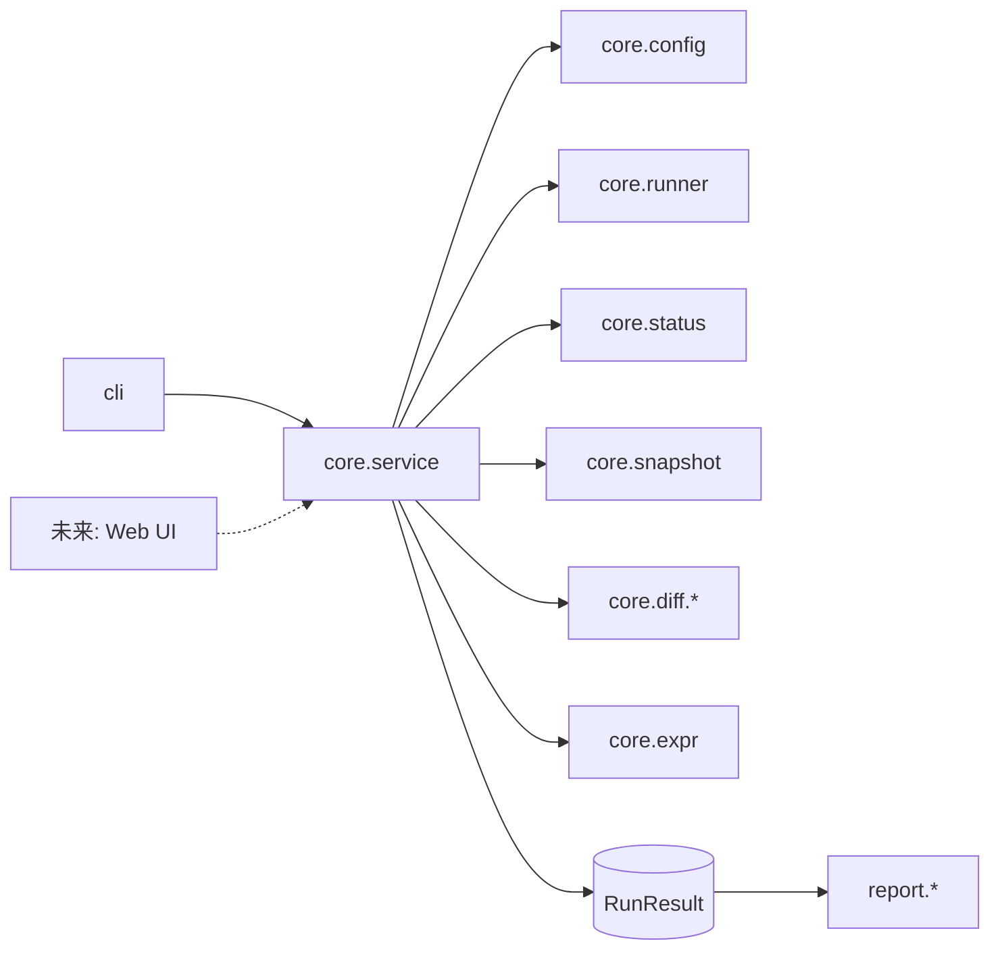

# api-regress v1 技术设计约束

> 配套 [spec-v1.md](spec-v1.md)。本文写的是实现时必须遵守的技术约束，还有经过实测验证的结论。行为以 spec 为准，两者冲突时按 spec 执行。
> 实现完成后，相应内容迁移到 `doc/dev/`。

## 1. 分层与接口

- `core` 是纯库，输入和输出都用 pydantic v2 模型。
- 用 import-linter 的 `forbidden` 契约禁止 `core` 引用 `cli` 和 `report`，CI 里执行 `lint-imports`。已实测：违规时退出码为 1。
- `core.service` 对外提供 async API：`validate_suite`、`run`、`record`、`compare`、`accept`，另外提供同步包装。`validate_suite`、`run` 已实现（进度事件、`cancel_event` 见 [doc/dev/architecture.md](../dev/architecture.md) 的「run 主流程」）。

### 1.1 建议的模块划分

每个文件预计不超过约 400 行。

| 模块 | 职责 |
|---|---|
| `core/config.py` | 加载 YAML，做 pydantic 校验，替换环境变量；用 `yaml.compose` 建立"路径 → 行号"映射，用于报错定位 |
| `core/paths.py` | 解析路径、切分 token、匹配、泛化 |
| `core/rules.py` | 按属性合并规则（`max(key=排序元组)`），处理 ignore 剪枝 |
| `core/jsonload.py` | 解析 JSON：Decimal、重复 key、NaN、BOM、charset |
| `core/runner.py` | httpx 并发请求，自己实现重试 |
| `core/status.py` | 请求状态判定：spec §7.2 的有序规则表 |
| `core/expr.py` | 编译和求值 success / asserts |
| `core/diff/walker.py` | 按 JSON 类型分发，实现"只报最高层节点" |
| `core/diff/arrays.py` | 4 种数组模式，用分发表选择 |
| `core/diff/schema.py` | 扁平表：泛化路径 → 类型集合和小数位集合 |
| `core/diff/unstable.py` | 不稳定字段建议 |
| `core/snapshot.py` | 读写快照、计算指纹、原子替换 |
| `core/service.py` | 编排各命令 |
| `report/{html,md,junit,jsonout}.py` | 各种报告的渲染 |
| `cli.py` | 命令行入口 |

### 1.2 控制复杂度（CC ≤ 10）

下面几处天然容易写成大段 if 链，统一改成数据驱动：

| 位置 | 写法 |
|---|---|
| 请求状态判定 | 有序的 `(谓词, 状态, 提示)` 列表，取第一个匹配项（已实现，见 doc/dev） |
| diff | 按 JSON 类型分发到不同函数（已实现，见 doc/dev） |
| 数组模式 | `dict[mode, fn]` 分发（已实现，见 doc/dev） |
| 规则合并 | 对每个属性用 `max(key=...)` 选胜者（已实现，见 [doc/dev/architecture.md](../dev/architecture.md)） |
| 退出码 | 按 2>3>1>4>0 的顺序排列谓词列表，取第一个满足的（已实现，见 doc/dev） |

## 2. JSON 解析与数字（已实测）

- 解析、Decimal、重复 key、NaN（含比较时的特殊处理）、BOM、charset、小数位的计算方式**已实现**，见 [doc/dev/architecture.md](../dev/architecture.md) 的「JSON 解析」一节。
- `result.json` 里的 Decimal 输出已实现（规范字符串，小数位与原文相同），见 doc/dev 的「result.json 契约」。快照保存 body 的原文，以快照为准。

## 3. 表达式引擎（simpleeval，已实测）

已在 T3 落地，实现约束迁到 [doc/dev/architecture.md](../dev/architecture.md) 的「表达式引擎」一节。

## 4. result.json 契约

已在 T4 落地，契约迁到 [doc/dev/architecture.md](../dev/architecture.md) 的「result.json 契约」一节，JSON Schema 在 `schema/result.schema.json`。

## 5. 运行与 IO

- **请求、重试**：已在 T4 落地，迁到 doc/dev 的「run 主流程」。
- **快照原子写入**：
  - 不能直接用 `os.replace` 覆盖已有的非空目录，会报 `ENOTEMPTY`（已实测）。
  - 正确做法：在同级目录写好临时目录，然后执行 `snap → snap.old`、`tmp → snap`，最后删除 `.old`。
  - 程序启动时清理残留的 `.old`。
- **指纹、body 存储**：计算和 sample 落盘格式已在 T4 落地（`core/samples.py`，run 目录在用），见 doc/dev。快照的 manifest 里写 `fingerprint_version`，留给 T5。
- **HTML 报告**：
  - Jinja2 开启 `autoescape`。
  - 两侧对照用 `difflib.HtmlDiff(context=True)` 生成，已实测它会转义 `<script>`。body 过大时截断，不引入 JS 库。
- **未命中规则检测**：已在 T4 落地，见 doc/dev。

## 6. 日志

已在 T4 落地，规定迁到 [doc/dev/architecture.md](../dev/architecture.md) 的「日志」一节。

## 7. 依赖

httpx[brotli,socks]、pydantic v2、PyYAML（只用 `safe_load` / `compose`）、Jinja2、simpleeval、Click（CLI，见 spec D5）、radon、import-linter。

测试使用 pytest、pytest-httpserver 或 `httpx.MockTransport`，deepdiff（只用于交叉校验），jsonschema（校验 `result.json`）。
