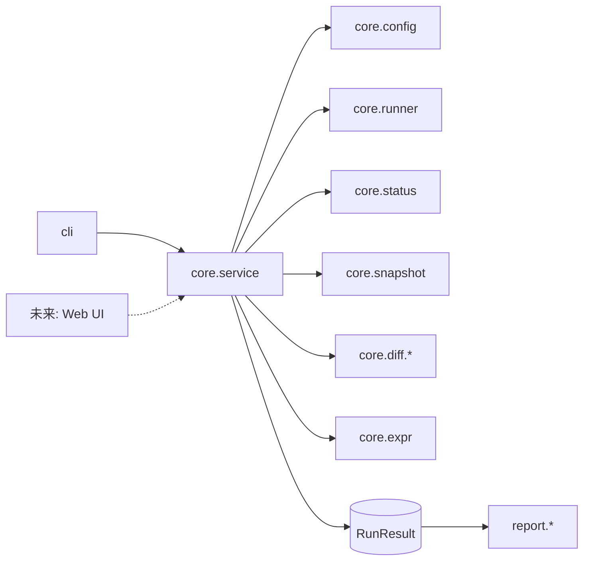

# api-regress v1 技术设计约束

> 配套 [spec-v1.md](spec-v1.md)。本文写的是实现时必须遵守的技术约束，还有经过实测验证的结论。行为以 spec 为准，两者冲突时按 spec 执行。
> 实现完成后，相应内容迁移到 `doc/dev/`。

## 1. 分层与接口

- `core` 是纯库，输入和输出都用 pydantic v2 模型。
- 用 import-linter 的 `forbidden` 契约禁止 `core` 引用 `cli` 和 `report`，CI 里执行 `lint-imports`。已实测：违规时退出码为 1。
- `core.service` 对外提供 async API：`validate_suite`、`run`、`record`、`compare`、`accept`，另外提供同步包装。
- 进度用回调推送 pydantic 事件，如 `RequestStarted`、`RequestDone`。调用方可以传入 `cancel_event` 中途取消。

### 1.1 建议的模块划分

每个文件预计不超过约 400 行。

| 模块 | 职责 |
|---|---|
| `core/config.py` | 加载 YAML，做 pydantic 校验，替换环境变量；用 `yaml.compose` 建立"路径 → 行号"映射，用于报错定位 |
| `core/paths.py` | 解析路径、切分 token、匹配、泛化 |
| `core/rules.py` | 按属性合并规则（`max(key=排序元组)`），处理 ignore 剪枝 |
| `core/jsonload.py` | 解析 JSON：Decimal、重复 key、NaN、BOM、charset |
| `core/runner.py` | httpx 并发请求，自己实现重试 |
| `core/status.py` | 请求状态判定：spec §7.2 的有序规则表 |
| `core/expr.py` | 编译和求值 success / asserts |
| `core/diff/walker.py` | 按 JSON 类型分发，实现"只报最高层节点" |
| `core/diff/arrays.py` | 4 种数组模式，用分发表选择 |
| `core/diff/schema.py` | 扁平表：泛化路径 → 类型集合和小数位集合 |
| `core/diff/unstable.py` | 不稳定字段建议 |
| `core/snapshot.py` | 读写快照、计算指纹、原子替换 |
| `core/service.py` | 编排各命令 |
| `report/{html,md,junit,jsonout}.py` | 各种报告的渲染 |
| `cli.py` | 命令行入口 |

### 1.2 控制复杂度（CC ≤ 10）

下面几处天然容易写成大段 if 链，统一改成数据驱动：

| 位置 | 写法 |
|---|---|
| 请求状态判定 | 有序的 `(谓词, 状态, 提示)` 列表，取第一个匹配项 |
| diff | 按 JSON 类型分发到不同函数 |
| 数组模式 | `dict[mode, fn]` 分发 |
| 规则合并 | 对每个属性用 `max(key=...)` 选胜者（已实现，见 [doc/dev/architecture.md](../dev/architecture.md)） |
| 退出码 | 按 2>3>1>4>0 的顺序排列谓词列表，取第一个满足的 |

## 2. JSON 解析与数字（已实测）

- 用 `json.loads(text, parse_float=Decimal, parse_constant=..., object_pairs_hook=...)` 解析，这三个参数可以同时使用。
  - 重复 key 由 `object_pairs_hook` 检测。这一步拿不到路径，所以 warning 的 `path` 字段是可选的。
  - `parse_constant` 处理 NaN 和 Infinity。`Decimal('NaN')` 和自身不相等，与其他数比较大小会抛异常，需要单独处理。
- 解码按 charset 进行，默认 UTF-8。`response.text` 会保留 BOM，必须先去掉再解析。
- 小数位按 `max(0, -d.as_tuple().exponent)` 计算，**不要调用 `normalize()`**，否则 `1.10` 会变成 `1.1`，正好掩盖了要检测的变化。
- 不能在 JSON 输出里保留数字的原文。`str(Decimal('1.50E1'))` 得到 `'15.0'`，所以 `result.json` 里统一输出 Decimal 的规范字符串，这个字符串的小数位与原文相同。快照保存 body 的原文，以快照为准。

## 3. 表达式引擎（simpleeval，已实测）

- **body 和 headers 必须包一层只读的 `JsonView`**：
  - `__getattr__` 只映射到 JSON 的 key，不暴露 dict 的方法。
  - 原因：如果直接传 dict，`body.x.items` 拿到的是 `dict.items`，`body.x.get(...)` 也能被调用。
- **字面量**：只把**浮点**字面量转成 Decimal，整数保留为 int。如果整数也转成 Decimal，`items[0]` 会抛 TypeError。int 和 Decimal 混合运算本来就是精确的。
- **AST 白名单预检**：在 `validate` 和每次运行开始前执行。
  - 只允许白名单内的节点类型和变量名。
  - 禁止访问以 `_` 开头的属性。
  - **函数调用的目标只能是白名单里的函数名**，否则可以通过 `obj.method()` 绕过限制。

## 4. result.json 契约

- **顶层**：`schema_version`、运行元信息、汇总。
- **枚举**：以下取值都与 spec 保持一致。
  - 请求状态
  - finding 类型和级别
  - warning code：`array_degraded_to_schema`、`array_empty`、`rule_ineffective_in_schema`、`rule_under_ignored`、`index_rule_ineffective`、`both_non_2xx`、`json_parse_failed`、`nan_or_infinity`、`duplicate_key`、`success_eval_error`、`second_sample_unavailable`、`fingerprint_mismatch`；另有 `env_var_missing`，只出现在 `validate` 的输出里
- **finding 的字段**：
  - `finding_id`：对 `请求名 + 类型 + 具体路径` 取 hash。keyed 模式下具体路径用 key 值，因此跨运行也稳定；schema 模式下用泛化路径；非 body 的 finding 用伪路径。
  - `path`、`path_tokens`、`generalized_path`
  - `base_value`、`cand_value`：字段不存在时输出 `{"absent": true}`，以区分 `null`。schema 模式输出类型集合或小数位集合，外加 `example_index`。
  - `rule_refs`：`{scope, index}` 形式。
- **防漂移**：从 pydantic 导出 JSON Schema 提交到仓库，再用快照测试防止它漂移。

## 5. 运行与 IO

- **请求**：
  - `httpx.AsyncClient` 加信号量控制并发。httpx 默认不跟随重定向，这点已实测。
  - 依赖装 `httpx[brotli]`，br 解码已实测可用。
- **重试**：
  - 自己实现，只针对连接错误和超时，不针对任何状态码。
  - 不用 transport 自带的 `retries`，因为它不会重试超时。
- **快照原子写入**：
  - 不能直接用 `os.replace` 覆盖已有的非空目录，会报 `ENOTEMPTY`（已实测）。
  - 正确做法：在同级目录写好临时目录，然后执行 `snap → snap.old`、`tmp → snap`，最后删除 `.old`。
  - 程序启动时清理残留的 `.old`。
- **指纹**：对规范化 JSON 取 sha256。字段包括：method、path 模板、排序后的 query 模板、defaults 和请求级的 header 名（转小写后排序）。`fingerprint_version` 写入 manifest。
- **body 存储**：UTF-8 解码失败时，改存 `body_b64`。
- **HTML 报告**：
  - Jinja2 开启 `autoescape`。
  - 两侧对照用 `difflib.HtmlDiff(context=True)` 生成，已实测它会转义 `<script>`。body 过大时截断，不引入 JS 库。
- **未命中规则检测**：遍历一遍原始 body，命中一条规则就从待查集合中移除，集合为空时提前结束。这一步与规则合并共用同一个匹配函数。

## 6. 日志

- 使用标准库 `logging`，输出到 stderr，可以用 `--log-file` 同时写入文件。
- **INFO**：spec §10 列出的关键节点。
- **WARNING**：所有 warning、重试、指纹不一致。
- **DEBUG**：额外输出响应体的前 2KB。
- 任何级别都**不输出请求头的值**，只输出名称。验收时用哨兵 token 检查。

## 7. 依赖

httpx[brotli]、pydantic v2、PyYAML（只用 `safe_load` / `compose`）、Jinja2、simpleeval、Click（CLI，见 spec D5）、radon、import-linter。

测试使用 pytest、pytest-httpserver 或 `httpx.MockTransport`，以及 deepdiff（只用于交叉校验）。
