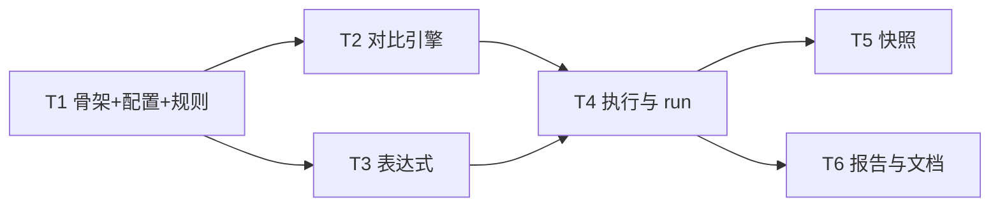

# api-regress v1 任务拆分

> 依据：[spec-v1.md](spec-v1.md)、[spec-v1-design.md](spec-v1-design.md)
> 每个任务结束时都能独立跑测试、独立 review。验收项（AC）编号对应 spec §12.3。

## 依赖关系

T2 和 T3 可以并行做，T5 和 T6 也可以并行做。

## 总览

> 当前进度以本表为准，每完成或开始一个任务就更新"状态"列。
> 状态取值：未开始 / 进行中 / 待 review / 已完成。

| 任务 | 状态 | 主要模块 | 覆盖的 AC | 测试方式 |
|---|---|---|---|---|
| T1 | 未开始 | config / paths / rules / validate | 01, 02, 22, 36（检查本身能跑） | 纯单元测试 |
| T2 | 未开始 | jsonload / diff | 04–09, 16–21 | 表驱动单元测试 |
| T3 | 未开始 | expr | 24, 25 | 单元测试，含恶意用例 |
| T4 | 未开始 | runner / status / service / run | 10–15, 23, 30, 31, 34, 35 | mock 服务集成测试 |
| T5 | 未开始 | snapshot / record / compare / accept | 03, 26–29 | mock 服务集成测试 |
| T6 | 未开始 | report / 文档 | 32, 33, 36（全部通过） | 快照测试 + 解析校验 |

---

## T1 项目骨架、配置与规则

**交付**
- **工程脚手架**：
  - `src/`、`tests/` 目录和 `pyproject.toml`。
  - CI 跑三项检查：`radon cc -n C src/`、`lint-imports`（core 不能引用 cli/report）、`pytest`。
- **`core/config.py`**：
  - 用 YAML 加 pydantic 做校验，开启 `extra="forbid"`。
  - 支持 `${VAR}` 和 `${VAR:-default}` 替换，每个 target 单独解析。
  - 报错时给出 YAML 行号（用 `yaml.compose` 建立映射）。
  - 写方法、重复 name、非法 name 都直接报错。
- **`core/paths.py`**：路径解析、token 化、匹配（`[*]`、`**`、引号 key）、泛化。
- **`core/rules.py`**：按属性合并规则（排序元组取 max），ignore 剪枝；对静态可判定的无效规则给 warning。
- **日志初始化**：`--log-level`、`--log-file`。
- **CLI 骨架**：先实现 `validate` 命令。

**验收**：AC-01、AC-02、AC-22；AC-36 的检查命令能在 CI 跑起来。

**review 重点**
- 配置模型的字段命名一旦定下，后续所有任务都依赖它。
- 规则优先级的边界情况。
- 路径语法的转义。

**测试**：纯单元测试，不发任何 HTTP 请求。

---

## T2 JSON 对比引擎（纯函数）

**交付**
- **`core/jsonload.py`**：用 Decimal 解析数字；处理重复 key、NaN/Infinity、BOM、charset。
- **`core/diff/walker.py`**：
  - 按 JSON 类型分发；
  - 只报最高层节点；
  - 处理可空性、decimal 小数位、`on_value_change`、`compare: values`。
- **`core/diff/arrays.py`**：实现 schema / keyed / positional / unordered 四种模式，以及 keyed 降级。
- **`core/diff/schema.py`**：扁平表，记录"泛化路径 → 类型集合、小数位集合"。
- **数据模型**：finding、warning，以及具体路径、泛化路径、伪路径。

**验收**：AC-04 ~ AC-09，AC-16 ~ AC-21。

**review 重点**
- 这是工具的核心，语义 bug 最容易出在这里。逐条对照 spec §7.4 ~ §7.6 检查。
- 每个函数的 CC 不超过 10，用分发表实现。

**测试**：表驱动用例，输入两段 JSON 加规则，断言输出的 finding 列表；用 deepdiff 交叉校验。

---

## T3 表达式：success 与 asserts

**交付**
- **`core/expr.py`**：
  - 只读的 `JsonView`：只映射 key，不暴露 dict 方法；对 headers 不区分大小写。
  - 浮点字面量转成 Decimal，整数保持 int。
  - AST 白名单：节点、变量名、函数调用目标都只能是白名单里的；禁止访问 `_` 开头的属性。
  - 内置函数：`len`、`scale`、`get`、`exists`、`is_number`、`is_string`、`keys`、`set`、`all`、`any`、`abs`、`min`、`max`。
  - 编译接口（供 validate 调用）和求值接口；求值时异常要被捕获。
- **接入 `validate`**：在 T1 的 `validate` 中增加表达式检查。

**验收**：AC-24、AC-25。AC-23 的表达式求值部分在本任务完成，流程部分在 T4。

**review 重点**：**安全**，防止沙箱逃逸。单独做成一个任务，是为了让安全 review 的范围集中。

**测试**：单元测试，外加一组恶意表达式用例（dunder、方法调用、import、超大计算）。

---

## T4 请求执行与 `run` 编排

**交付**
- **`core/runner.py`**：
  - 用 httpx AsyncClient 加信号量控制并发，不跟随重定向。
  - 自己实现重试，只对连接错误和超时重试。
  - 基线串行采 2 个 sample。
- **`core/status.py`**：请求状态判定，按 spec §7.2 的有序表实现。
- **流程编排**：
  - 状态码比较、`success` 判定、`compare_headers` 比较、body 对比、asserts，按 spec §7.1 的顺序执行。
  - `core/diff/unstable.py`：不稳定字段建议。
  - 检测本次未命中的规则。
- **`core/service.py`**：
  - async API 和同步包装；进度事件；`cancel_event`。
  - 退出码按优先级（2>3>1>4>0）用谓词列表实现。
- **`result.json`**：数据模型，导出 JSON Schema 并提交进仓库，`finding_id` 要稳定。
- **run 目录**：写入 `baseline/` 和 `candidate/`。
- **`run` 命令**：输出 stdout 摘要和 `result.json`，HTML/MD/JUnit 报告在 T6 做。
- **关键节点日志**：按 design §6。

**验收**：AC-10 ~ AC-15、AC-23、AC-30、AC-31、AC-34、AC-35。

**review 重点**
- 请求状态判定和退出码优先级。
- 日志、run 目录、`result.json` 里不能泄露请求头的值（用哨兵 token 测试）。
- `result.json` 是将来界面的数据契约，字段要稳定。

**测试**：用 pytest-httpserver 或 `httpx.MockTransport` 做集成测试，mock 返回固定内容。从这个任务开始，整个流程可以端到端跑通。

---

## T5 快照：`record` / `compare` / `accept`

**交付**
- **`core/snapshot.py`**：
  - 目录结构、manifest，含 `schema_version` 和 `fingerprint_version`。
  - 请求指纹：对 method、path/query 模板、header 名做 sha256。
  - 原子替换：先写同级的临时目录，然后把旧目录 swap 成 `.old`，启动时清理残留。
  - body 存原文，UTF-8 解码失败时改存 `body_b64`；只保存 `Content-Type` 和 `compare_headers` 里列出的响应头。
- **`record` 命令**：只用 baseline 环境；按请求合并写入；`--clean` 清空后重录；失败的请求保留旧 sample；在 stdout 输出不稳定字段建议。
- **`compare` 命令**：只用 candidate 环境；指纹不一致或快照缺失的请求判为 inconclusive。
- **`accept` 命令**：按请求合并写入；按 spec §8.3 的规则决定接受或拒绝；快照不存在时新建。

**验收**：AC-03、AC-26 ~ AC-29，以及 spec §12.1 的 S2 走查（3a ~ 3e）。

**review 重点**
- 快照会提交进 git 长期保存，格式和版本兼容性要看清楚。
- accept 的接受/拒绝规则。
- 原子写入在异常中断时的行为。

**测试**：集成测试，用 mock 服务模拟"发版前"和"发版后"两种状态。

---

## T6 报告与文档

**交付**
- **`report/html.py`**：
  - 单文件 HTML，Jinja2 开启 autoescape。
  - 用 `difflib.HtmlDiff` 生成并排 diff，body 过大时截断。
  - curl 复现命令，header 值用 `<redacted>` 代替。
- **`report/md.py`**：格式参照 spec §12.2 的样例。
- **`report/junit.py`**：每条请求是一个 testcase；failure 和 error 的判定按 spec §9。
- **报告板块**：汇总、各请求详情、建议 ignore（附 YAML 片段）、本次未命中的规则、warning 列表。
- **CLI**：接入 `--format`。
- **文档**：
  - `README.md`：产品简介和快速上手，示例中包含 decimal 规则。
  - `doc/user/`：
    - 命令说明
    - suite 格式和 YAML 常见坑
    - 规则与路径
    - 数组模式选型表
    - success/asserts
    - 如何读报告（含字段改名的示例）
    - 退出码
  - `doc/dev/`：
    - 模块职责
    - 关键路径（不写行号）
    - 主流程图
    - result.json 契约
    - 迁移 design 文档里已实现的部分

**验收**：AC-32、AC-33；AC-36 全部通过。

**review 重点**
- 拿一份真实报告，以 QA 的视角看能否直接据此排查问题。
- 文档中不引用代码行号。
- README 能让新人 5 分钟内跑通。

**测试**：报告快照测试、XSS 用例、用标准解析器读取 junit.xml。
