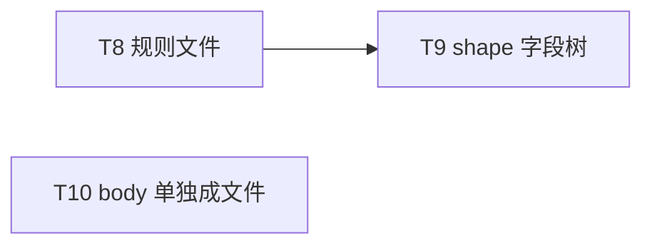

# api-regress v2 任务拆分

> 依据：[spec-v2.md](spec-v2.md)、[spec-v2-design.md](spec-v2-design.md)
> 任务编号接着 v1 往下排。每个任务结束时都能独立跑测试、独立 review。

## 依赖关系

T9 的字段树要标出来自规则文件的规则，`--write` 写出的也是规则文件格式，所以 T8 先做。T10 和 T8、T9 互不依赖（shape 通过 `samples` 读样本，不关心落盘格式），按 T8 → T10 → T9 的顺序做，T9 直接用新格式的快照写测试。

## 总览

> 当前进度以本表为准，每完成或开始一个任务就更新"状态"列。
> 状态取值：未开始 / 进行中 / 待 review / 已完成。

| 任务 | 状态 | 主要模块 | 覆盖的 AC | 测试方式 |
|---|---|---|---|---|
| T8 | 待 review | rulesfile / config / rules / models / report | 43–47 | 单元测试 + mock 服务集成测试 + golden |
| T9 | 未开始 | shape / shapeflow / service / cli | 38–42 | 固定快照、run 目录的集成测试 |
| T10 | 未开始 | samples / snapshot / rundir / accept | 48–52 | mock 服务集成测试 |

开工前提：spec-v2 §8 中的相关决策已确认（T8、T9：D26–D31；T10：D32–D34）。

---

## T8 树形规则文件

**交付**
- **`core/rulesfile.py`**：加载、展开、报错定位（spec §4.2、§4.4）。
- **`core/config.py`**：`Request.rules_file`；`load_suite` 解析路径并加载规则文件；文件不存在时报在 suite 的 `rules_file` 行。
- **`core/rules.py`**：三种来源的优先级（spec §4.3）；静态检查覆盖规则文件里的规则。
- **`core/models.py`**：`RuleRef`、`WarningItem` 的新增字段；重新导出 JSON Schema。
- **`report/`**：命中的规则、未命中的规则、warning 显示规则文件和行号。
- **CLI**：`validate` 的错误和 warning 按规则文件的位置打印。
- **文档**：
  - `doc/user/rules-file.md`（新）：格式、优先级、YAML 坑、示例。
  - `doc/user/suite.md`：`requests[]` 表格加 `rules_file`；「规则怎么合并」补上来源顺序。
  - `doc/user/run.md` 的 `result.json` 字段说明、`doc/user/report.md`、`doc/user/validate.md`。
  - `doc/dev/architecture.md`：模块表、规则合并、配置加载、数据契约。
  - `README.md` 如果提到规则写法，补一句规则文件。

**验收**：AC-43 ~ AC-47。

**review 重点**
- 展开时 token 拼接与引号 key、`**` 的边界。
- 不使用 `rules_file` 时输出逐字节不变（golden）。
- 错误定位指向规则文件而不是 suite。

**测试**
- 规则文件展开的表驱动单元测试（含每种报错）。
- 等价性：同一组 mock 响应，`rules` 与 `rules_file` 两种写法 finding 相同。
- 优先级：每个比较层级各一个用例。

---

## T9 shape 字段树

**交付**
- **`core/shape.py`**：样本合并、规则标注、两种渲染（spec §3.2 – §3.4）。
- **`core/shapeflow.py`**：读 `--from`（快照 / run 目录）、`--only`、`--write`、退出码（spec §3.5）；`service.shape` / `shape_sync` 转发。
- **`cli.py`**：`shape` 命令。
- **日志**：spec §3.6，示例值不进日志。
- **文档**：
  - `doc/user/shape.md`（新）：命令、字段树怎么看、骨架、退出码；用 demo 的快照跑出真实输出作为示例。
  - `README.md`：命令列表加 `shape`，快速上手里加一步"review 规则"。
  - `doc/dev/architecture.md`：模块表、shape 主流程。
- 用 models.dev 的快照实测一次大 body 的耗时，写进 `doc/dev/`。

**验收**：AC-38 ~ AC-42。

**review 重点**
- 以 QA 的视角拿真实接口的字段树 review 一遍，看能不能直接据此补规则。
- 骨架和日志里不出现示例值。
- 大对象下的构建耗时。

**测试**：用 `tests/mock_api.py` 录出固定快照和 run 目录，对 stdout 做快照测试；`--write` 的已存在文件、部分写失败用例。

---

## T10 body 单独成文件

**交付**
- **`core/samples.py`**：请求文件引用 body 文件；body 文件的写入、读取、校验（spec §6.2、§6.3）。
- **`core/snapshot.py`**：`samples/<name>/` 的写入和原样复制；`schema_version` 保持 1，旧格式的请求文件按损坏处理（spec §6.4）。
- **`core/rundir.py`**：`samples/<side>/<name>/`；复用和中断残留的判断加上 `samples/`（spec §6.5）。
- **`core/accept.py`**：复制候选的请求文件和 body 目录；body 文件损坏时拒绝。
- **文档**：
  - `doc/user/snapshot.md`：「快照目录」改成新结构，说明怎么查看 body、不要误提交 `samples/`；版本说明。
  - `doc/user/run.md`：run 目录结构和请求文件格式。
  - `doc/dev/architecture.md`：落盘格式、快照与 run 目录的读写。
  - `CLAUDE.md` 的「不要提交」如有需要补上 `samples/`。

**验收**：AC-48 ~ AC-52，以及 AC-47 中涉及快照、run 目录的 v1 用例。

**review 重点**
- body 字节在写入、复制、读回的整条链路上保持不变（BOM、非 UTF-8、空 body）。
- `body_file` 的校验在拼路径之前。
- record / accept 原样复制时不读 body。

**测试**：AC-48 每种 body 一个用例；`--only` 原样复制的逐字节比较；损坏的各种情况；旧格式请求文件的处理。
